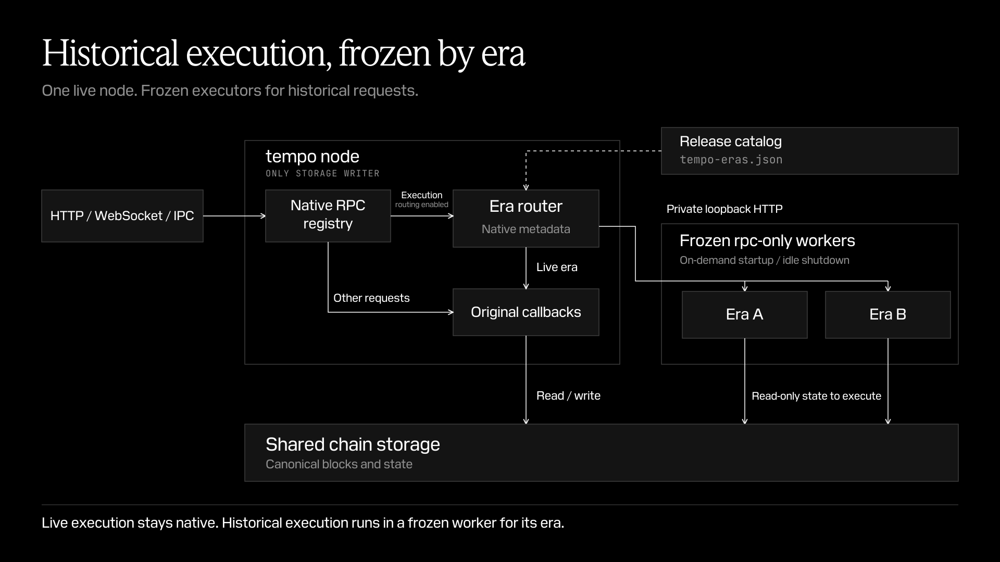

# Tempo metabinary

`tempo node` remains the entrypoint, with its existing arguments and defaults. The live node
runs in-process. An execution-independent library decorates its registered RPC callbacks and
starts frozen read-only workers lazily for historical execution.



## Release configuration

The release supplies `tempo-eras.json` beside the executable. Each catalog entry binds a chain ID
to its ordered frozen eras:

```json
{"chains":[{
  "chain_id":"0x1079",
  "eras":[
    {"until":"T11","binary":"eras/tempo-t10",
     "checkpoint":{"number":1000000,"hash":"0x2222222222222222222222222222222222222222222222222222222222222222"}}
  ]
}]}
```

A frozen era executes blocks before its `until` hardfork. Its boundary is that fork's activation
timestamp in `tempo-hardfork`'s constants, so only mainnet and moderato can have frozen eras, and
`until` must be an already scheduled fork. Executables resolve relative to the catalog, and blocks
after the last frozen era run in the live node. A frozen era's required `checkpoint` pins its last
canonical block, and checkpoints strictly increase. The built-in catalog (`bin/tempo/eras.json`)
routes mainnet and Moderato blocks before T11 to `eras/tempo-genesis-t10`. Unmatched chains,
custom genesis, and custom fork schedules use the native path. Independently of the catalog, the
live binary refuses to execute blocks older than its compiled `TempoHardfork::MINIMUM_SUPPORTED`,
currently T10, on every execution path.

Docker images, release archives, and `tempoup` install the worker beside the live executable.
Source builds must bundle it explicitly:

```sh
cargo build --locked --release --bin tempo
python3 scripts/bundle-history.py --output target/release --profile release
```

The worker is the standalone `bin/tempo-metabinary/eras/genesis-t10` crate. It pins the frozen
source, tagged `era/genesis-t10-v0.1.2` in this repository, together with that tree's `Cargo.lock`,
so its dependencies never unify with the live workspace. The helper builds it, checks the embedded
catalog against the frozen chain schedules, and smoke-tests calls and traces on mainnet,
Moderato, and synthetic T10/T11 chains before installation. Use `--package /path/to/bundle` to
reinstall a previously verified bundle for the same host, profile, and pin.
Installed checksums and build/smoke provenance live in `history/genesis-t10/`.

Workers inherit the selected genesis, datadir, custom static-file/RocksDB paths, and resolved SDK
`EthConfig` through private temporary files. Gas, simulation, memory, and tracing settings retain
the node's configured values. Execution concurrency budgets apply per process, while public
transport limits remain global. Historical workers are selected by requests, regardless of
`--full` or pruning. Missing historical state fails through the worker's ordinary storage behavior.

## Routing

- Stored blocks, receipts, logs, proofs, state queries, and live transaction operations stay native.
- Execution requests read native headers and transaction metadata to choose an era by timestamp.
  Historical forwarding pins tags other than `pending`, and preserves explicit hashes and
  `requireCanonical`. Pool and missing transactions stay native. Positional and named parameters
  are supported.
- `eth_feeHistory` routes by its newest block and pins it to a block number. Historical requests
  use the frozen era's fee rules; `pending` resolves as `latest`, and zero-count requests stay
  native. Ranges may cross eras because earlier entries use stored data, not re-execution.
- Simulations and bundles (`eth_simulateV1`, `tempo_simulateV1`, `eth_callBundle`,
  `mev_simBundle`, `eth_callMany`, `debug_traceCallMany`) run only on a live base block or
  `pending`, with explicit override timestamps in the live era. Historical bases return `-32004`.
- Execution requests crossing eras return `-32004`, including trace filters and timestamp overrides.
  Split ranges rather than transferring speculative state between processes. Methods not reviewed as
  non-executing fail closed until their selectors are supported, including unknown namespaces
  such as `testing` and `flashbots`. The live binary never executes a frozen era's blocks.
- Native transports retain their registries, authentication, CORS, compression, subscriptions,
  batching, and limits. The authenticated Engine endpoint's Ethereum execution methods use the
  same era routing; Engine protocol methods remain native. Metadata resolution works even when
  eth is disabled publicly. Live debug trace subscriptions stay native, and historical debug trace
  subscriptions are rejected.
- Raw-block tracing decodes only the Tempo header to select its execution era. The selected
  executor validates the body with its own transaction codec.
  Bad-block tracing and `ots_getContractCreator` remain unsupported with era routing:
  bad-block cache resolution and whole-history deployment searches are not implemented.

Workers are coalesced per era and verified by protocol, chain, genesis, read-only mode, and PID.
The PID check detects accidental port collisions. Local processes are trusted.
Workers shut down after five idle minutes, checked every 30 seconds, and restart on demand.
Active private RPC calls retain their worker. Cancelling a caller drops its forwarding future.
Shutdown reaps owned children. A failed or missing worker affects only historical requests for its
era, and live RPC stays available.

Cancelled startup keeps its child so the next request can resume the handshake. Startup failures
and detected child exits are retried on demand after a 30-second cooldown. Failed workers receive
graceful shutdown before forced termination, and their RocksDB secondary directories are removed
after reaping, including after crashes.

## Network sync handoff

`--dev`, `--debug.tip`, `--debug.max-block`, `--debug.terminate`, `--debug.rpc-consensus-url`, and
`--etherscan` skip handoff, so they fail unless durable storage already reaches the last frozen
era's checkpoint.

Otherwise `tempo node` runs each frozen writer whose checkpoint durable storage has not reached, in
era order, with the operator's arguments, minus `--follow*` and `TEMPO_FOLLOW`, plus
`--history-sync --debug.tip=<hash> --debug.max-block=<number> --debug.terminate`. After each
writer it verifies that storage ends exactly at that era's canonical checkpoint, and reaps the
writer before the next era or live execution. Each writer resumes from its predecessor's
checkpoint, and interrupted sync resumes from Reth's saved progress.

Before starting consensus, the live node verifies a recent finalization through the configured
follow upstream or the chain's default consensus RPC, syncs execution to that certified tip, and
verifies its epoch boundary header from the authenticated chain. No boundary certificate is required.
It persists the certified floor in the consensus archives. Cached executed blocks survive an
interrupted handoff and can be replayed without an upstream. Finality is persisted only through
the durable execution prefix. Historical validator-config reads use storage without constructing
an EVM.

## Re-execution

With a release schedule, `tempo re-execute` splits its range at the first local block of each
`until` fork, found by searching local header timestamps. Each frozen part runs as
`<frozen binary> re-execute` with the operator's arguments and only `--from`/`--to` replaced, one
era at a time in block order. The live binary then re-executes
the remainder. It does not run if nothing remains or a shutdown signal stopped a frozen child.

- Genesis is skipped, `--to` is clamped to the local head, and ranges exclude `--to`.
- `TEMPO_RE_EXECUTE_ERA` marks frozen children so they never delegate again.

## Frozen artifact requirements

Frozen artifacts need this `rpc-only` discovery protocol and hidden `--rpc-config` interface,
backported where necessary, plus a recorded revision and checksum. A network sync writer must also
support `--history-sync`, which bounds execution, consensus payloads, and fork choice to its era.
`--debug.max-block` alone does not supply that contract. Artifacts must support their era and
shared storage layout, since identity discovery does not establish execution compatibility.
