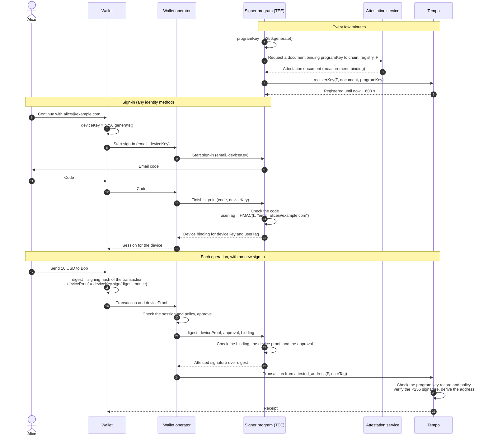

# TIP-XXX1: Attested Signers (Meta)

## Abstract

This TIP adds attested signers: Tempo addresses that sign through a signer program in a trusted execution environment (TEE). A user signs in with any method the program supports, such as an email code or an OpenID Connect provider, and the sign-in binds a key on the user's device. After that, the program signs any digest for the user when it receives a proof from that device and an approval from the wallet operator. The chain accepts the signature only from a key that an attestation service certified as belonging to approved code. Each signature costs one P256 verification and two storage reads.

Component TIPs define the signature type, the key registry, and one attestation scheme each for AWS Nitro Enclaves and Google Cloud Confidential Space. The design trusts the TEE hardware, the attestation service, the approved code, and the identity method the user signs in with.

## Motivation

Wallets that offer "Continue with email" or "Continue with Google" run a server that decides when a user signed in. The server then signs for the user, either with a key it holds or with a token that a custodian accepts. Whoever controls that server controls every account:

- a breach of the server can sign as every user at once;
- an insider or a bad deploy can do the same, with no visible change;
- users cannot tell what the server signs for them until it is onchain.

Moving the key into a key management service (KMS) prevents theft of the key, but the server still decides when to use it. The decision is the problem, not the storage.

An attested signer moves the decision into a program whose exact code the chain can identify. A TEE runs the program in memory that the host cannot read or change. An attestation service certifies a measurement of the program, a hash of its code, together with a key that the program generated. The chain accepts that key only if a policy lists the measurement. Different code has a different measurement, so a compromised operator cannot produce an accepted key.

The program, not the protocol, checks how the user signed in. The chain sees only a policy ID and a user tag, so a wallet can add a sign-in method by approving new code, with no protocol change.

### Alternatives considered

- **A zero-knowledge proof of the identity provider's token:** removes the operator for providers that sign tokens with a supported algorithm. It cannot prove an email code or a method without a signed token, and the token issuer can still sign as all of its users. Each proof needs a prover and a trusted setup, and costs about 350,000 gas to verify.
- **A custodian with an operator-signed token:** the custodian and the operator can each sign as every user, and neither can be observed.
- **A new attestation document with every signature:** removes the registered key, but documents are several kilobytes, beyond [TIP-1045](./tip-1045.md)'s 1,024-byte key-authorization bound. A Nitro document costs about 790,000 gas to verify ([TIP-XXX4](./tip-xxx4.md#gas)).
- **Signing only at sign-in, then access keys alone:** a key authorization at sign-in, then an access key for every later operation. It needs access keys with broad permissions for operations that only the account's owner can do. The program signs each operation instead, and access keys stay optional.
- **Validators checking sign-ins:** adds validator duties and makes the network choose identity methods.

## Assumptions

- **TEE integrity.** The TEE keeps the program's memory confidential and runs only the measured code. A break exposes the program key and the program's secrets until the break is fixed.
- **Attestation service honesty.** The service certifies only measurements it observed. A dishonest or compromised service can certify any measurement, so it can sign for every address of every policy that trusts it.
- **Approved code correctness.** The program signs only with a valid device binding, a valid device proof, and a valid operator approval for the same digest. A bug in approved code can let anyone sign as any user of the policy until the policy removes the measurement.
- **Policy owner diligence.** The owner proposes only measurements that reproducible builds of reviewed source produce. The delay before a measurement becomes active gives others time to check this. A compromised owner can approve malicious code after the delay.
- **Identity methods.** Each identity method is as safe as its weakest party, such as the user's mailbox and the program's email account, or the OpenID Connect provider. A compromised method lets the attacker bind a device as any user of that method.
- Configurable accounts (TIP-1107 and TIP-1114, in draft) are not required. Where they are active, attested signers can be owners.

---

# Specification

## Overview

### Terms

| Term | Meaning |
|---|---|
| Signer program | The program that checks sign-ins and signs. It runs in a TEE. |
| Measurement | A 32-byte value that identifies the program's exact code, derived by the attestation scheme. |
| Attestation document | Evidence from an attestation service that a TEE runs code with a given measurement and holds a given key. |
| Attestation scheme | The rules that verify one service's documents ([TIP-XXX4](./tip-xxx4.md) for AWS Nitro Enclaves, [TIP-XXX5](./tip-xxx5.md) for Google Cloud Confidential Space). |
| Program key | A P256 key that the signer program generates and registers with an attestation document. A registration lasts at most 600 seconds. |
| Policy | An onchain record naming one scheme, its approved measurements, its trust anchors, an owner, a guardian, and a delay ([TIP-XXX3](./tip-xxx3.md)). |
| Identity method | A way to prove an identity to the program, such as an email code, an OpenID Connect ID token, or a wallet signature. The program defines each method. |
| Identity | A method name and a normalized identifier, such as `email:alice@example.com` or `google:`. |
| User tag | A 32-byte value that the program derives from an identity. The chain treats it as opaque. |
| Device key | A P256 key that the user's client generates at each sign-in. It never leaves the client. |
| Device binding | A record, issued by the program at sign-in, that binds one device key to one user tag until it expires. |
| Operator approval | A signature by the wallet operator over one digest for one device. |
| Attested signer | The address derived from a policy ID and a user tag ([TIP-XXX2](./tip-xxx2.md#address-derivation)). |

### Lifecycle

1. **Approval.** A policy owner proposes a measurement. After the policy's delay, the measurement is active.
2. **Registration.** The program generates a program key and obtains an attestation document that binds the key to this chain, the registry, and the policy. Anyone submits it to `registerKey`. The registry verifies it under the policy's scheme and records the key for 600 seconds. The program registers a new key before each one expires.
3. **Sign-in.** The client generates a device key. The user proves an identity with one identity method, and the proof commits to the device key. The program checks the proof, derives the user tag, and issues a device binding.
4. **Signing.** For each operation, the client signs a device proof over the digest, and the wallet operator approves the same digest. The program checks the binding, the device proof, and the approval, then signs the digest with its program key.
5. **Verification.** The chain checks that the program key is registered and current, verifies the signature, and derives the signer address from the policy ID and user tag.

Steps 1, 2, and 5 are consensus rules. Steps 3 and 4 are rules of the measured code, which the [reference authorization profile](#reference-authorization-profile) describes.

The critical authority boundary is the measurement check at registration. Only code whose measurement the policy approved can hold a registered program key, and only a registered program key can sign for the policy's addresses. Inside that code, the second boundary is the pair of device proof and operator approval: neither the device nor the operator gets a signature alone.

### Components

Read the components in this order:

| TIP | What it adds | Why read it here |
|---|---|---|
| [TIP-XXX2: Attested Signatures](./tip-xxx2.md) | Signature type `0x06`, address derivation, validity rules, accepted contexts, and gas | Defines what a transaction carries and how the node checks it |
| [TIP-XXX3: Attested Key Registry](./tip-xxx3.md) | Policies, delays, the guardian, `registerKey`, and the scheme interface | Defines where program keys and approved measurements come from |
| [TIP-XXX4: AWS Nitro Enclaves Attestation](./tip-xxx4.md) | Scheme `0x01` | First scheme, reusing the Zone verifier's Nitro attestation code |
| [TIP-XXX5: Google Cloud Confidential Space Attestation](./tip-xxx5.md) | Scheme `0x02` | Second scheme, using RS256 tokens and policy trust anchors |

The signature and registry TIPs activate in the same hardfork as at least one scheme. Later schemes activate independently.

### Scope

- Identity methods, device bindings, and operator approvals are rules of the signer program, not of the protocol. Adding a method is a new measurement, not a hardfork.
- Attested signatures sign transactions, key authorizations, and configurable-account owner approvals. Contracts verify them for any hash through TIP-1020, against the current registry state.
- Access keys are optional. An attested signer can authorize one like any account owner.
- Each identity is a separate attested signer. A configurable account with several attested signers as owners links one person's methods.
- Each policy uses one scheme. Combining schemes uses configurable-account thresholds.
- Attested signer addresses do not depend on the measurement, so upgrades of the signer program keep every address.

## Sign-in and signing

The following scenario is illustrative. Alice signs in to a wallet with the email address `alice@example.com` under policy `P`, whose signer program runs in an AWS Nitro Enclave. Email is one identity method. Another method changes only the challenge and the proof in steps 10 to 14.

1. The signer program registers a program key, as [TIP-XXX3](./tip-xxx3.md#registration) describes, and repeats this before each registration expires.
2. Alice's wallet generates a device key for this sign-in and starts the sign-in through the wallet operator.
3. The signer program sends Alice an email code from its own email account. The challenge commits to the device key.
4. Alice enters the code. The program checks it, derives her user tag, and issues a device binding for the device key.
5. For each later operation, the wallet signs a device proof over the operation's digest, and the wallet operator approves the same digest.
6. The signer program checks the binding, the device proof, and the approval, then signs the digest ([TIP-XXX2](./tip-xxx2.md#signed-digest)).
7. The transaction is sent from Alice's attested signer address. The node verifies the attested signature ([TIP-XXX2](./tip-xxx2.md#verification)).

The same path signs key authorizations, configurable-account owner approvals, and messages. If Alice enters a wrong code, the program issues no binding. If the device proof or the approval is missing or names another digest, the program signs nothing. If the program key expires before the transaction lands, the node rejects the signature, and the wallet requests a new one. The wallet operator can forward each operation in one round trip from the wallet, and it can revoke the device at once.

## Trust

| Party | Can | Cannot |
|---|---|---|
| Attestation service | Certify any measurement, and so sign for every address of every policy that uses its scheme | Affect policies that use another scheme |
| TEE hardware vendor | Expose program keys and secrets through a hardware flaw, until the flaw is fixed | Change which measurements a policy approves |
| Policy owner | Approve any measurement after the delay, and so sign for the policy's addresses | Approve a measurement before the delay ends, or affect other policies |
| Policy guardian | Pause the policy, remove measurements and anchors, revoke all program keys, and cancel pending proposals | Approve a measurement or trust anchor |
| Signer program (approved code) | Sign for any user tag of its policy, as its code allows | Run with a different measurement under the same registration |
| Identity method's parties, such as an OpenID Connect provider or the program's email account | Prove any identity of that method, and so bind a device as any of its users | Sign without the operator's approval, or affect other methods |
| Wallet operator | Approve or refuse each signature, revoke devices at once, and serve the client's code | Sign without a device proof, bind its own device, or register a key for unapproved code |
| User's device | Sign device proofs | Sign without the operator's approval |
| Validators | Nothing beyond their existing role | |

## Costs

Dollar amounts use the [TIP-1067](./tip-1067.md) base-fee cap of 1.2 × 10^10 attodollars per gas.

| Operation | Gas | Cost at the cap | Paid |
|---|---|---|---|
| Registering a Nitro program key with a five-certificate chain | 790,000 for verification ([TIP-XXX4](./tip-xxx4.md#gas)), plus storage and calldata | about $0.0095 | Every 600 seconds or less, for each running signer program |
| Registering a Confidential Space program key | To be measured ([TIP-XXX5](./tip-xxx5.md#gas)) | | Every 600 seconds or less, for each running signer program |
| Verifying an attested signature | P256 verification plus 4,200 ([TIP-XXX2](./tip-xxx2.md#gas)) | about $0.00015 | Each operation that the attested signer signs |
| Transactions signed by an access key | No extra gas | | Where the user authorized an access key |

At one registration every 600 seconds, one Nitro signer program costs about $1.37 per day at the cap.

## Signer program requirements

These requirements are not consensus rules. They determine whether a policy's addresses are safe, so wallets SHOULD show users only addresses of policies whose signer program meets them. The program's authorization rules are part of its measured code, so reviewers check them through the measurement.

### General

- **No operator configuration.** The program MUST NOT read security-relevant configuration from its operator, such as identity provider keys, the email account, the operator's approval key, or the KMS key. All of it is part of the measured code. An operator can run approved code anywhere, so its behavior must not depend on where it runs.
- **Secrets.** `k` and the device binding key are secrets that a KMS releases only to TEEs with an approved measurement. The release policy MUST cover the old and new measurements during an upgrade. Losing `k` prevents users from signing in again.
- **Program keys.** The program SHOULD generate a new program key for each registration and register it at least 120 seconds before the current one expires.
- **Transport.** The program SHOULD accept requests only from the wallet operator, over mTLS. The operator serves the client's code, so a compromised operator can read sign-in proofs or swap device keys for users who sign in during the compromise. A direct path from the client to the program helps only for clients whose code the operator does not serve.
- **Builds.** The program MUST build reproducibly from published source. Before the owner proposes a measurement, at least two independent parties SHOULD rebuild it and confirm the measurement. During the delay, monitors SHOULD rebuild every proposed measurement from its published commit.

### Identity methods

Each identity method that a program supports MUST meet these rules:

| Rule | Reason |
|---|---|
| The program verifies the proof itself, with every trust input fixed in its measured code, such as the provider's issuer and keys, the email account, or the normalization | The operator cannot replace the provider or forge a proof |
| The proof commits to the device key, such as an OpenID Connect `nonce` or a challenge that names it | A proof that the operator observes cannot bind another device |
| The identity is `method || ":" || normalized_identifier`, and the method names and normalization rules never change for a policy | The identity determines the address |
| `user_tag = HMAC-SHA256(k, "tempo:user-tag:v1" || identity)` | The chain sees no identifier, and nobody without `k` can link an identifier to its address |

Examples:

| Method | Proof the program verifies |
|---|---|
| Email code | A code that the program sent from its own email account |
| OpenID Connect | An ID token from a fixed issuer, signed by its published keys, whose `nonce` commits to the device key |
| Wallet signature | A signature over a challenge that names the device key |

A passkey usually needs no signer program. It is a native Tempo signer and can own an account directly.

### Reference authorization profile

A policy MAY approve code with other authorization rules. This profile is the reference.

- **Device binding.** At sign-in, the program issues the binding as a token that it seals with the device binding key, over the user tag, the device key, the chain, the policy, and an expiry of at most 30 days. Only a verified sign-in issues one.
- **Device proof.** The device key signs `keccak256("tempo:attested-device" || chainId || policyId || userTag || deviceKeyId || digest || nonce || timestamp)`. The program accepts a timestamp within 60 seconds of its clock and rejects a nonce it saw in that window.
- **Operator approval.** The operator's approval key signs `keccak256("tempo:attested-approval" || chainId || policyId || userTag || deviceKeyId || digest || nonce || expiry)`, with an expiry of at most 120 seconds. The approval key's public key is fixed in the measured code or in the policy.
- **Signing.** The program signs a digest only if the binding, the device proof, and the approval are valid and name the same user tag, device key, digest, and nonce.
- **Rate limits.** The program limits sign-ins for each identity and in total, and signatures for each device.

## Scope boundaries

- A policy cannot express an approval that depends on claims other than the measurement, such as a cloud project. The signer program enforces those conditions itself.
- The chain cannot check identity methods, device bindings, or approvals. It checks only that approved code signed.
- Program keys are not portable between chains, because the binding names the chain ID and the registry.
- Moving an existing account to an attested signer requires a configurable account that adds the attested signer as an owner.

# Compatibility

No existing transaction, account, or signature changes. Before activation, type `0x06` is rejected in every context ([TIP-XXX2](./tip-xxx2.md#activation)).

| Integration | What changes |
|---|---|
| Wallets and SDKs, such as ox and Viem | Need attested signer address derivation, the `0x06` encoding, and builders for transactions, key authorizations, and owner approvals with an attested signature ([TIP-XXX2](./tip-xxx2.md)) |
| Wallet clients | Generate a device key at each sign-in, keep it on the device, and sign device proofs for each operation |
| Wallet operators | Run a signer program in a TEE, register its program keys, operate a policy with an owner and guardian ([TIP-XXX3](./tip-xxx3.md)), and approve each signature |
| Explorers and indexers | Decode type `0x06` signatures and registry events. An attested signer is an ordinary account with no code |
| Contracts using TIP-1020 | `recover` and `verify` accept attested signatures checked against the current registry state ([TIP-XXX2](./tip-xxx2.md#tip-1020-verification)) |
| RPC simulation and gas estimation | Apply the same registry reads and charges as block validation, and report which check failed |
| Existing accounts | Unchanged. Moving to an attested signer needs a configurable account, where active |

# Observability

The registry emits events for policy changes and registrations ([TIP-XXX3](./tip-xxx3.md#observability)). Each answers an operational question:

| Question | Evidence |
|---|---|
| Which code can sign for a policy's addresses now, and which code will be able to after the delay? | `MeasurementProposed`, `MeasurementRemoved`, and `ProposalCancelled` |
| Which code signed a given operation? | `KeyRegistered` names the measurement of each program key, and the attested signature names the program key |
| Did an incident response take effect? | `KeysRevoked`, `PolicyPaused`, and `MeasurementRemoved` |
| Is a signer program healthy? | A `KeyRegistered` event for its policy at least every 600 seconds |

Monitors SHOULD alert on every `MeasurementProposed` whose measurement no independent rebuild reproduces, and on a policy with no current program key. Wallet operators SHOULD log approvals and device revocations. Nodes SHOULD export attested-signature rejections by reason.

# Threat Model

The most consequential attack is signing for every address of a policy. The attacker must make the registry accept a program key held by code it controls. The registry accepts a key only from a document that the scheme verifies and whose measurement the policy approved before the delay ended.

| Actor | Capability and trust | Boundary check and failure consequence |
|---|---|---|
| Compromised wallet operator, insider, or deploy pipeline | Controls servers, deploys, the approval key, and the TEE host | Different code has a different measurement, so registration fails ([TIP-XXX3](./tip-xxx3.md#registration)). The approval key signs nothing without a device proof, and only a verified sign-in binds a device. It can read sign-in proofs or swap device keys for users who sign in during the compromise, because it serves the client's code |
| Stolen device key | Signs device proofs | Gets no signature without the operator's approval. The operator revokes the device at once |
| Identity method's parties | Prove any identity of the method | Can bind a device as any user of that method. Signing still needs the operator's approval. For email, whoever reads the program's outbound messages can do this, so the email account needs few admins, no message previews, and alerts on changes |
| User's mailbox or provider account | Proves that user's identity | Binds a device as that user only |
| Compromised build pipeline | Produces a malicious image from reviewed source | The image's measurement differs from independent rebuilds. Monitors flag the proposal, and the guardian cancels it during the delay. Without independent rebuilds, the owner approves it and it can sign as every user |
| Compromised policy owner | Proposes any measurement or trust anchor | Proposals wait for the delay. The guardian cancels them and can pause the policy. If no one acts, the malicious code signs as every user after the delay |
| Compromised guardian | Pauses the policy and removes entries | Can deny service. Cannot approve code |
| Attestation service | Signs documents | Fully trusted for its scheme. A compromise lets the attacker register keys for any measurement. Guardians remove the service's trust anchors or pause, which stops new registrations at once. A hardfork disables the scheme |
| TEE hardware flaw | Reads program memory | Exposes the current program key, `k`, and the device binding key. The program key expires within 600 seconds, and the guardian revokes keys at once. A leaked `k` links identities to addresses. A leaked binding key lets an attacker bind devices, which still need the operator's approval |

Residual risks:

- An attacker that controls both the wallet operator and an identity method, or both the operator and a user's device, can sign as the affected users.
- Users who sign in while the operator's client code is compromised can have their device key replaced.
- The design trusts the attestation service and the TEE vendor for each scheme. A configurable account that requires owners under two schemes removes the single vendor, at the cost of two signatures per operation.
- Losing `k` stops new sign-ins for every user of the policy.

# Invariants

- An attested signer's address depends only on its policy ID and user tag.
- A signature is valid only if its program key was registered with a document whose measurement was active in the policy at registration.
- A measurement proposal never becomes active before its activation time, which is at least the policy's delay after the proposal.
- Removing a measurement, revoking keys, or pausing a policy takes effect for every later transaction in the same block.
- A program key is never valid more than 600 seconds after its registration.
- Code that follows the reference profile signs a digest only with a valid device binding, device proof, and operator approval for that digest and nonce. Reviewers check this property in the measured code. Consensus cannot.

## Test Cases

- A full sign-in and a signed transaction under each scheme, for each identity method the reference program supports.
- A device proof without an approval, an approval without a device proof, and both for different digests or nonces.
- A sign-in proof that commits to another device key.
- A measurement proposal that the guardian cancels before activation, and one that activates exactly at its activation time.
- A program key used one second after expiry, after `revokeKeys`, and after `pause` earlier in the same block.
- A signer program upgrade that keeps every address.
