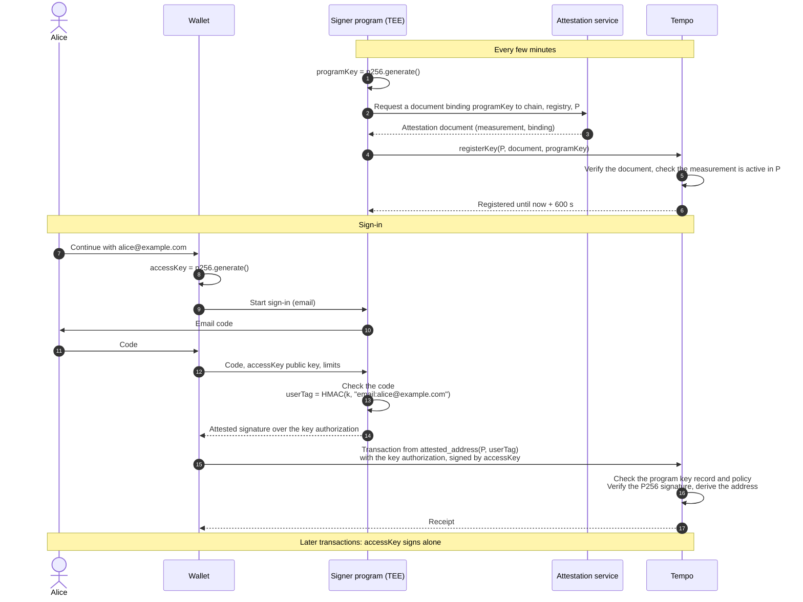

# TIP-XXX1: Attested Signers (Meta)

## Abstract

This TIP adds attested signers: Tempo addresses that sign through a program running in a trusted execution environment (TEE). The program checks a user's sign-in, such as an email code, and signs a key authorization for the user's new access key. The chain accepts the signature only from a key that an attestation service certified as belonging to an approved build of the program. Each sign-in costs one P256 verification and two storage reads.

This meta TIP describes the feature and its components. Component TIPs define the signature type, the key registry, and one attestation scheme each for AWS Nitro Enclaves and Google Cloud Confidential Space. The design trusts the TEE hardware, the attestation service, and the approved code.

## Motivation

Wallets that offer "Continue with email" or "Continue with Google" run a server that decides when a user signed in. The server then signs for the user, either with a key it holds or with a token that a custodian accepts. Whoever controls that server controls every account:

- a breach of the server can sign as every user at once;
- an insider or a bad deploy can do the same, with no visible change;
- users cannot tell what the server signs for them until it is onchain.

Moving the key into a key management service (KMS) prevents theft of the key, but the server still decides when to use it. The decision is the problem, not the storage.

An attested signer moves the decision into a program whose exact code the chain can identify. A TEE runs the program in memory that the host cannot read or change. An attestation service certifies a measurement of the program, a hash of its code, together with a key that the program generated. The chain accepts that key only if a policy lists the measurement. Different code has a different measurement, so a compromised operator cannot produce an accepted key.

### Alternatives considered

- **A zero-knowledge proof of the identity provider's token:** removes the operator for providers that sign tokens with a supported algorithm. It cannot prove an email code, and the token issuer can still sign as all of its users. When the wallet operator is also the issuer, the operator remains a single point of failure. Each proof also needs a prover and a trusted setup, and costs about 350,000 gas to verify.
- **A custodian with an operator-signed token:** the custodian and the operator can each sign as every user, and neither can be observed.
- **A new attestation document with every signature:** removes the registered key, but documents are several kilobytes, beyond [TIP-1045](./tip-1045.md)'s 1,024-byte key-authorization bound. A Nitro document costs about 790,000 gas to verify ([TIP-XXX4](./tip-xxx4.md#gas)).
- **Validators checking sign-ins:** adds validator duties and makes the network choose identity methods.
- **Threshold signing across independent operators:** removes single operators, but each operator must check the sign-in independently. It needs a separate trust arrangement for every deployment.

## Assumptions

- **TEE integrity.** The TEE keeps the program's memory confidential and runs only the measured code. A break exposes the program key and the program's secrets until the break is fixed.
- **Attestation service honesty.** The service certifies only measurements it observed. A dishonest or compromised service can certify any measurement, so it can sign for every address of every policy that trusts it.
- **Approved code correctness.** The program signs only after a valid sign-in for the user it names. A bug in approved code can let anyone sign as any user of the policy until the policy removes the measurement.
- **Policy owner diligence.** The owner proposes only measurements that reproducible builds of reviewed source produce. The delay before a measurement becomes active gives others time to check this. A compromised owner can approve malicious code after the delay.
- **Identity channels.** Email codes are as safe as the user's mailbox and the program's email provider account. The program sends email itself. A wallet operator that relays the message can read every code.
- Configurable accounts (TIP-1107 and TIP-1114, in draft) are not required. Where they are active, attested signers can be owners.

---

# Specification

## Overview

### Terms

| Term | Meaning |
|---|---|
| Signer program | The program that checks sign-ins and signs. It runs in a TEE. |
| Measurement | A 32-byte value that identifies the program's exact code, derived by the attestation scheme. |
| Attestation document | Evidence from an attestation service that a TEE runs code with a given measurement and holds a given key. |
| Attestation scheme | The rules that verify one service's documents ([TIP-XXX4](./tip-xxx4.md) for AWS Nitro Enclaves, [TIP-XXX5](./tip-xxx5.md) for Google Cloud Confidential Space). |
| Program key | A P256 key that the signer program generates at boot and registers with an attestation document. A registration lasts at most 600 seconds. |
| Policy | An onchain record naming one scheme, its approved measurements, its trust anchors, an owner, a guardian, and a delay ([TIP-XXX3](./tip-xxx3.md)). |
| User tag | A 32-byte value that the signer program derives from the user's identity. The chain treats it as opaque. |
| Attested signer | The address derived from a policy ID and a user tag ([TIP-XXX2](./tip-xxx2.md#address-derivation)). |

### Lifecycle

1. **Approval.** A policy owner proposes a measurement. After the policy's delay, the measurement is active.
2. **Registration.** The signer program boots, generates a program key, and obtains an attestation document that binds the key to this chain, the registry, and the policy. Anyone submits it to `registerKey`. The registry verifies it under the policy's scheme and records the key for 600 seconds. The program registers a new key before each one expires.
3. **Sign-in.** A user proves their identity to the signer program and sends it a new access key. The program derives the user tag and signs a key authorization for that access key with its program key.
4. **First transaction.** The chain checks that the program key is registered and current, verifies its signature, and derives the signer address from the policy ID and user tag. It stores the access key.
5. **Later transactions.** The access key signs alone, within its [TIP-1011](./tip-1011.md) limits. No attestation or program key is involved.

The critical authority boundary is the measurement check at registration. Only code whose measurement the policy approved can hold a registered program key, and only a registered program key can sign for the policy's addresses.

### Components

Read the components in this order:

| TIP | What it adds | Why read it here |
|---|---|---|
| [TIP-XXX2: Attested Signatures](./tip-xxx2.md) | Signature type `0x06`, address derivation, validity rules, accepted contexts, and gas | Defines what a transaction carries and how the node checks it |
| [TIP-XXX3: Attested Key Registry](./tip-xxx3.md) | Policies, delays, the guardian, `registerKey`, and the scheme interface | Defines where program keys and approved measurements come from |
| [TIP-XXX4: AWS Nitro Enclaves Attestation](./tip-xxx4.md) | Scheme `0x01` | First scheme, reusing the Zone verifier's Nitro attestation code |
| [TIP-XXX5: Google Cloud Confidential Space Attestation](./tip-xxx5.md) | Scheme `0x02` | Second scheme, using RS256 tokens and policy trust anchors |

The signature and registry TIPs activate in the same hardfork as at least one scheme. Later schemes activate independently.

### Scope

- Identity methods are defined by the signer program, not the protocol. Email codes, OpenID Connect sign-ins, and passkeys all produce a user tag.
- Each policy uses one scheme. Combining schemes, such as requiring signatures from both a Nitro and a Confidential Space program, uses configurable-account thresholds.
- Attested signatures sign transactions and key authorizations. Contracts verify them for any hash through TIP-1020, against the current registry state.
- The same person signing in through two identity methods, or through two policies, has two attested signers.
- Attested signer addresses do not depend on the measurement, so upgrades of the signer program keep every address.

## Sign-in and first transaction

The following scenario is illustrative. Alice signs in to a wallet with the email address `alice@example.com` under policy `P`, whose signer program runs in an AWS Nitro Enclave.

1. The signer program registers a program key, as [TIP-XXX3](./tip-xxx3.md#registration) describes.
2. Alice's wallet generates an access key and starts the sign-in.
3. The signer program sends Alice an email code from its own email provider account.
4. Alice enters the code, and the wallet sends it with the access key's public key and the requested limits.
5. The signer program checks the code, derives Alice's user tag, and signs the key authorization ([TIP-XXX2](./tip-xxx2.md#signed-digest)).
6. The wallet sends a transaction from Alice's attested signer address. The node verifies the attested signature ([TIP-XXX2](./tip-xxx2.md#verification)) and stores the access key.

If Alice enters a wrong code, the program signs nothing and no transaction is sent. If the program key expires before the transaction lands, the node rejects the signature, and the wallet requests a new one with the same code session.

## Trust

| Party | Can | Cannot |
|---|---|---|
| Attestation service | Certify any measurement, and so sign for every address of every policy that uses its scheme | Affect policies that use another scheme |
| TEE hardware vendor | Expose program keys and secrets through a hardware flaw, until the flaw is fixed | Change which measurements a policy approves |
| Policy owner | Approve any measurement after the delay, and so sign for the policy's addresses | Approve a measurement before the delay ends, or affect other policies |
| Policy guardian | Pause the policy, remove measurements and anchors, revoke all program keys, and cancel pending proposals | Approve a measurement or trust anchor |
| Signer program (approved code) | Sign for any user tag of its policy | Run with a different measurement under the same registration |
| Wallet operator and its servers | Delay or refuse sign-ins, and swap the access key of users who sign in through its servers while it is compromised | Sign for any user without that user's sign-in, or register a key for unapproved code |
| Validators | Nothing beyond their existing role | |

## Costs

Dollar amounts use the [TIP-1067](./tip-1067.md) base-fee cap of 1.2 × 10^10 attodollars per gas.

| Operation | Gas | Cost at the cap | Paid |
|---|---|---|---|
| Registering a Nitro program key with a five-certificate chain | 790,000 for verification ([TIP-XXX4](./tip-xxx4.md#gas)), plus storage and calldata | about $0.0095 | Every 600 seconds or less, for each running signer program |
| Registering a Confidential Space program key | To be measured ([TIP-XXX5](./tip-xxx5.md#gas)) | | Every 600 seconds or less, for each running signer program |
| Verifying an attested signature | P256 verification plus 4,200 ([TIP-XXX2](./tip-xxx2.md#gas)) | about $0.00015 | Once per sign-in |
| Transactions signed by an access key | No extra gas | | |

At one registration every 600 seconds, one Nitro signer program costs about $1.37 per day at the cap.

## Signer program requirements

These requirements are not consensus rules. They determine whether a policy's addresses are safe, so wallets SHOULD show users only addresses of policies whose signer program meets them.

- **No operator configuration.** The program MUST NOT read security-relevant configuration from its operator, such as the email provider, the KMS key, or the identity provider's keys. All of it is part of the measured code. An operator can run approved code anywhere, so its behavior must not depend on where it runs.
- **User tags.** The program SHOULD derive `user_tag = HMAC-SHA256(k, "tempo:user-tag:v1" || method || ":" || normalized_identifier)`. `k` is a secret that a KMS releases only to TEEs with an approved measurement. The derivation, the method names, and the normalization rules MUST NOT change for a policy, because they determine every address.
- **Secret continuity.** The KMS release policy for `k` MUST cover the old and new measurements during an upgrade. Losing `k` prevents users from signing in again. Their existing access keys continue to work.
- **Program keys.** The program SHOULD generate a new program key for each registration and register it at least 120 seconds before the current one expires.
- **Transport.** The program SHOULD end TLS inside the TEE, so the wallet operator's servers cannot read codes or swap access keys.
- **Builds.** The program MUST build reproducibly from published source. Before the owner proposes a measurement, at least two independent parties SHOULD rebuild it and confirm the measurement. During the delay, monitors SHOULD rebuild every proposed measurement from its published commit.

## Scope boundaries

- A policy cannot express an approval that depends on claims other than the measurement, such as a cloud project. The signer program enforces those conditions itself.
- Program keys are not portable between chains, because the binding names the chain ID and the registry.
- Moving an existing account to an attested signer requires a configurable account that adds the attested signer as an owner.

# Compatibility

No existing transaction, account, or signature changes. Before activation, type `0x06` is rejected in every context ([TIP-XXX2](./tip-xxx2.md#activation)).

| Integration | What changes |
|---|---|
| Wallets and SDKs, such as ox and Viem | Need attested signer address derivation, the `0x06` encoding, the signed digest, and builders for key authorizations with an attested signature ([TIP-XXX2](./tip-xxx2.md)) |
| Wallet operators | Run a signer program in a TEE, register its program keys, and operate a policy with an owner and guardian ([TIP-XXX3](./tip-xxx3.md)) |
| Explorers and indexers | Decode type `0x06` signatures and registry events. An attested signer is an ordinary account with no code |
| Contracts using TIP-1020 | `recover` and `verify` accept attested signatures checked against the current registry state ([TIP-XXX2](./tip-xxx2.md#tip-1020-verification)) |
| RPC simulation and gas estimation | Apply the same registry reads and charges as block validation, and report which check failed |
| Existing accounts | Unchanged. Moving to an attested signer needs a configurable account, where active |

# Observability

The registry emits events for policy changes and registrations ([TIP-XXX3](./tip-xxx3.md#observability)). Each answers an operational question:

| Question | Evidence |
|---|---|
| Which code can sign for a policy's addresses now, and which code will be able to after the delay? | `MeasurementProposed`, `MeasurementRemoved`, and `ProposalCancelled` |
| Which code signed a given sign-in? | `KeyRegistered` names the measurement of each program key, and the attested signature names the program key |
| Did an incident response take effect? | `KeysRevoked`, `PolicyPaused`, and `MeasurementRemoved` |
| Is a signer program healthy? | A `KeyRegistered` event for its policy at least every 600 seconds |

Monitors SHOULD alert on every `MeasurementProposed` whose measurement no independent rebuild reproduces, and on a policy with no current program key. Nodes SHOULD export attested-signature rejections by reason.

# Threat Model

The most consequential attack is signing for every address of a policy. The attacker must make the registry accept a program key held by code it controls. The registry accepts a key only from a document that the scheme verifies and whose measurement the policy approved before the delay ended.

| Actor | Capability and trust | Boundary check and failure consequence |
|---|---|---|
| Compromised wallet operator, insider, or deploy pipeline | Controls servers, deploys, and the TEE host. Trusted for availability only | Different code has a different measurement, so registration fails ([TIP-XXX3](./tip-xxx3.md#registration)). It can still swap access keys for users who sign in through its servers during the compromise, unless TLS ends in the TEE |
| Compromised build pipeline | Produces a malicious image from reviewed source | The image's measurement differs from independent rebuilds. Monitors flag the proposal, and the guardian cancels it during the delay. Without independent rebuilds, the owner approves it and it can sign as every user |
| Compromised policy owner | Proposes any measurement or trust anchor | Proposals wait for the delay. The guardian cancels them and can pause the policy. If no one acts, the malicious code signs as every user after the delay |
| Compromised guardian | Pauses the policy and removes entries | Can deny service. Cannot approve code |
| Attestation service | Signs documents | Fully trusted for its scheme. A compromise lets the attacker register keys for any measurement. Policy owners and guardians remove the service's trust anchors, or pause, which stops new registrations at once. A hardfork disables the scheme |
| TEE hardware flaw | Reads program memory | Exposes the current program key and `k`. The program key expires within 600 seconds, and the guardian revokes keys at once. A leaked `k` links identities to addresses but does not sign |
| Stolen access key | Signs as the user | Acts within its TIP-1011 limits until it expires or the user revokes it |
| User's mailbox | Reads that user's codes | Signs in as that user only |
| Email provider account (admins, message previews, API tokens) | Reads outbound messages, or sends as the program | Anyone can start a sign-in for any address, so whoever reads outbound codes can sign in as every email user of the policy. Use a dedicated provider account with few admins, turn off message previews and content logging, alert on setting and token changes, and rate-limit sign-ins in the signer program |

Residual risks:

- The design trusts the attestation service and the TEE vendor for each scheme. A configurable account that requires owners under two schemes removes the single vendor, at the cost of two signatures per sign-in.
- Users who sign in while the wallet's front end is compromised can have their access key replaced. A configurable account with a passkey owner limits the effect for accounts holding significant value.
- Losing `k` stops new sign-ins for every user of the policy.
- Whoever can read the program's outbound email can sign in as every email user. The email provider account is a root of trust for email sign-ins.

# Invariants

- An attested signer's address depends only on its policy ID and user tag.
- A signature is valid only if its program key was registered with a document whose measurement was active in the policy at registration.
- A measurement proposal never becomes active before its activation time, which is at least the policy's delay after the proposal.
- Removing a measurement, revoking keys, or pausing a policy takes effect for every later transaction in the same block.
- A program key is never valid more than 600 seconds after its registration.
- Transactions signed by an access key carry no attestation and pay no attestation-specific gas.

## Test Cases

- A full sign-in under each scheme, from registration to a first transaction with a key authorization.
- A measurement proposal that the guardian cancels before activation, and one that activates exactly at its activation time.
- A program key used one second after expiry, after `revokeKeys`, and after `pause` earlier in the same block.
- A signer program upgrade that keeps every address.
