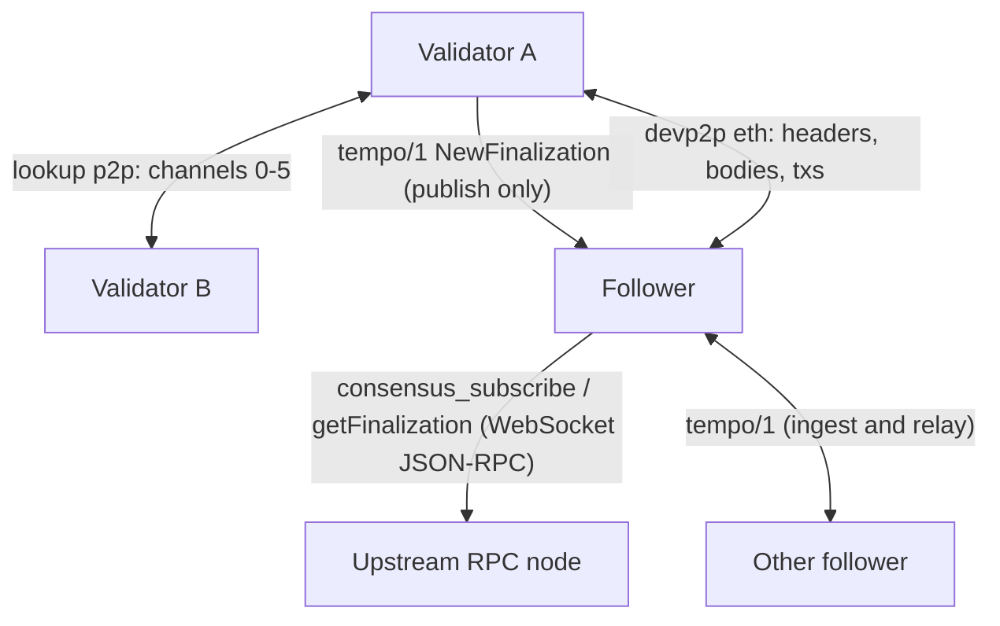

# 08 — P2P and sync

This chapter specifies how Tempo nodes talk to each other and how a node obtains, authenticates, persists and serves finalized history. It covers:

- the validator consensus network (the authenticated lookup network of [p2p.md §6](commonware/p2p.md#6-authenticated-lookup-network)), its peer sets and its six channels;
- the execution-layer devp2p network, including the Tempo `tempo/1` RLPx subprotocol that gossips finalization certificates;
- block and certificate backfill, retention, syncing from genesis and consensus snapshots;
- follower mode (certificate and block sources, verification, identity installation, execution-layer forkchoice driving);
- persistence and crash-safety requirements;
- key and share file formats (informative).

The consensus protocol itself (Simplex, the threshold scheme, certificate formats and verification, epochs, the DKG and the on-chain DKG artifacts, the network-identity trust root) is specified in 07-consensus.md. This chapter references those definitions by name and does not restate them. The commonware protocols that the consensus network uses are specified in [commonware/p2p.md](commonware/p2p.md) (transport, handshake, multiplexer, resolver and broadcast), [commonware/simplex.md](commonware/simplex.md), [commonware/dkg.md](commonware/dkg.md), [commonware/cryptography.md](commonware/cryptography.md) and [commonware/codec.md](commonware/codec.md).

Nothing in this chapter is fork-gated within T0..T13: every rule below applies to every mainnet block height. (Fork-gated consensus behaviour such as the T12 leader elector lives in 07-consensus.md.) Where a rule depends on the fork schedule it is stated explicitly using the fork predicate of 01-chain-and-forks.md.

## 0. Conventions and external specifications

The key words MUST, MUST NOT, SHOULD, SHOULD NOT and MAY are to be interpreted as in RFC 2119.

External wire formats that this chapter references rather than restates are defined by these specifications:

| Specification | Where | Used for |
|---|---|---|
| devp2p | [ethereum/devp2p](https://github.com/ethereum/devp2p): RLPx (`rlpx.md`), discv4 (`discv4.md`), discv5 (`discv5/`), ENR (EIP-778), the `eth` capability (`caps/eth.md`) | execution-layer networking (section 4) |
| `eth` versions | `eth/66` EIP-2481, `eth/67` EIP-4938, `eth/68` EIP-5793, `eth/69` EIP-7642, `eth/70` EIP-7975, `eth/71` EIP-8159 | the `eth` message sets a Tempo node advertises (4.1) |
| Fork identifier | EIP-2124 | `eth` Status (4.1) |
| Block size limit | EIP-7934 (`MAX_RLP_BLOCK_SIZE = 8,388,608` bytes) | message size limits (2.2, 3.4, 4.1) |
| Engine API | [ethereum/execution-apis](https://github.com/ethereum/execution-apis), `src/engine/` (Prague and Osaka) | the semantics of `engine_newPayload` and `engine_forkchoiceUpdated` statuses (sections 7 and 8) |

Codec notation ([codec.md §2](commonware/codec.md#2-notation)): `varint(x)` is the unsigned LEB128 encoding of an unsigned integer with the canonical-form rules of [codec.md §3](commonware/codec.md#3-varint); `u8`, `u64be` are fixed-width big-endian integers ([§4](commonware/codec.md#4-fixed-width-integers)); `bytes(x)` is `varint(len(x)) || x` ([§5.4](commonware/codec.md#54-length-prefixed-sequences-and-bytes)); a tuple `(A, B)` encodes as `enc(A) || enc(B)`; an `Option<T>` encodes as a `bool` byte (`0x00`/`0x01`) followed by `T` when present ([§5.2](commonware/codec.md#52-option)).

Terms:

- **CL** / **EL**: the consensus layer and the execution layer of a node. They MAY run in one process; this chapter describes their interaction as Engine API calls either way.
- **Validator**: a node running the consensus engine with an ed25519 signing key (`--consensus.signing-key`). It may or may not hold a BLS share in a given epoch (signer vs verifier, 07-consensus.md).
- **Follower**: a node that does not vote. It obtains finalization certificates and blocks from other nodes, verifies them and drives its EL (`tempo node --follow`).
- **Marshal**: the component that orders finalized blocks, persists finalizations and blocks, and repairs gaps (5.1); its consensus-facing wrapper is [simplex.md §10](commonware/simplex.md#10-marshal-inline-wrapper).
- **Finalization**: the Simplex finalization certificate of [simplex.md §3.7](commonware/simplex.md#37-certificates) under the threshold VRF scheme ([cryptography.md §6.2](commonware/cryptography.md#62-certificate-signature-pair)), whose digest is the 32-byte block hash (07-consensus.md §7 "Certificates and follower verification").
- **Block (consensus encoding)**: the RLP encoding of the Tempo execution block (header + body) as specified in 02-encoding.md, with no additional framing. Decoding MUST reject a block whose body does not match the header commitments (transactions root, ommers hash, withdrawals root) and a block whose header carries a block-access-list hash.
- **epoch(h)**, **last(E)**, **first(E)**: the fixed epoch mapping of 07-consensus.md with `epochLength = 21600` on mainnet (chain id 4217) and Moderato (chain id 42431). The boundary block of epoch `E` is `last(E)`; its `extra_data` is the `OnchainDkgOutcome` for epoch `E+1`. The genesis block (height 0) plays the role of the boundary of "epoch −1": its `extra_data` is the outcome for epoch 0.
- **boundary_for(E)**: `0` if `E = 0`, else `last(E−1)`. The outcome in `header(boundary_for(E)).extra_data` describes epoch `E`.

## 1. Overview

A Tempo node has two independent network stacks:

| Stack | Who | Identity | Transport | Purpose |
|---|---|---|---|---|
| Consensus p2p | validators only | ed25519 consensus key (the `publicKey` registered in ValidatorConfigV2) | lookup network over TCP ([p2p.md §6](commonware/p2p.md#6-authenticated-lookup-network)), encrypted stream ([p2p.md §4](commonware/p2p.md#4-encrypted-stream-handshake), [§5](commonware/p2p.md#5-encrypted-transport)) | votes, certificates, block broadcast, backfill, DKG |
| Execution devp2p | every node | secp256k1 node key (enode) | discv4 + RLPx | transaction gossip, header/body serving, EL sync, `tempo/1` certificate gossip |

Validators never accept consensus data from devp2p: they publish certificates on `tempo/1` but discard inbound `tempo/1` frames. Followers have no consensus p2p connection; they obtain certificates from an upstream node over JSON-RPC and, optionally, from `tempo/1` peers.



## 2. Validator consensus network

### 2.1 Identity

A validator's consensus identity is its ed25519 key pair ([cryptography.md §3.1](commonware/cryptography.md#31-ed25519-encodings); 32-byte public key). The public key MUST equal the `publicKey` (bytes32) of the validator's ValidatorConfigV2 entry (precompiles/validator-config-and-zones.md). The same key authenticates the p2p handshake, is the participant identifier in Simplex and the DKG (players and dealers are ordered sets of these keys), and signs DKG dealer logs (07-consensus.md). Simplex votes and certificates are *not* signed with ed25519; they carry BLS12-381 threshold partials or recovered signatures (07-consensus.md).

> **Resolved conflict C-P2P-01**: TIP-1017 says the ed25519 key is used for signing all consensus p2p messages; the code uses it only for transport authentication and DKG artifacts, while votes and certificates carry BLS threshold signatures. Decided: this spec follows the implementation, and the TIP is amended in its own PR (tempoxyz/tempo#8940 to #8974). See [conflicts](conflicts.md#c-p2p-01).

### 2.2 Transport and handshake

Validators MUST implement the authenticated lookup network of [p2p.md §6](commonware/p2p.md#6-authenticated-lookup-network) with the following parameters (named as in [p2p.md §11](commonware/p2p.md#11-constants)). "Normative" parameters MUST be used for interoperability or because peers depend on them; "default" values are the operator defaults of Tempo's node and MAY differ.

| Parameter | Value | Kind |
|---|---|---|
| `namespace` | `union_unique(b"TEMPO", b"_P2P")` = `0x05 \|\| "TEMPO" \|\| "_P2P"` = bytes `05 54 45 4d 50 4f 5f 50 32 50` | normative |
| stream namespace (derived from `namespace`) | `namespace \|\| b"_STREAM"` | normative ([p2p.md §4.1](commonware/p2p.md#41-roles-identities-and-namespace)) |
| `crypto` | the validator's ed25519 private key | normative |
| `max_message_size` | `8_388_608` bytes (`MAX_RLP_BLOCK_SIZE` of EIP-7934) | normative lower bound: a node MUST accept application payloads up to this size; see 3.4 |
| `tracked_peer_sets` | 1 | default (see 2.4) |
| `max_peers_per_set` | 128 (distinct identities including self; registering a larger set is fatal) | default; an implementation MUST support at least the number of identities that 2.4 derives |
| `synchrony_bound` | 5 s | default |
| `max_handshake_age` | 10 s | default |
| `handshake_timeout` | 5 s | default |
| `dial_timeout` | 15 s | default |
| `max_concurrent_handshakes` | 512 | default |
| `allowed_handshake_rate_per_ip` | one per 5 s | default |
| `allowed_handshake_rate_per_subnet` | one per 15 ms | default |
| `peer_connection_cooldown` | 60 s | default |
| `dial_frequency` | 1 s | default |
| `ping_frequency` | 50 s | default |
| `block_duration` (how long a blocked peer stays blocked) | 4 h | default |
| `send_batch_size` | 8 | default |
| `bypass_ip_check` | false | default |
| `allow_private_ips` | false | default |
| `allow_dns` | true | default (ingress values from ValidatorConfigV2 are always literal socket addresses, so DNS is never used) |
| `listen` | operator-chosen (Tempo's node defaults to `127.0.0.1:8000`; production nodes bind the port of their registered ingress) | default |

The framing, handshake, key exchange and encryption are specified in [p2p.md](commonware/p2p.md): framing [§2](commonware/p2p.md#2-framing), transcript [§3](commonware/p2p.md#3-transcript), handshake [§4](commonware/p2p.md#4-encrypted-stream-handshake), encrypted transport [§5](commonware/p2p.md#5-encrypted-transport). A connection is authenticated to an ed25519 public key; the application sees every inbound message tagged with that key.

On the authenticated stream, each encrypted frame carries one network message ([p2p.md §6.1](commonware/p2p.md#61-network-messages)):

```
Message := 0x00 || Data          ; application data
         | 0x01                  ; Ping
Data    := varint(channel) || bytes(payload)
```

`channel` is the channel id of section 3 (a u64). `payload` is the channel's application message. Pings are transport keep-alives. A message on an unknown channel, or one that does not decode, closes the connection ([p2p.md §6.3](commonware/p2p.md#63-receiving)).

### 2.3 Peer addresses and admission

Each peer in a tracked set has an asymmetric address `{ingress, egress}` ([p2p.md §6.5.2](commonware/p2p.md#652-addresses)) built from its ValidatorConfigV2 entry:

- `ingress` = the socket address `parse_socket_addr(entry.ingress)`, the address other validators dial. `parse_socket_addr` accepts exactly the `SocketAddr` grammar of [precompiles/validator-config-and-zones.md §0.3](precompiles/validator-config-and-zones.md#03-endpoint-text-grammar): a literal IPv4 or IPv6 socket address, never a host name.
- `egress` = `(parse_ip_addr(entry.egress), port 0)`, where `parse_ip_addr` accepts exactly the `IpAddr` grammar of the same section. Only the IP is used: it is the source address the peer's outbound connections come from.

`decode(entry)` returns the entry's `public_key` and its `p2p_address = {ingress, egress}` as above, which is `to_p2p_address` of [precompiles/validator-config-and-zones.md §2.9](precompiles/validator-config-and-zones.md#29-consumption-by-consensus). It never uses `validatorAddress` (the entry's EVM address). An entry whose `publicKey` is not a valid ed25519 point encoding ([cryptography.md §3.2](commonware/cryptography.md#32-public-key-decoding)), or whose `ingress` or `egress` fails to parse, is *undecodable* (2.4 says how undecodable entries are handled).

Admission rules of the lookup network (connection slots [p2p.md §6.5.3](commonware/p2p.md#653-connection-slots), accepting [§6.5.4](commonware/p2p.md#654-accepting-connections), dialing [§6.5.5](commonware/p2p.md#655-dialing)):

1. Outbound dials go only to **primary** peers, at their ingress address.
2. Inbound connections are accepted only from identities in the union of the primary and secondary peers of the tracked set(s).
3. Unless `bypass_ip_check` is set, an inbound connection whose source IP is not one of the registered egress IPs (of any primary or secondary peer) is rejected before the handshake.
4. Unless `allow_private_ips` is set, connections from or to non-global IP addresses are rejected.
5. Messages sent to all peers (`All`, [p2p.md §6.2](commonware/p2p.md#62-sending)) go to every connected primary and secondary peer.

### 2.4 Peer-set derivation

Peer sets are derived only from finalized state. The node keeps the highest finalized tip that consensus (marshal) has reported, `consensus_tip`, initialised from the finalization archive tip at startup (5.1.5).

```python
def refresh_peers(el, consensus_tip_height, last_tracked):
    # Highest height that is both finalized in the EL and finalized by consensus.
    h = min(el.finalized_block_number() or 0, consensus_tip_height)
    if last_tracked is not None and last_tracked.height >= h:
        return last_tracked                     # nothing new

    # Latest boundary block at or below h.
    if last(epoch(h)) == h:
        b = h
    elif epoch(h) == 0:
        b = 0
    else:
        b = last(epoch(h) - 1)
    outcome = OnchainDkgOutcome.read(el.header_by_number(b).extra_data)     # prefix decode (07-consensus.md §10); failure is an error

    primary_keys   = outcome.output.players                # sorted set (07-consensus.md §10.2)
    secondary_keys = [k for k in outcome.next_players if k not in primary_keys]

    # All contract reads below are against the post-state of block h.
    vc = ValidatorConfigV2.at_post_state(el.header_by_number(h))
    active = {}                                            # public key -> p2p address {ingress, egress}
    for entry in vc.getActiveValidators():
        d = decode(entry)                                  # see 2.3
        if d is None:
            continue                                       # undecodable active entries are skipped
        active[d.public_key] = d.p2p_address               # a later duplicate replaces an earlier one

    primary = {}
    for k in primary_keys:
        if k in active:
            primary[k] = active.pop(k)
        else:
            d = decode(vc.validatorByPublicKey(k))         # inactive DKG player
            assert d is not None                           # invariant; violation is fatal
            primary[k] = d.p2p_address
    for k in secondary_keys:
        if k not in active:
            d = decode(vc.validatorByPublicKey(k))
            assert d is not None                           # invariant; violation is fatal
            active[k] = d.p2p_address
    secondary = active                                     # next players + other active validators
    return track_or_overwrite(h, primary, secondary, last_tracked)
```

`track_or_overwrite`:

- If nothing was tracked before, or the key sets of `primary` or `secondary` differ from the last tracked set, the node MUST track a new peer set with index `h` and these primary and secondary peers (`track`, [p2p.md §6.5.1](commonware/p2p.md#651-peer-sets)). With `tracked_peer_sets = 1` the previous set is dropped, disconnecting peers that left the union.
- If only addresses changed, the node MUST overwrite the addresses of the existing set in place (`overwrite`, [p2p.md §6.5.1](commonware/p2p.md#651-peer-sets)).
- In all cases the remembered height becomes `h`.

When peer sets are refreshed:

1. Once at engine construction, from EL state alone, **before** marshal, the executor or the DKG manager start (the DKG manager may need peers to recover and authenticate the tip). If this initial read fails (missing header or state), startup MUST fail.
2. On every marshal `FinalizedBlock` update (the block is acknowledged immediately) and `FinalizedTip` update (5.1.3), after raising `consensus_tip` to the reported height if higher.
3. Every 30 s when no update arrived (the timer restarts on each update). Errors on these later refreshes are ignored; the previous set stays in force.

Consequences that implementers MUST preserve:

- Peer membership follows the DKG outcome of the latest finalized boundary (current players are always dialed) plus the contract's active set at the finalized tip (joining validators are reachable before they become players).
- Addresses always come from ValidatorConfigV2 at the finalized tip, including for players that are no longer active.
- A node whose EL is behind its consensus tip derives peers from the EL's finalized height. A node whose EL is ahead derives them from the consensus tip.

> **Note**: ValidatorConfigV2 has no entries before it is populated after T2 (mainnet genesis allocates only the V1 contract at `0xCCCCCCCC00000000000000000000000000000000`). The invariant assertions above therefore fail for heights before ValidatorConfigV2 holds entries for every player of the latest boundary outcome, so a validator cannot start its consensus engine from such a height; see 5.7.

> **Note (informative)**: On mainnet the lowest such height is 13,486,150 (epoch 624).
> - ValidatorConfigV2 has no code before T2 (block 12,290,227). It has no entries before block 13,485,095.
> - Throughout epoch 624 the latest boundary outcome is `outcome(624)` in block 13,478,399. At block 13,486,149, four of its 11 players and next players still have no ValidatorConfigV2 entry.
> - From block 13,486,150, every one of them has a decodable entry.
> - The contract records `initializedAtHeight = 13,486,706`. A validator-mode node can therefore start its consensus engine only from a height of at least 13,486,150.

### 2.5 Misbehaviour and blocking

A node reacts to a bad inbound message from an authenticated peer in one of three ways:

- **Block**: the peer is blocked ([p2p.md §6.7](commonware/p2p.md#67-blocking)). Its connection is closed and it is refused for `block_duration` (4 h by default).
- **Close**: the connection is closed without blocking. The peer may reconnect after the usual cooldowns.
- **Drop**: the message is ignored and the connection stays open.

Which reaction applies changes which peers stay connected, so it is normative:

| Layer or channel | Block | Close | Drop |
|---|---|---|---|
| Transport ([p2p.md §6.3](commonware/p2p.md#63-receiving)) | never | an oversized or undecryptable frame, a `Message` that does not decode, a message on an unknown channel | a message that finds the channel's inbound buffer full; a message over the channel quota is delayed, not dropped (3.1) |
| Epoch multiplexer, channels 0, 1, 2, 5 (3.2) | never | never | an epoch prefix that is not a canonical `varint`, a full subchannel queue, an unregistered epoch on channels 1, 2 and 5; on channel 0 an unregistered epoch goes to the backup queue, which drops entries that don't fit |
| 0 votes | a `Vote` that does not decode; a vote whose epoch differs from its subchannel's; a vote from a peer that is not a participant of the epoch; a signer index different from the sender's index; two conflicting votes from one signer (two notarizes or two finalizes for different proposals, a nullify and a finalize for one view, two different nullifies, or different bytes for the same proposal); a vote whose signature fails verification | never | a vote for a view outside the node's current window (checked before the participant check); an exact duplicate |
| 1 certificates | a `Certificate` that does not decode; a certificate whose epoch differs from its subchannel's; a certificate that fails verification; the leader, when its notarization or finalization shows it proposed two blocks in one view | never | a certificate outside the current window; a second certificate of the same kind for a view |
| 2 simplex resolver ([p2p.md §9](commonware/p2p.md#9-resolver-protocol)) | a response whose value does not decode as a `Certificate`, does not cover the requested view (3.3.3), names another epoch or fails verification | never | a resolver message that does not decode; a response or error for an unknown request id or from a peer not asked; a response for a view already settled. An `Error` reply only makes the requester retry. |
| 3 block broadcast | never | never | a message that does not decode as a block (including a block whose header carries a block-access-list hash); a duplicate; from a peer that is not a primary peer, the block only wakes local waiters (3.3.4) |
| 4 marshal backfill | a response that fails the checks of 3.3.5, including a block that does not decode or carries a block-access-list hash | never | a resolver message that does not decode; a response for an unknown request id; a `Finalized` or `Notarized` response for an epoch whose scheme the node lacks |
| 5 DKG | a `DkgMessage` that does not decode; a dealing that fails validation (sender not a dealer of the round, invalid commitment, or a share that does not match the commitment) | never | a dealing when the node is not a player; a repeated dealing from a dealer already handled (answered with the same ack); any acknowledgement, valid or not (an invalid one only stops the dealer from resending to that player) |

A node MUST NOT block a peer for a certificate it can't verify only because it lacks the epoch's scheme. After leaving epoch `E` a node keeps the schemes of `E−1` and `E` ([07-consensus.md §14](07-consensus.md#14-epoch-transition-validator)), because straggling peers keep re-proposing and certifying the outgoing epoch's boundary block.

## 3. Consensus channels

### 3.1 Channel map

| Id | Name | Per-peer quota (inbound and outbound, each direction independently) | Epoch-multiplexed | Payload |
|---|---|---|---|---|
| 0 | votes | 128 msg/s | yes | `Vote` ([simplex.md §3.6](commonware/simplex.md#36-votes)) |
| 1 | certificates | 128 msg/s | yes | `Certificate` ([simplex.md §3.7](commonware/simplex.md#37-certificates)) |
| 2 | simplex resolver | 128 msg/s | yes | resolver message ([p2p.md §9.1](commonware/p2p.md#91-message)) with key `u64be(view)` (3.3.3) |
| 3 | block broadcast | 8 msg/s | no | consensus block encoding (3.3.4) |
| 4 | marshal backfill | `--consensus.backfill-frequency` msg/s, default 8 | no | resolver message ([p2p.md §9.1](commonware/p2p.md#91-message)) with the marshal key of 3.3.5 |
| 5 | DKG | 128 msg/s | yes | Tempo DKG message (3.3.6) |

Votes and certificates are signed with the threshold VRF scheme ([cryptography.md §6](commonware/cryptography.md#6-threshold-vrf-scheme)). Quotas are GCRA quotas of `n` messages per second with burst `n` ([p2p.md §7](commonware/p2p.md#7-rate-limiting)), enforced per channel and per peer. An inbound message over quota is delayed, not dropped: the receiver stops reading that connection until the quota allows the message ([p2p.md §6.3](commonware/p2p.md#63-receiving), [§7.2](commonware/p2p.md#72-channel-quotas)), which stalls every channel of the connection. Outbound, recipients over quota are left out, and a send is refused only when every recipient is over quota. Quotas are local policy, but a node that sends above its peers' quotas slows its own connections to them; a conforming node SHOULD NOT exceed them.

### 3.2 Epoch multiplexing

Channels 0, 1, 2 and 5 are multiplexed by epoch with the multiplexer of [p2p.md §8](commonware/p2p.md#8-epoch-multiplexer) (all subchannels share the channel's quota): the channel payload is

```
MuxedPayload := varint(epoch) || inner_message
```

A node registers subchannel `E` on channels 0, 1 and 2 when it enters epoch `E` (starts the Simplex instance for `E`), and on channel 5 when its DKG manager runs the ceremony of epoch `E`. Registration is local and is not signalled to peers ([p2p.md §8](commonware/p2p.md#8-epoch-multiplexer)).

Each registered subchannel has a receive queue of `--consensus.mailbox-size` messages (default 16,384). The multiplexer reads the channel's messages in arrival order and never waits on a consumer: a message whose subchannel queue is full is dropped, and a payload whose epoch prefix is not a canonical `varint` is dropped. Messages for a subchannel that is not registered are dropped, except on channel 0 (votes).

On channel 0 the multiplexer has a **backup queue**. A vote message for an unregistered epoch is pushed to it as `(their_epoch, sender, inner_message)`, without decoding `inner_message`. The backup queue holds `--consensus.mailbox-size` entries and keeps arrival order; an entry that does not fit is dropped. Its only consumer is the component that enters and exits epochs (the epoch manager). It takes entries one at a time, in queue order, interleaved with its own epoch transitions, and handles each with:

```python
def on_vote_for_unregistered_epoch(their_epoch, sender):   # inner_message is discarded unread
    if no epoch has been entered yet:
        return
    reference = latest entered epoch
    if their_epoch <= reference:
        return                                  # a straggler in an epoch we left, or ours
    # A peer votes in a later epoch: the boundary of our epoch must be finalized.
    marshal.hint_finalized(height=last(reference), targets=[sender])
```

The vote itself is never verified: a hint only starts a targeted fetch (5.1.8), and the response must verify under the node's own scheme for `reference` (3.3.5). A peer that answers with an invalid finalization is blocked (2.5). A hint is a no-op once the finalization of `last(reference)` is stored or that height is processed. While a fetch for it is in progress, each further hint adds its sender to the fetch's targets. Dropped backup entries lose nothing, because every later vote from an epoch ahead triggers the same hint.

The hint makes marshal fetch the finalization of `last(reference)` (with its block) from the sender (3.3.5). Once the DKG manager processes that finalized boundary block it enters the next epoch; this repeats one epoch at a time until the node reaches the network's epoch (5.6).

A validator exits epoch `E` and enters `E+1` when it processes the finalized boundary block `last(E)`, in the order of [07-consensus.md §14](07-consensus.md#14-epoch-transition-validator): it persists the DKG state of `E+1`, deregisters `E`'s subchannels on channels 0, 1, 2 and 5, deletes the scheme of epoch `E−2` (keeping those of `E−1` and `E`), installs the scheme of `E+1`, and registers `E+1`'s subchannels on channels 0, 1 and 2 and then on channel 5. Between the two steps no subchannel is registered: messages for `E` or `E+1` on channels 1, 2 and 5 are dropped, and votes go to the backup queue, which ignores them while no epoch is entered.

### 3.3 Channel payloads

All payloads are encoded with the codec of [codec.md](commonware/codec.md), decoded under its rules (no trailing bytes, [§11](commonware/codec.md#11-decoding-rules)), and carried in `Data` messages ([p2p.md §6.1](commonware/p2p.md#61-network-messages)).

#### 3.3.1 Channel 0: votes

`Vote` (notarize, nullify, finalize) of [simplex.md §3.6](commonware/simplex.md#36-votes), under the mux prefix. Signing domains and verification: 07-consensus.md and [simplex.md §4](commonware/simplex.md#4-signing).

#### 3.3.2 Channel 1: certificates

`Certificate` (notarization, nullification, finalization) of [simplex.md §3.7](commonware/simplex.md#37-certificates) under the mux prefix. Informative summary (normative layout: 07-consensus.md §7): a finalization's encoding is `Proposal || VrfCertificate` where `Proposal = varint(epoch) || varint(view) || varint(parent_view) || digest[32]` and `VrfCertificate = vote_signature[48] || seed_signature[48]` (compressed G1 points), as in the golden frame of 4.3.4.

#### 3.3.3 Channel 2: simplex resolver

The Simplex resolver fetches certificates for views a node missed ([simplex.md §8.14](commonware/simplex.md#814-fetching-missing-certificates-resolver)). The wire message and the requester and responder rules are those of [p2p.md §9](commonware/p2p.md#9-resolver-protocol):

```
Message := u64be(id) || Payload
Payload := 0x00 || Key            ; Request
         | 0x01 || bytes(value)   ; Response (same id as the request)
         | 0x02                   ; Error
```

For channel 2, `Key = u64be(view)` (8-byte big-endian view number) and a response value is the encoding of a `Certificate`: a nullification of exactly that view, or a notarization or finalization of that view or a later one. Timeouts: requests are retried after `--consensus.wait-for-peer-response` (default 2 s).

#### 3.3.4 Channel 3: block broadcast

Channel 3 carries the buffered broadcast engine ([p2p.md §10](commonware/p2p.md#10-buffered-broadcast)). Each message is exactly one consensus block encoding (the raw block RLP), not epoch-multiplexed and not otherwise framed. The leader broadcasts its proposed block to all peers (sent with priority). Receivers decode it (rejecting body/header mismatches and BAL hashes, section 0) and hand it to marshal and to the application for verification. A block from a primary peer of the latest peer set is also cached, keyed by its digest (at most `--consensus.deque-size` = 10 digests per peer); a block from any other peer satisfies local waiters but is not cached. A block received on channel 3 has no authority by itself; it becomes final only through a finalization (07-consensus.md).

#### 3.3.5 Channel 4: marshal backfill

Channel 4 carries the marshal resolver, an instance of the resolver protocol of [p2p.md §9](commonware/p2p.md#9-resolver-protocol), with the wire message of 3.3.3 and the key:

```
Key := 0x00 || digest[32]                       ; Block: a block by hash
     | 0x01 || varint(height)                   ; Finalized: the finalization at a height, with its block
     | 0x02 || varint(epoch) || varint(view)    ; Notarized: the notarization of a round, with its block
```

Response values:

| Request | Response value | Requester MUST check |
|---|---|---|
| `Block(d)` | block encoding | decodes; `keccak256(rlp(header)) == d` |
| `Finalized{h}` | `enc(Finalization) \|\| enc(Block)` | the finalization's epoch is `epoch(h)` and it verifies under that epoch's scheme (07-consensus.md); its payload equals the block hash; the block's number is `h` |
| `Notarized{r}` | `enc(Notarization) \|\| enc(Block)` | the notarization's round is `r` and it verifies under the scheme of `r.epoch`; its payload equals the block hash |

A response that fails these checks SHOULD cause the requester to block the responder (2.5) and retry with another peer. A `Finalized` or `Notarized` response for an epoch whose scheme the requester no longer (or does not yet) holds is dropped without blame. How marshal uses the responses is in 5.1 and 5.3. Resolver parameters of Tempo's node: request timeout 2 s, retry delay 100 ms, requests and responses not sent with priority, peers chosen from the primary peers of the latest tracked peer set ([p2p.md §9.2](commonware/p2p.md#92-requester)).

#### 3.3.6 Channel 5: DKG

Under the mux prefix (subchannel = the ceremony's epoch):

```
DkgMessage := 0x00 || DealerPubMsg || DealerPrivMsg   ; dealer -> one player
            | 0x01 || PlayerAck                    ; player -> its dealer
```

The message types and the envelope are those of [dkg.md §5](commonware/dkg.md#5-messages) and [§5.4](commonware/dkg.md#54-tempo-dkg-channel-envelope). Every DKG message is sent to exactly one recipient, with priority. Semantics, validity and when to send: 07-consensus.md §9.3 "DKG messages".

### 3.4 Message size limits

- A node MUST NOT send an application payload (including the mux prefix) larger than its configured `max_message_size` (default 8,388,608 bytes). It drops such an outbound message locally instead of passing it to the transport.
- Inbound encrypted frames whose payload exceeds the receiver's `max_message_size` plus the 32 bytes of message framing and authentication tag are rejected by the transport ([p2p.md §5.3](commonware/p2p.md#53-encrypted-frames)).
- A proposed block travels as a single channel-3 message and inside channel-4 responses. Every node MUST accept inbound application payloads of at least 8,388,608 bytes (the block RLP size limit `MAX_RLP_BLOCK_SIZE` of EIP-7934, 05-block-execution.md). With the default (`max_message_size = 8,388,608`) a channel-4 response carrying a block whose RLP is within a few hundred bytes of that limit exceeds the limit once the finalization and `Message` framing are added, and is dropped by the responder; such a block can still be obtained from the EL (devp2p) or after a retry from a peer configured with a larger limit. Operators SHOULD NOT lower the default.

## 4. Execution-layer devp2p

### 4.1 Stack

Every Tempo node (validator or follower) runs a devp2p stack as defined by the devp2p specifications of section 0. Tempo uses it unchanged, with the choices and limits below.

**Node identity and discovery.**

- A node is identified by a secp256k1 key; its node id is the 64-byte uncompressed public key, written as an `enode://` URL or an ENR (EIP-778).
- A node MUST implement discv4. Tempo nodes also run discv5 by default, on its own UDP port (default 9200); a node MAY implement it. DNS discovery (EIP-1459) has no Tempo list.
- Bootnodes are operational configuration, not protocol. Tempo nodes ship a built-in list per chain (informative, below) and by default also fetch hints from `https://peers.tempo.xyz`, which returns a JSON object mapping a decimal chain id to a list of `enode://` URLs.

> Informative: built-in bootnodes at the time of writing. They change with operations; the bootnode endpoint has the current list.
>
> Mainnet:
>
> - `enode://f314fd4d28a25e3fe8c8f42e794a95fbdeb47afff5bf1f50ba82f6e647f566b1266f8feb15549b2a50092ddd7a8b423a574bea67dec6d400343480e16d90215a@40.160.24.34:30002`
> - `enode://a3cc3ec05f75b5d71d838a6b4a822044efef67b145ba14fcac3a7798de92806e59b12def3087c9453968e41a8d46439b35510a19014592afdd8962ab27060d67@40.160.24.210:30004`
> - `enode://34b106ae5eddcaf9943987a9d38bb45dc2a64bbac996f34ddecd863217af567273102b4b7010e7cf516151c3903927a18abb1fafe32bb999d752fca064158e05@40.160.64.50:30006`
> - `enode://b8c911b351614b71d027fcec98957be800cdc5e290b616d7f034a89c07d2be480fb9f11700cf7fc77073119b7d3d0855f697ebd4118fb34a35bd53ac58503122@148.113.220.159:30008`
> - `enode://135666c3e82f051e803ae39d401c62329d0bd1b7c868bf9a9154b0aaca0fa9fe3a474b357ef09ff5238d7c6d56be8c3c7533feff277bd839b506e98433418fa5@40.160.22.6:30011`
> - `enode://055ddd029a90d38ddb07fc248179e717ec25206cdc095ca6bb6dd187c54cb644664197fac75514e385f24e26a50d94190cbe78324a5e8d8d8c564cde8e7a503a@40.160.22.228:30012`
> - `enode://fcde6d46394dabea840ab0fdc6f16be8352946c4eb91e32bc18a359e51f14e9b66810233ca00106dd8cdb01f44a7e2e080ea055fa0dc5a5797925356e831252a@148.113.213.6:30013`
> - `enode://048954f10e776c4c31269b97dfbbe52be9dbce48278a02f67cd7a6eec805c1114c25c27e3e9bfabfb8117d134d89190888bb952b73a29f7c8430552a5192ec04@15.204.106.73:30015`
> - `enode://944d8afe14b222ccf26e328bedc10d1db94d756d836b956d1daa5e681f8b29ae48973528af1362110ce61e4d338d758a7e5bba19a66d289a7d536fba795403a1@15.204.106.68:30017`
>
> Moderato:
>
> - `enode://daff60c56f91f13f7a01304badbf65a4b0fe71004293a1fa26e31bf9b2083cb7c176b8318219ac2a651dc26c61e094eff70ece6f440b849b8a1881c7766373bb@148.113.217.72:30014`
> - `enode://1dc8f9d6f7406cd9ea546f7dd8abc84f69fce8a88dc7315372859010e3db9235d74a93347e91732283e7b4dd22f7d3a60c81dee31a8dc6665dc7ed9aff977c20@148.113.193.121:30016`
> - `enode://c2b3cd1404534510487b96b099541d88072260d5410bcc38195d7f606decf0c0043964f6f9252869534675a80ca9f12af81d5b9c078966e9dfae4487a773cb0b@148.113.225.199:30018`
> - `enode://53fc9564e37a20aa3f53dc5b3dce124f55df6b8eab45f5b40b13d19f4753255f4b1e240c4b5004bab8f5f8698a7f8c6607d28dc9afa0018fb69526b88411d8ab@148.113.193.123:30020`
> - `enode://a52bd09170b63d1bc2c394a81a02c8f4e00eb8516e46f858af70b41452a521b12355eabb1ae97fca012af663241d953dd4d1d2b62a97c4a2f6ac1f00a4145981@148.113.215.68:30052`
> - `enode://8dd0354c46d6b57dc3bda3661d2a9b01592b429b014ddbf557523cbdb4ae9f4e954030d6a54f405d753a7d9a59972fe47308a34100fe8e586849c3398c27ec21@40.160.32.193:30053`
> - `enode://b497b28c16b9b9f534c95211807b7439687ba9b19f557bc8b7d7c72eacee44599681a6fbcc38737b9622d231906c8dc08aa08cc7d4ea49af282e235395138647@148.113.225.199:30054`

**RLPx session.**

- Transport is RLPx with the `p2p` capability, protocol version 5 (snappy-compressed messages after the Hello).
- The Hello advertises `eth/66`, `eth/67`, `eth/68`, `eth/69`, `eth/70` and `eth/71`, plus `tempo/1` when enabled (4.3). `snap` is not advertised by default. As the RLPx specification says, the session uses, for each capability name, the highest version both sides advertise.
- A conforming node MUST support at least one of these `eth` versions so that it can exchange transactions and serve and download headers and bodies. `eth/68` or `eth/69` is RECOMMENDED: every Tempo node accepts both. `eth/70` and `eth/71` are advertised but not required. Their EIPs are drafts, so a node MUST NOT advertise either unless it implements exactly the message formats below.
- When an operator enables `snap/2` (10 message ids), it is advertised too. It sorts between `eth` and `tempo`.

RLPx numbers each session's capabilities after the reserved `p2p` ids `0x00`–`0x0f`, in name order, each taking as many ids as its version defines. The `eth` capability starts at `0x10`. Its message-id count is its highest id plus one, unassigned ids included:

| Negotiated `eth` | Ids (relative to `0x10`) | Count | `tempo/1` `NewFinalization` id (without `snap/2`) | with `snap/2` |
|---|---|---|---|---|
| `eth/66`, `eth/67`, `eth/68` | `0x00`–`0x10` | 17 | `0x21` | `0x2b` |
| `eth/69`, `eth/70` | `0x00`–`0x11` | 18 | `0x22` | `0x2c` |
| `eth/71` | `0x00`–`0x13` | 20 | `0x24` | `0x2e` |

Two Tempo nodes with default settings negotiate `eth/71` without `snap/2`, so `NewFinalization` is message id `0x24`. The relative `eth` ids are:

- **`eth/66`**: `0x00` Status, `0x01` NewBlockHashes, `0x02` Transactions, `0x03` GetBlockHeaders, `0x04` BlockHeaders, `0x05` GetBlockBodies, `0x06` BlockBodies, `0x07` NewBlock, `0x08` NewPooledTransactionHashes, `0x09` GetPooledTransactions, `0x0a` PooledTransactions, `0x0b`–`0x0c` unassigned, `0x0d` GetNodeData, `0x0e` NodeData, `0x0f` GetReceipts, `0x10` Receipts.
- **`eth/67`**: as `eth/66`, but `0x0d` and `0x0e` are invalid. They still count.
- **`eth/68`**: as `eth/67`, with the EIP-5793 form of `0x08` (types, sizes, hashes).
- **`eth/69`**: as `eth/68`, with the EIP-7642 Status (no total difficulty) and Receipts without blooms, plus `0x11` BlockRangeUpdate.
- **`eth/70`**: as `eth/69`, with the EIP-7975 forms of `0x0f` GetReceipts (request id, first-block receipt index, block hashes) and `0x10` Receipts (request id, last-block-incomplete flag, receipt lists).
- **`eth/71`**: as `eth/70`, plus EIP-8159 `0x12` GetBlockAccessLists and `0x13` BlockAccessLists.

A Tempo node answers `eth/70` GetReceipts with the receipts it has for at most 1,024 blocks, stopping at the first unknown hash. It skips the requested number of receipts in the first block, keeps the response near 2 MiB, and sends a partial last block with the incomplete flag set rather than exceed that. Tempo blocks have no block access lists, so it answers `eth/71` GetBlockAccessLists with one entry per requested hash (at most 1,024), each the empty RLP string `0x80`. It never refuses the request.

**`eth` Status.** The Status message follows the negotiated `eth` version (`eth/66`–`eth/68`: `caps/eth.md`; `eth/69` and later: EIP-7642). Its fields:

- network id = chain id: 4217 on mainnet, 42431 on Moderato;
- genesis hash of the Tempo genesis (04-state-and-genesis.md);
- fork id of EIP-2124, computed over Tempo's fork schedule as specified in 01-chain-and-forks.md;
- `eth/66`–`eth/68` only: total difficulty and best hash. Tempo has no proof of work, so the total difficulty carries no meaning; a receiver MUST NOT use it for peer selection;
- `eth/69` and later: the served block range `(earliest, latest, latest_hash)`, kept current with `BlockRangeUpdate`.

A Tempo node disconnects a peer with reason `0x02` (breach of protocol) when the peer's Status has a different genesis hash, `eth` version or network id, a fork id that EIP-2124 validation rejects, or (`eth/66`–`eth/68`) a total difficulty longer than 160 bits. It also ends the session when an `eth/69` Status has `earliest > latest` or a zero latest hash.

**Message size limits.** These limits are observable by peers:

- An RLPx message whose snappy-declared decompressed size exceeds 16 MiB (16,777,216 bytes) ends the session.
- An `eth` message larger than 10 MiB (10,485,760 bytes) ends the session.
- A block's RLP encoding is at most 8,388,608 bytes (EIP-7934; 05-block-execution.md), so one block body always fits in a `BlockBodies` response.
- When serving, a node returns at most 1,024 headers, 1,024 bodies or 1,024 receipt lists per response. It stops adding items once the response reaches 2 MiB, so a response MAY hold fewer items than requested.

**Reputation (informative).** Peer scoring is local policy, but its effects are visible to peers. A Tempo node keeps a reputation per peer, starting at 0, and disconnects and refuses a peer whose reputation falls below −51,200. A bad message (for example a malformed or invalid `tempo/1` frame, 4.3.5) costs 16,384, a timeout or a remote disconnect 4,096, and a protocol breach bans at once. Reputation below 0 recovers by 1 per second while connected. So four bad messages in quick succession get a peer disconnected. A banned peer stays refused for 12 hours.

### 4.2 What devp2p is used for

| Use | Messages | Notes |
|---|---|---|
| Transaction propagation | `Transactions`, `NewPooledTransactionHashes`, `GetPooledTransactions`/`PooledTransactions` | Tempo transaction envelopes (06-transactions-and-fees.md). Pool policy never affects block validity. |
| Serving and downloading history | `GetBlockHeaders`/`BlockHeaders`, `GetBlockBodies`/`BlockBodies` (and receipts) | Used by the EL's own sync and by followers to fetch a block by hash (7.3). When a forkchoice update names a head the EL does not have, the EL answers `SYNCING` (Engine API) and downloads the missing chain from devp2p peers: headers by hash, walking parent hashes back to a block it has, then the bodies, which it executes in order. A node MUST serve these requests by hash and by number, including the `reverse` and `skip` fields of `GetBlockHeaders`. |
| Block propagation | none | `NewBlock`/`NewBlockHashes` are not used (post-merge semantics). Blocks reach the EL only through the engine API from the node's own CL. |

A node MUST NOT treat a block obtained over devp2p as canonical or final because a peer served it. Canonicality comes only from the CL's forkchoice updates, which are driven by verified finalization certificates (sections 7 and 8). Devp2p is an untrusted data source: a block fetched by hash is authenticated by that hash, which a verified certificate or a verified descendant committed to.

### 4.3 The `tempo/1` subprotocol

`tempo/1` is an RLPx capability that gossips finalization certificates between Tempo nodes. It lets a follower keep progressing when its upstream RPC is unavailable.

#### 4.3.1 Capability

| Item | Value |
|---|---|
| Capability name | `"tempo"` |
| Version | `1` |
| Message ids reserved | 1. RLPx places the capability after all lower-sorting shared capabilities, so its offset is `0x10` plus the negotiated `eth` version's count, plus 10 when `snap/2` is shared: `0x21`, `0x22` or `0x24` without `snap/2` (4.1) |
| Messages | `0x00` `NewFinalization` |
| Maximum frame size | 1,024 bytes (message id included) |

A node offering `tempo/1` MUST advertise it in every RLPx hello; capabilities are negotiated per session, so a session opened before the protocol was registered never carries it. If the remote side does not support `tempo/1`, the session MUST be kept for its other capabilities (`eth`).

Tempo's node offers `tempo/1` by default (`--consensus.devp2p.finalizations=true`).

#### 4.3.2 Frame format

A `NewFinalization` is carried as an RLPx message whose message id is the capability's base offset plus `0x00` and whose data (after snappy decompression, as for every RLPx message) is the raw certificate encoding. Expressed as an id-relative frame (the message id minus the capability's base offset, followed by the decompressed data):

```
frame := 0x00 || enc(Finalization)
```

There is no RLP wrapping: `enc(Finalization)` is the encoding of a `Finalization` ([simplex.md §3.7](commonware/simplex.md#37-certificates), codec of [codec.md](commonware/codec.md)) (3.3.2). Decoding rules, in order:

1. `len(frame) > 1024` → oversized; the receiver MUST close the connection.
2. `len(frame) == 0` → empty; malformed.
3. `frame[0] != 0x00` → unknown message id; malformed.
4. `frame[1:]` does not decode as exactly one `Finalization` (no trailing bytes) → malformed.

The frame layout is frozen for version 1; an incompatible change MUST use a new version.

#### 4.3.3 Sender rules

- Validators and followers publish only finalizations that are stored in their own finalization archive (section 9): when marshal reports a new finalized tip `(round, height)`, the node reads the stored finalization at `height` and publishes it. If none is stored, nothing is published.
- A node keeps one **latest publication**, the frame with the highest round it has published. A tip whose round is lower than the latest publication's is not published. Republishing the same round reuses the cached frame bytes.
- Per logical peer the node tracks `seen_round`, the highest round it sent to or received from that peer. It MUST NOT offer a frame whose round is ≤ `seen_round`. On a new peer connection the latest publication (if any) is offered immediately.
- Outbound buffering keeps only the newest frame per logical peer; an unsent older frame is replaced.
- At most 2 concurrent physical RLPx connections per peer id are attached to the logical peer (a transient duplicate can exist while the RLPx layer resolves two simultaneous connections between the same pair of nodes); a third is rejected, which closes that RLPx connection.

#### 4.3.4 Golden frame

This 132-byte frame MUST round-trip (decode then encode yields the same bytes):

```
000001000000000000000000000000000000000000000000000000000000000000000001
893a6fba4f0630edd4f1f610258f9b3a1e1fbf9c1abefaea77a62bfd27b0dea1d448c4b4b992fa094bf96c8789b49cfa
8565f0bc98152e274fd6d0e3b85955736432cdca1a52201ff244bf69a65b566ffbcf642a53a23e66b4d9bd6819dd95cc
```

| Offset | Bytes | Field |
|---|---|---|
| 0 | `00` | message id `NewFinalization` |
| 1 | `00` | `proposal.round.epoch` = varint 0 |
| 2 | `01` | `proposal.round.view` = varint 1 |
| 3 | `00` | `proposal.parent` (parent view) = varint 0 |
| 4..35 | `00…01` | `proposal.payload` (32-byte digest) |
| 36..83 | `893a6f…49cfa` | `certificate.vote_signature` (48-byte compressed G1) |
| 84..131 | `8565f0…95cc` | `certificate.seed_signature` (48-byte compressed G1) |

The fixture only pins the layout; its signatures are not valid for any real network key.

#### 4.3.5 Receiver rules

A node ingests `tempo/1` frames only in certified follower mode. Validators MUST discard inbound `tempo/1` frames (they receive certificates over the authenticated consensus network); they still enforce the size limit.

Per physical connection, in order:

1. Oversized frame (> 1,024 bytes, message id included) → close the RLPx session. The check uses the decompressed size that the snappy header declares, before decompressing. The RLPx layer also buffers at most 64 unread `tempo/1` frames and 64 KiB of them per connection; a frame that would exceed either bound closes the RLPx session.
2. Per-connection admission rate limit: 8 frames/s (`--consensus.devp2p.finalizations.peer-frame-rate`); frames over the rate are dropped silently.
3. Not ingesting (validator) → drop.
4. Enqueue to consensus; the shared queue holds 256 frames and drops on overflow (a later certificate also finalizes earlier blocks, so a loss does not block progress).

In the consensus-side actor, per logical peer:

1. Frame from a peer with no live connection → drop.
2. Malformed (4.3.2 rules 2–4) → drop and penalize the peer with one bad-message reputation penalty (4.1).
3. `round ≤ seen_round(peer)` → replay, drop. Otherwise set `seen_round(peer) = round`.
4. `round ≤ latest_verified_round` (the highest round verified locally or stored by marshal) → stale, drop.
5. Put the certificate in the peer's single **slot**, replacing a slot that is still waiting (keeping its queue position); if the peer's slot is being verified or quarantined, drop the new frame.
6. Verification is dispatched one certificate at a time, from the slot that has waited longest, at most 32 per second across all peers (`--consensus.devp2p.finalizations.verify-rate`). The verifier is the follower driver (7.4). Results:
   - **valid**: raise `latest_verified_round`; clear every slot whose round is ≤ it; the certificate is reported to marshal as a finalization (marshal then fetches its block and, once stored, republishes it per 4.3.3).
   - **invalid** (verification failed under a scheme learned from an authenticated boundary): clear every slot holding the identical frame bytes (compared by `keccak256(frame)`) and give each owning peer one bad-message penalty (4.1).
   - **needs scheme** (no scheme for the epoch yet, or it failed only against the pinned network identity fallback): quarantine the slot until a finalized boundary block installs a scheme for that epoch, then requeue it. The sender is not penalized.
   - **no answer** (verifier unavailable): settle the frame (clear identical slots) without penalty.

## 5. Marshal, backfill and sync

### 5.1 Marshal

Marshal turns consensus activity into a gap-free, height-ordered stream of finalized blocks. Every validator and every follower runs one marshal. It persists finalizations and finalized blocks, keeps a cache of recent notarized and verified blocks, repairs gaps from peers (5.3) and answers peers' backfill requests (5.4). Simplex reaches it through the Inline wrapper of [simplex.md §10](commonware/simplex.md#10-marshal-inline-wrapper); the rest of the node consumes its output updates (5.1.3).

The names below are this specification's. Only the backfill wire format (3.3.5) is interoperable; everything else in this section is local behaviour that other nodes rely on only through what a node serves and when it votes.

#### 5.1.1 State and stores

Marshal keeps:

- `processed_height`: the highest height whose finalized block every consumer acknowledged, or none. It is durable.
- `round_floor`: a round at or below which no certificate-bound work is needed. It is derived at startup (5.1.5) and advances with `processed_height` (5.1.6).
- `tip`: the highest height reported in a `FinalizedTip` during this run.
- `pending_floor`: a floor finalization whose block has not arrived yet, or none (5.1.7).
- `in_flight`: the blocks dispatched to consumers and not yet acknowledged, in height order, at most `max_pending_acks` of them.

It uses these logical stores (their on-disk layout is implementation-defined, 9.1):

| Store | Contents | Indexed by |
|---|---|---|
| finalization archive | one `Finalization` per height, insert-only | height, block digest |
| finalized-block store | finalized blocks (5.2) | height, block digest |
| delivery metadata | `processed_height` | — |
| consensus cache, one per epoch | verified blocks (several per view allowed), notarized blocks, notarizations and finalizations by view; certified blocks by height; plus the range of epochs that may have a cache | view or height, block digest |

Marshal does not own the block broadcast buffer of 3.3.4, but reads it. `find(d)` looks for the block with digest `d` in the broadcast buffer, then in the consensus caches (newest epoch first; verified, notarized, then certified blocks), then in the finalized-block store.

A finalized block is *stored* with:

```python
def store_finalized(h, B, f):                 # f is None when B is finalized only through a descendant
    if h <= (processed_height or 0):
        return False                           # already delivered; ignored
    finalized_blocks.put(B)                    # buffered: readable at once, durable after the next sync
    if f is not None:
        finalizations.put(h, digest(B), f)
    barrier = min(barrier, h)                  # dispatch stops at h until a sync covers this write
    if f is not None and h > tip:
        emit FinalizedTip(f.round, h, digest(B))
        tip = h
    return True
```

Every step that stores finalized blocks ends by starting a durable sync of both stores. When the sync completes, `barrier` is cleared for the writes it covers and dispatch resumes (5.1.4). A sync failure is fatal.

#### 5.1.2 Inputs

| Input | Source | Effect |
|---|---|---|
| `notarization(n)` | Simplex (validators) | Write `n` to the cache at its round. Its sync runs in the background. If `find(n.payload)` returns a block that the verified cache does not already hold at that round, write it as a notarized block too. A notarization alone never triggers a fetch. |
| `finalization(f)` | Simplex (validators); the follower driver (7.4) | Write `f` to the cache at its round and wait until it is durable. If `find(f.payload)` returns `B`: `store_finalized(h(B), B, f)`, advance the round floor if `h(B) ≤ processed_height` (5.1.6), run repair (5.3) and start a sync. Otherwise request `Block(f.payload)` (3.3.5) for the finalized chain. |
| `proposed(round, B)` | the Inline wrapper's `broadcast` | Send `B` to all peers on channel 3 (3.3.4), then store it as verified for `round`. Sending first keeps propagation off the storage path. |
| `store_verified(round, B)` | the Inline wrapper's `verify` | Write `B` to the verified cache at `round`, unless that view already holds this digest. Returns once the write is durable. Presence in the verified cache is not a validity claim. |
| `store_certified(round, B)` | the Inline wrapper's `certify`; the follower driver for upstream blocks (7.4) | Write `B` to the notarized cache at `round`, unless the verified cache already holds it there. Returns once the block and the round's notarization (if one was written earlier) are durable. |
| `hint_finalized(h, targets)` | epoch catch-up (3.2, 5.6); the follower driver (7.5) | 5.1.8 |
| `set_floor(f)` | the follower executor (7.6) | 5.1.7 |
| backfill responses | resolver (3.3.5, 7.3) | 5.3 |

Every block that marshal receives or writes, by any of these paths, also wakes local waiters for its digest (5.1.9). If its digest is the payload of `pending_floor`, the floor is applied (5.1.7) and the block is not processed further.

#### 5.1.3 Outputs

Marshal emits two kinds of update. Each update goes to every consumer, in a fixed order. Validators' consumers are the application, the executor (8), the DKG manager, the peer manager (2.4), the RPC feed and `tempo/1` gossip (4.3.3). Followers' consumers are the executor (7.6), the driver (7.5), the RPC feed and gossip, with the driver ahead of gossip.

`FinalizedTip(round, height, digest)` reports a new finalized tip:

- It is emitted when `store_finalized` writes a finalization above every tip reported in this run, and once at startup for the finalization archive's highest entry (5.1.5).
- Within one run, tip heights strictly increase. The startup tip can repeat a height reported before the restart.
- The finalization is readable from the finalization archive when the tip is emitted. The tip is not a durability signal: the write may not be durable yet.
- The tip can name a height whose ancestors marshal does not hold yet.
- A finalization whose block marshal does not hold yields no tip, because its height is unknown. The tip follows once the block arrives.
- When a tip for height `h` is emitted, it precedes `FinalizedBlock` for `h` in the same run. A height finalized only through a descendant gets a block update and no tip.

`FinalizedBlock(block, ack)` delivers one finalized block:

- Heights are delivered in strictly increasing order without gaps, starting at `processed_height + 1`, or at 0 (the genesis block) when nothing was processed.
- A block is emitted only after it, and its finalization if marshal has one, are durable.
- Delivery is at least once. A block can be delivered again after a restart (5.1.5) or after a floor is applied (5.1.7). Consumers MUST tolerate a repeated block and still acknowledge it.
- At most `max_pending_acks` blocks are unacknowledged at a time. Tempo's node uses 1 for followers and, for validators, the number of unpersisted blocks the EL holds in memory before it stops processing engine requests. Validators acknowledge only after EL persistence (8), so their window must exceed the EL's persistence batch.

Each consumer gets its own copy of `ack` and MUST acknowledge it once it has processed the block. A consumer that does not need the block for durable state, such as gossip or the peer manager, acknowledges at once. The block counts as acknowledged only when every copy is acknowledged. A copy dropped without acknowledging stops marshal, which is fatal to the node.

#### 5.1.4 Delivery

```python
def next_height():
    return 0 if processed_height is None else processed_height + 1

def dispatch():
    if pending_floor is not None:
        return
    while len(in_flight) < max_pending_acks:
        h = in_flight[-1].height + 1 if in_flight else next_height()
        if barrier is not None and h >= barrier:
            return                              # the block at h may not be durable yet
        B = finalized_blocks.get(h)
        if B is None:
            return                              # a gap; repair (5.3) fills it
        ack = new_ack()
        emit FinalizedBlock(B, ack)
        in_flight.append((h, digest(B), ack))

def on_acknowledged():                          # runs when in_flight[0] is fully acknowledged
    while in_flight and in_flight[0].ack is acknowledged:
        h, d, _ = in_flight.popleft()
        processed_height = h
        cancel resolver requests for heights <= h
        f = finalizations.get(h)
        if f is not None:
            advance_round_floor(h, f.round)     # 5.1.6
    persist processed_height                    # durable sync, before any further dispatch
    dispatch()
```

Acknowledgements are consumed in height order, so `processed_height` never skips a block that is still in flight. Because blocks are dispatched only once durable and `processed_height` is persisted only after acknowledgement, a crash never leaves `processed_height` above a block the stores lack.

#### 5.1.5 Startup and restart

On startup (both modes), before any consumer runs:

1. Open the stores and run the startup checks of 9.4.
2. Choose the startup anchor. If the finalization archive is empty, the anchor is the genesis block, which MUST equal the EL's genesis; marshal stores it at height 0 unless it is present or `processed_height` is above 0. Otherwise the anchor is the archive's lowest finalization (the floor of 6.4, already verified there).
3. Restore `processed_height`. Derive `round_floor` as the round of the highest stored finalization at or below `processed_height` (or the zero round). Raise it to the round of the finalization at `processed_height + 1` if that finalization and its block are both stored.
4. Emit `FinalizedTip` for the finalization archive's highest entry, if any.
5. Open the consensus caches of every epoch in the recorded range.
6. Install a non-genesis anchor as a floor (5.1.7). It has no effect when its round is at or below `round_floor`.
7. Run repair (5.3), sync, and dispatch (5.1.4).

So every block above the persisted `processed_height` is delivered again after a restart. A restored node with no `processed_height` gets the anchor's block first. The *startup floor* is `max(processed_height, anchor height)`. The validator executor replays EL history up to it before marshal's deliveries matter (5.7).

#### 5.1.6 Round floor and cache retention

```python
def advance_round_floor(h, r):
    if h > (processed_height or 0) or r <= round_floor:
        return
    old = round_floor
    round_floor = r
    # Retain a window behind the previous floor.
    delete the consensus caches of every epoch < old.epoch
    in old.epoch's cache, delete views < old.view - view_retention
    cancel resolver requests bound to rounds <= r
    if pending_floor is not None and pending_floor.round <= r:
        pending_floor = None                    # its block is already processed; resume
        repair(); dispatch()
```

Deletion is in whole sections of 4,096 views, so a cache can keep more than `view_retention` views. `view_retention` is 10 × `--consensus.views-to-track` (2,560 views by default) on validators, so they can serve `Notarized{r}` requests (5.4), and 1 on followers. Certified blocks above `processed_height` are cached by height when an ancestry walk fetches them (5.1.9). They are deleted with their epoch's cache and below an applied floor.

#### 5.1.7 Floors

A *floor* moves the start of delivery to a finalized block. The startup anchor (5.1.5) and `set_floor(f)` both install one:

```python
def install_floor(f, from_set_floor):
    if f.round <= round_floor:
        return                                  # stale floor; ignored
    require f verifies under the scheme of f.epoch   # failure is fatal: a local caller supplied f
    write f to the cache at f.round
    if from_set_floor and pending_floor is not None and pending_floor.round >= f.round:
        return                                  # keep waiting for the newer pending floor
    pending_floor = f
    B = find(f.payload)
    if B is not None:
        apply_floor(B)
    else:
        drop in_flight                          # their acknowledgements are ignored
        request Block(f.payload) for the finalized chain

def apply_floor(B):                             # B is the block named by pending_floor
    f = pending_floor
    pending_floor = None
    h = h(B)
    if h <= (processed_height or 0):
        advance_round_floor(h, f.round)
        repair(); dispatch()
        return
    finalized_blocks.put(B); finalizations.put(h, digest(B), f); durable sync
    if h > tip:
        emit FinalizedTip(f.round, h, digest(B)); tip = h
    processed_height = h - 1                    # so that B itself is delivered next
    advance_round_floor(h - 1, f.round)
    persist processed_height
    drop in_flight
    prune the finalization archive, the finalized-block store and the certified-block caches below h
    repair(); dispatch()
```

While `pending_floor` is set, repair and dispatch pause. In Tempo the finalization archive and the finalized-block store ignore pruning (5.2), so a floor only moves the delivery start and prunes certified-block caches.

#### 5.1.8 Hints

`hint_finalized(h, targets)` asks for the finalization at height `h`:

```python
def hint_finalized(h, targets):
    if finalizations.has(h):
        return
    if h <= (processed_height or 0):
        return
    resolver.fetch_targeted(Finalized{h}, targets)   # a fetch already in progress gains these targets
```

The response is checked per 3.3.5. If no scheme is known for `epoch(h)` when it arrives, it is dropped as stale without penalizing the peer, and the hint has no effect. A valid response is stored with `store_finalized(h, B, f)`, which reports a new tip if `h` is above it, and repair then walks down from `B` (5.3). Hints are fire-and-forget: nothing is reported back to the caller. Followers ignore `targets` and ask the upstream (7.3).

#### 5.1.9 Lookups

The Inline wrapper ([simplex.md §10](commonware/simplex.md#10-marshal-inline-wrapper)) and the consumers use these operations. None of them waits for durability.

| Operation | Result |
|---|---|
| `has_verified_block(round)` | true iff the verified cache holds a block at `round` |
| `block(d, fetch_round=r)` | `find(d)` if it succeeds. Otherwise the caller waits until a block with digest `d` reaches marshal by any path (5.1.2). If `r` is given and above `round_floor`, marshal also requests `Notarized{r}` (3.3.5). The caller MAY abandon the wait. A block obtained this way may not have been stored yet. |
| `block(d)` with an ancestry height bound `h` | as above, but requests `Block(d)`; a matching response at height ≤ `h` and above `processed_height` is cached as a certified block. Used when walking the ancestry of a block the node already accepted (building on, verifying or certifying it). |
| `finalized_block(h)`, `finalization(h)` | the finalized-block store or the finalization archive at `h`, or none; never fetches |
| `latest()` | height, digest and round of the finalization archive's highest entry |
| `processed_height()` | `processed_height` |

### 5.2 Storage model

Validators and followers keep the same consensus storage (so a node can switch modes without migration, 9.5):

- **Finalization archive**: maps height → `Finalization`, also looked up by block digest. It holds one finalization per finalized height from the node's floor upward (heights for which only a later descendant's certificate was received may be absent). The genesis block MUST NOT have a finalization. It is never pruned, in either mode.
- **Finalized-block store**: a *hybrid* store. A prunable store (4,096 blocks per section) holds recently finalized blocks; every block at or below the EL's finalized height is served from the EL (canonical blocks only). On every insertion the prunable store drops whole sections below `el_finalized − retention + 1` (default retention 64,800 = 3 × 21,600 blocks, so it holds between 64,800 and 68,895 blocks once the EL has caught up). It never drops a block the EL has not finalized, and marshal's prune requests have no effect on it. An insertion at a height the prunable store has already dropped is a successful no-op, since the EL holds that block. Gap tracking treats every height at or below the EL's finalized height as present.
- **Delivery metadata**: `processed_height` (5.1.1).
- **Consensus caches**: the per-epoch caches of 5.1.1, retained per 5.1.6.

### 5.3 Gap repair

Marshal repairs the finalized chain above `processed_height` (5.1.4 delivers it). Repair runs after every stored finalization, after every batch of resolver deliveries, after a floor is applied and at startup. It does nothing while `pending_floor` is set.

```python
def repair():
    start = (processed_height or 0) + 1
    # 1. Finalizations above the last stored block: anchor the highest one first.
    t = finalizations.last_index()
    if t is not None and t >= start and (finalized_blocks.last_index() or -1) < t:
        f = finalizations[t]
        B = find(f.payload)
        if B is not None: store_finalized(t, B, f)
        else: request Block(f.payload) for the finalized chain at height t
    # 2. Internal gaps: walk parent hashes down from the block above each gap.
    for each gap (lo, hi] of missing heights at or above start, lowest first:
        cursor = finalized_blocks.get(hi + 1)
        while h(cursor) - 1 > lo:
            P = find(parent(cursor))
            if P is None:
                request Block(parent(cursor)) for the finalized chain at height h(cursor) - 1
                break out of both loops
            store_finalized(h(cursor) - 1, P, cached finalization for digest(P), if any)
            cursor = P
    # 3. Ask for finalizations of the lowest missing heights.
    request Finalized{h} for up to max_repair missing heights >= start
```

A block fetched by `Block(d)` is authenticated by `d`, which a stored child or a verified finalization committed to. It is stored as finalized when it was requested for the finalized chain or a finalization for it is cached, because a verified finalization of a descendant finalizes all ancestors. A `Finalized{h}` response carries the finalization and block for `h`, verified per 3.3.5.

Requests go over channel 4 (validators) or to the follower resolver (7.3). Marshal handles resolver messages (responses and peers' requests) in batches of up to `max_repair` = 20. It verifies the batch's certificates together, runs repair, starts one sync, and then answers the batch's peer requests. Requests at or below `processed_height` (or bound to a round at or below `round_floor`) are not sent, and are cancelled when the floors pass them.

### 5.4 Serving obligations

A validator MUST answer channel-4 requests it can satisfy:

- `Block(d)` when `find(d)` succeeds: the broadcast buffer, the consensus caches, the prunable store or, for canonical EL blocks, the EL;
- `Finalized{h}` for any height in its finalization archive, with the block from the finalized-block store;
- `Notarized{r}` while its consensus cache still holds the notarization of `r` and the block it names (5.1.6).

It answers `Error` (or nothing) when it cannot. A node whose EL prunes history can serve blocks only within its retention window; requests for heights below it fail without penalty and the requester retries elsewhere. A node under load MAY drop peers' requests before its own responses.

### 5.5 Retention guarantees

| Data | Retention in Tempo's node | Guarantee a peer can rely on |
|---|---|---|
| Finalized blocks in the prunable store | ≥ 64,800 blocks behind the EL's finalized tip (`MINIMAL_PEER_SYNC_FINALIZED_BLOCKS`, `--consensus.finalized-blocks-retention`) | blocks up to three mainnet epochs behind the finalized tip are servable from consensus storage |
| Finalized blocks older than that | served from the EL; available iff the EL has not pruned them (RPC/archive nodes default to archive mode; `--minimal` prunes) | none |
| Finalizations | the finalization archive is never pruned: a node keeps every finalization it stored from its first stored height (genesis+1 for a node synced from genesis, the snapshot anchor for a restored node) upward; heights finalized only implicitly (through a descendant's certificate during backfill) may lack one | none for any particular height. A node that is not freshly restored usually holds the finalizations it received during the epochs it ran, but heights finalized implicitly have none, and no node is required to keep the finalization of a boundary block. History older than a node's anchor is trusted through the network identity checkpoint and the hash chain ([07-consensus.md §8.1](07-consensus.md#81-root-of-trust)) |
| Notarizations and notarized blocks | at least `view_retention` views behind the processed round (5.1.6) | none |
| DKG events | current and previous epoch | (local only) |

Validators SHOULD keep EL history for at least `MINIMAL_PEER_SYNC_FINALIZED_BLOCKS` blocks so that peers up to three epochs behind can catch up over consensus p2p.

### 5.6 Epoch catch-up (validators)

A validator that is behind enters epochs one at a time:

```python
while behind:
    E = latest entered epoch
    # Triggered by a vote for an epoch > E (3.2).
    marshal.hint_finalized(last(E), targets=[voter])   # fetch Finalized{last(E)} from the voter
    # The finalization of last(E) verifies under epoch E's scheme, which the node has.
    # Marshal backfills epoch E's blocks by parent hash and delivers them in order (5.3).
    # The DKG manager processes the finalized boundary block last(E), persists the
    # state for epoch E+1 (07-consensus.md) and only then enters epoch E+1, which
    # registers the scheme for E+1 and the channel subchannels for E+1.
```

A node MUST NOT install the scheme of epoch `E+1` before the boundary block `last(E)` is finalized and processed, and MUST NOT accept a hint target's claim about any other height: hints always name the boundary of the node's own current epoch.

### 5.7 Syncing from genesis

**Follower mode** syncs any history, including from genesis:

1. At genesis the EL's finalized height is 0, so the follower installs the epoch-0 scheme from the genesis outcome and pins its trusted network identity (7.5).
2. It verifies the upstream's latest finalization against the pinned identity (mainnet: `from_epoch = 2042`) and reports it to marshal. With the genesis checkpoint (`from_epoch = 0`, [07-consensus.md §8.3](07-consensus.md#83-network-identity-checkpoints)), a tip after a rotation fails this check. The follower then fetches `Finalized{last(E)}` for its current epoch `E`, starting at `last(0)`, and installs each next scheme from the processed boundary until it reaches the tip's epoch (7.4, 7.5). This needs a source that serves those boundary finalizations, which no node is required to keep (5.5).
3. Marshal fetches the tip block and walks parent hashes down to height 1 (5.3), storing every block as finalized; blocks are delivered in order and executed by the EL (7.6). Historical certificates are not needed: the verified tip authenticates its whole ancestry by hash.

**Validator mode** derives peers from ValidatorConfigV2 at the finalized tip (2.4) and replays finalized blocks through the engine API with `VALID` required (8). A validator therefore cannot start consensus from a state whose finalized height precedes the population of ValidatorConfigV2 with entries for every player of the latest boundary outcome. To join from scratch, a validator MUST first reach a recent finalized height in follower mode or from a snapshot (section 6), then start in validator mode on the same storage (9.5).

In validator mode, on startup the executor first replays finalized blocks from the EL's finalized height up to the startup floor (5.1.5), reading them from marshal's stores and falling back to the EL. It issues a forkchoice update every 8 delivered blocks and at the startup floor, after waiting until the EL reports ready (a forkchoice update reaffirming the EL's own current forkchoice returns `VALID`, polled every 1 s). If a block in that range cannot be sourced, startup fails.

## 6. Consensus snapshots

A snapshot lets a node start from recent state instead of genesis. It consists of an execution-layer snapshot, a consensus archive and a manifest that describes both.

The whole snapshot format is implementation-defined: the EL snapshot's contents and encoding, the manifest's encoding, and the consensus archive's container, compression, file names and store layout. A snapshot is only guaranteed to install on the implementation, and storage format version, that produced it. This section specifies the logical contents every snapshot carries, the startup checks and the trust preconditions for a safe restore.

### 6.1 Contents

The manifest MUST carry this consensus metadata:

| Field | Type | Meaning |
|---|---|---|
| `execution_finalized_height` | integer | the EL snapshot source's finalized height |
| `execution_finalized_digest` | 32 bytes | its block hash |
| `tip_finalization_height` | integer | the highest height with a finalization in the source |
| `tip_finalization_digest` | 32 bytes | that finalization's payload |
| `anchor_finalization_height` | integer | the anchor (6.2) |
| `anchor_finalization_digest` | 32 bytes | the anchor finalization's payload |
| `consensus_archive` | integrity record | the consensus archive's file name, size, decompressed size and hash, and the list of files it extracts to, each with path, size and hash |

The manifest's EL snapshot block MUST be at or above `execution_finalized_height`.

The consensus archive holds two of the logical stores of 9.1, and nothing else:

- the **finalization archive**, with every finalization from the anchor height to the tip height that the source holds;
- the **finalized-block store**'s prunable part, with every block above `execution_finalized_height` that the source holds.

It excludes the DKG state, the follower identity record, Simplex vote journals, the consensus caches and marshal's delivery metadata; a restored node rebuilds them (6.4).

> Informative: Tempo's node writes the manifest as JSON, with the fields above in an object under the key `"consensus"` (digests as `0x`-prefixed hex), hashes files with BLAKE3, and packs the consensus archive as a zstd-compressed tar of its two store directories.

### 6.2 Anchor selection

```python
def select_anchor(finalizations, prunable, el_finalized):
    tip = finalizations.last_index()                    # error if none
    candidate = tip
    while True:
        if candidate <= el_finalized:
            return candidate
        hole = highest height in (el_finalized, candidate] missing from prunable, or None
        if hole is None:
            return candidate                            # contiguous blocks from el_finalized+1 to candidate
        below = highest height < hole with a finalization, or None
        if below is None:
            raise "no anchor"
        candidate = below
```

So the anchor is the highest finalized height from which a contiguous run of snapshot blocks reaches down to the EL snapshot's finalized block, or a certified height at or below the EL's finalized height. A producer MUST NOT create a snapshot while the source node's consensus storage is in use.

### 6.3 Installation

Before replacing any local consensus data the installer MUST:

1. check the archive's hash against the one in `consensus_archive`;
2. extract it into a staging directory without following or creating links outside it;
3. require that every extracted entry is a regular file or directory, that every file is in the file list of `consensus_archive` with matching size and hash, and that every listed file is present;
4. require that the extracted files form the two stores of 6.1 in the installer's own storage format, and reject the archive otherwise (for example, Tempo's installer requires each top-level directory to belong to one of its two stores);

then move the stores into the consensus data directory (default `<datadir>/consensus`), refusing to overwrite existing files unless forced.

These checks only protect integrity against the manifest. Authenticity depends on the trust preconditions and the conditional startup verification of 6.4, not on the manifest alone.

### 6.4 Trust: verifying a restored snapshot at startup

The reference startup procedure on restored storage performs, before any actor runs:

1. **Archive consistency** (9.4): the finalization archive's tip certificate epoch equals `epoch(tip_height)`; its first index is not 0; the tip header, where the prunable store or the EL has a block at that height, has number `tip_height` and hash equal to the tip certificate's payload.
2. **Floor verification**: the floor is the first finalization in the archive (the anchor). The node reads `header(boundary_for(cert.epoch))` from the hybrid store, reads its `OnchainDkgOutcome` with prefix decoding ([07-consensus.md §10](07-consensus.md#10-on-chain-dkg-artifacts)), requires `outcome.epoch == cert.epoch`, builds the full verifier scheme from `outcome.output.players` and the sharing `outcome.output.public` (whose `total` and threshold must match the players, [cryptography.md §5.4](commonware/cryptography.md#54-public-polynomial-and-sharing-encoding)), and requires the floor finalization to verify. Failure is fatal. The scheme is registered for the floor's epoch. This checks consistency with the restored boundary outcome; it is not an independent trust anchor unless that boundary is already authenticated.
3. **Tip verification against the trusted identity** (summary; normative rule: [07-consensus.md §8.3, startup identity selection and tip check](07-consensus.md#startup-identity-selection-and-tip-check)): the trusted identity is the configured one (built-in: mainnet `{from_epoch: 2042, identity: 0x8627d337…a182}`, see 07-consensus.md), replaced by a persisted identity with a higher `from_epoch` (validators: from DKG state; followers: from the driver record, 9.3); a persisted identity with the same `from_epoch` but a different key is fatal. If the tip certificate's epoch ≥ `trusted.from_epoch` it MUST verify under the trusted identity, otherwise startup fails (an operator must configure a newer identity after a full-DKG rotation). If its epoch < `trusted.from_epoch` it is accepted as historical without verification against the trusted identity. The trusted identity is registered for `from_epoch`, and for the tip's epoch when verified; a later attempt to register a different key for either epoch is fatal.
4. **EL linkage**: when the floor is below the EL's finalized height, the executor starts from the EL's canonical block at the floor height and marshal re-delivers finalized blocks from the floor; each delivery must extend the EL's canonical chain (a `newPayload` that is not `VALID` for a finalized block is fatal, section 8). When the floor is above the EL's finalized height, the executor backfills from the EL's finalized height to the floor from the snapshot's contiguous prunable blocks (5.7).

**Trust precondition for historical snapshots.** When `tip.epoch < trusted.from_epoch`, the startup checks above do not by themselves guarantee authentication of the restored history: step 3 skips the trusted-identity check, and step 2 takes its verification key from restored storage. Before relying on such a snapshot, the operator MUST either trust the snapshot and its source explicitly or authenticate its header against a separately trusted block hash or a certificate verified with a separately trusted key, using the checked ancestry described below. This is a safety precondition, not an additional check performed by the reference startup procedure.

A certificate verified under an independently trusted key authenticates its block and ancestors linked to it by a checked `parent_hash` chain ([07-consensus.md §7.2](07-consensus.md#72-verification-algorithm)). Thus the EL snapshot's state root is authenticated by that certificate only if the snapshot header is on that checked chain, at or below the certified height. A tip that passes step 3 can provide this anchor; a snapshot-sourced floor key alone cannot. An EL snapshot taken above that height needs separate authentication. Authenticating the header's state root is distinct from checking that the restored state matches it; executing later blocks alone does not establish either prerequisite.

After restore, the validator DKG manager has no persisted state and rebuilds it from the latest boundary outcome at or below the floor. Its share comes, in order of preference, from `--consensus.signing-share` if it matches the outcome's public polynomial at its index, then from a salvaged stale share that matches, then by recovery from the previous epoch's finalized dealer logs ([07-consensus.md §9.5](07-consensus.md#95-share-recovery-informative)). Recovery has no private dealings, so it succeeds only when every selected dealer's log revealed this validator's share; otherwise the validator runs the epoch without a share.

## 7. Follower mode

### 7.1 Model

A follower runs marshal, a *driver* that verifies certificates, a resolver that fetches missing data, and an executor that drives its EL; it runs no Simplex instance, no DKG and no consensus p2p. Its trust model is:

- **Trust root**: the genesis hash and the network identity checkpoint (built-in per chain, overridable with `--consensus.network-identity` + `--consensus.network-identity-from-epoch`, and derived from the genesis outcome when the chain ships none), together with the identities it learns from finalized boundary blocks ([07-consensus.md §8](07-consensus.md#8-trust-chain-and-network-identity)).
- **Everything else is untrusted**: the upstream RPC node, `tempo/1` peers and devp2p peers only supply data; a follower accepts a block as finalized only if a finalization that verifies under a trusted scheme commits to it or to a descendant.

A follower executes every block in its EL; it does not trust the upstream's state.

### 7.2 Certificate sources

**Upstream JSON-RPC.** A follower obtains finalizations from an upstream Tempo node over JSON-RPC 2.0 on a WebSocket connection: `--follow <ws-url>`, or `--follow auto`, which uses `wss://rpc.presto.tempo.xyz` on mainnet and `wss://rpc.moderato.tempo.xyz` on Moderato. Tempo's follower pings every 5 s, treats 10 s without traffic as a dead connection, and reconnects after 2 s × attempts, capped at 20 s, plus up to 1 s of jitter. These timings are local policy. The methods below are normative for an upstream that serves followers and for a follower that uses one. Servers also accept them over HTTP and IPC.

**Encoding conventions.**

- `epoch`, `view`, `height` and `seen` are unsigned 64-bit integers written as JSON numbers, not as hex strings.
- 32-byte hashes (`digest`, header hashes) are `0x`-prefixed hex strings of 64 digits.
- `certificate` is the hex encoding of `enc(Finalization)` (07-consensus.md §7.1). Servers write it without a `0x` prefix in lowercase. A reader MUST accept it with or without a `0x` prefix, in either case.
- Parameters are a positional array. A server also accepts the named form `{"query": ...}` for `consensus_getFinalization`.

`CertifiedBlock` is a JSON object with exactly these members:

| Member | Type | Meaning |
|---|---|---|
| `epoch` | number | the certificate's epoch |
| `view` | number | the certificate's view |
| `digest` | 32-byte hex | the finalized block's hash |
| `certificate` | hex string | `enc(Finalization)` |
| `block` | object | `{"header": Header, "body": {"transactions": [...], "ommers": [...], "withdrawals": null or [...]}}` |

`Header` is the header of 02-encoding.md as a JSON object with camelCase members: the Ethereum header fields (`parentHash`, `sha3Uncles`, `miner`, `stateRoot`, `transactionsRoot`, `receiptsRoot`, `logsBloom`, `difficulty`, `number`, `gasLimit`, `gasUsed`, `timestamp`, `extraData`, `mixHash`, `nonce`, and, when present, `baseFeePerGas`, `withdrawalsRoot`, `blobGasUsed`, `excessBlobGas`, `parentBeaconBlockRoot`, `requestsHash`), then `mainBlockGeneralGasLimit`, `sharedGasLimit` and `timestampMillisPart` as hex quantities, and, when present, `consensusContext` = `{"epoch": number, "view": number, "parentView": number, "proposer": 32-byte hex}`. Integer header fields are `0x`-prefixed hex quantities and byte fields `0x`-prefixed hex. The object carries no `hash`: the reader computes the hash from the header (02-encoding.md §2.4). Each transaction is its envelope's JSON object, tagged by `"type"`. This specification does not define that JSON form.

A follower MUST take from a `CertifiedBlock` only `certificate` and the block. It MUST ignore `epoch`, `view` and `digest`, because the certificate's own round and payload are authoritative. It obtains the block in one of two ways, which give the same result:

- it decodes `block`, rebuilds the header and body, and recomputes the hash; or
- it ignores `block` and fetches the block named by the certificate's payload from a block source (7.3), for example by hash over devp2p.

Either way it then applies the checks of 7.4.

| Method | Params | Result |
|---|---|---|
| `consensus_getFinalization` | `[query]`, where `query` is `"latest"` or `{"height": N}` | `CertifiedBlock` for the latest finalization or the one at height `N` |
| `consensus_getLatest` | `[]` | `{"finalized": CertifiedBlock or null, "notarized": null}` |
| `consensus_subscribe` | `[]` | a subscription id; events follow as notifications |
| `consensus_unsubscribe` | `[subscription id]` | `true` once the subscription is removed |
| `eth_getBlockByHash` | `[hash, true]` | the block in Ethereum JSON-RPC form (block source, 7.3) |

`consensus_getFinalization` never returns `null`. When it has nothing to return it answers a JSON-RPC error:

- code `204`, message `"the requested content was not available"`: the node isn't ready;
- code `503`, message `"the consensus subservice was not available, but the request can be retried later"`, with `data` `"certificate"` (no finalization stored at that height), `"block"` (the block is missing) or `"certifications"` (nothing finalized yet, for `"latest"`).

A follower treats any error as "not available" and retries later (7.3).

Each event of a subscription arrives as a notification:

```json
{"jsonrpc": "2.0", "method": "consensus_event", "params": {"subscription": <id>, "result": <Event>}}
```

An `Event` is an object with a `"type"` member:

- `"finalized"`: the members of a `CertifiedBlock` plus `seen`;
- `"notarized"`: the same members;
- `"nullified"`: `epoch`, `view` and `seen`.

`seen` is the Unix time in milliseconds when the server published the event. A server emits only `"finalized"` events. A follower MUST ignore the other types and MUST NOT depend on them.

A subscription is best effort. A server skips events for a subscriber that lags, and closes a subscription whose subscriber stays too slow. So a follower MUST NOT assume that it sees every finalization: a later one finalizes all earlier blocks, and gaps are filled with `consensus_getFinalization` (5.3, 7.3).

> Informative: a Tempo server allows 4 consensus subscriptions per connection (error `-32006` beyond that) and 256 in total (error `-32009`). It closes a subscription when more than 128 notifications are pending or a send takes longer than 5 s.

> **Resolved conflict C-P2P-02**: docs protocol/rpc/index.mdx says `consensus_subscribe` emits notarized, finalized and nullified events and `consensus_getLatest` returns the latest notarized block; the code emits only finalized events and always returns `notarized: null`. Decided: this spec follows the implementation, and the docs are fixed in [tempoxyz/docs#1098](https://github.com/tempoxyz/docs/pull/1098). See [conflicts](conflicts.md#c-p2p-02).

**`tempo/1` peers** (optional, on by default): frames verified per 4.3.5 and 7.4.

An implementation without RPC MAY rely on `tempo/1` alone as its certificate source; a `tempo/1` certificate only names a block hash, which the follower then fetches (7.3). Such a follower can verify only certificates whose epoch scheme it already installed or that verify under its pinned identity: it fetches blocks by hash over devp2p, but crossing a full-DKG rotation it slept through needs a source of `Finalized{h}` for the intermediate boundaries (an upstream) or an updated pinned identity.

### 7.3 Block sources

When marshal needs a block by hash the follower resolver tries, in order:

1. its own EL (any block the EL has, canonical or not);
2. otherwise it races the upstream (`eth_getBlockByHash`) against devp2p (a full-block request by hash: `GetBlockHeaders` for the hash, then `GetBlockBodies`), taking the first that returns.

When marshal needs `Finalized{h}` (a hint) the follower asks the upstream `consensus_getFinalization({"height": h})` and returns `(finalization, block)` to marshal for verification. Every fetched block MUST be checked for body/header consistency and the absence of a BAL hash before use, and its hash MUST equal the requested hash. Each request has a deadline (`--follow.upstream-request-timeout`); failed keys are retried with exponential backoff from 250 ms, doubling up to 30 s. `Notarized` requests are never resolved in follow mode.

### 7.4 Verification

```python
# scheme_provider: epoch -> verifier scheme; a second registration for an epoch with a
# different network identity is fatal. Pinned at startup with the trusted identity (7.5).

# Normative verification and identity chaining: 07-consensus.md §7-§8; restated here for the follower flow.
def verify_certificate(fin):
    E = fin.round.epoch
    if scheme_provider.has(E):
        if not fin.verify(scheme_provider[E]):          # 07-consensus.md
            return INVALID                              # sender is at fault
        return OK
    if E >= trusted.from_epoch:                         # fallback; trusted is fixed at startup (07-consensus.md §8.3)
        s = certificate_verifier(NAMESPACE=b"TEMPO", identity=trusted.identity)
        if not fin.verify(s):
            return FALLBACK_FAILED                      # identity may have rotated
        scheme_provider.register(E, s)
        return OK
    return IDENTITY_UNAVAILABLE

def decode_and_verify(certified_block):                 # upstream path
    check body matches header
    fin = Finalization.decode(hex_decode(certified_block.certificate))   # malformed -> error
    require fin.proposal.payload == certified_block.block.hash
    require fin.round.epoch == epoch(certified_block.block.number)
    return verify_certificate(fin)
```

Handling:

- Upstream event, `OK`: report the block to marshal as certified for `fin.round` and report `fin` as a finalization.
- Upstream event, `FALLBACK_FAILED`: if `epoch(block.number) > current_epoch`, set `epoch_sync_target` to the max of it and any pending target and hint the boundary of the current epoch (7.5). Drop the event.
- Upstream event, `IDENTITY_UNAVAILABLE` (an epoch below `trusted.from_epoch` with no installed scheme): drop, without a hint. A follower with the genesis checkpoint never gets this result.
- Upstream event, `INVALID`: drop. Other errors (malformed, digest or epoch mismatch): drop and log.
- `tempo/1` certificate with `round ≤ latest_verified_round`: accept as already settled. `OK`: raise `latest_verified_round` and report the finalization to marshal (marshal fetches the block). `INVALID` → *invalid*. `IDENTITY_UNAVAILABLE` → *needs scheme*. `FALLBACK_FAILED` → hint as above, then *needs scheme* (4.3.5).

`current_epoch` is the highest epoch whose scheme the follower has installed from an authenticated boundary. It starts at the epoch of the EL's latest boundary (7.5) and rises only when a processed boundary installs a scheme. A scheme registered through the fallback, including the checkpoint's own epoch, never raises it.

**Catch-up below the checkpoint.** The walk always starts at `last(current_epoch)`, even when `current_epoch + 1 < trusted.from_epoch`. Take a follower whose EL is at genesis (`current_epoch = 0`) and whose checkpoint has `from_epoch = 2042`, after a rotation at an epoch `R > 2042` that its checkpoint doesn't record. Every upstream tip of an epoch `≥ R` returns `FALLBACK_FAILED`, so the follower hints `last(0)`, then would hint `last(1)`, and so on. These are boundary finalizations of epochs below the checkpoint, which no node is required to serve (5.5); the public mainnet RPC doesn't serve that of `last(0)`. If the upstream doesn't serve them, the follower makes no progress. It keeps repeating the hint, raises no error and doesn't stop. The startup tip check doesn't detect this either, because such a follower has no stored tip. The operator recovers by configuring a checkpoint whose `from_epoch` is at or after the latest rotation, so that the upstream tip verifies under the fallback and marshal backfills the chain from it. A follower whose EL has already processed a boundary at or above `trusted.from_epoch − 1` isn't affected.

### 7.5 Identity installation

At startup (after marshal is initialized):

1. Run the tip verification of 6.4 step 3 with the persisted driver identity (9.3).
2. Let `f` be the EL's finalized height and `b` the latest boundary at or below `f` (`f` itself if it is a boundary, else `last(epoch(f) − 1)`, or 0). Read `header(b).extra_data` as an `OnchainDkgOutcome` with prefix decoding (failure is fatal) and register `certificate_verifier(outcome.output.public.public())` for `outcome.epoch`. Set `current_epoch = outcome.epoch`.
3. If the startup floor (5.1.5) is in a later epoch than `b`'s outcome describes (the EL is behind consensus storage), let `p = epoch(floor) − 1`; if `p > epoch(b)` and marshal has the block `last(p)`, decode and register its outcome likewise and raise `current_epoch`. If marshal lacks it, continue: the node relies on the pinned identity fallback.

On every block marshal delivers (in order, after durable storage), if it is a boundary block `last(E)`:

```python
outcome = OnchainDkgOutcome.read(block.extra_data)         # prefix decode (07-consensus.md §10); failure is fatal
identity = outcome.output.public.public()                   # the network identity of outcome.epoch
scheme_provider.register(outcome.epoch, certificate_verifier(identity))
assert outcome.epoch == E + 1                               # fatal otherwise
if outcome.epoch >= configured.from_epoch and identity != configured.identity:
    warn("binary's network identity is outdated")
persisted_from = max(trusted.from_epoch, driver_record.from_epoch if any)
if outcome.epoch >= persisted_from:
    driver_record.observe(from_epoch=outcome.epoch, identity=identity)
current_epoch = max(current_epoch, outcome.epoch)
if epoch_sync_target is not None:
    if current_epoch >= epoch_sync_target: epoch_sync_target = None
    else: marshal.hint_finalized(last(current_epoch))         # one boundary at a time
acknowledge(block)                                          # always last
```

`driver_record.observe` persists `{from_epoch, identity}` only when the identity differs from the persisted one (a reshare keeps the original `from_epoch`), syncing before returning. It does not change `trusted`: the fallback of 7.4 keeps the identity selected at startup until the next restart, which then selects the persisted record if it is newer ([07-consensus.md §8.3](07-consensus.md#83-network-identity-checkpoints) describes what this fallback trusts).

A hint always names `last(current_epoch)`, never a height taken from an unverified certificate. Each processed boundary installs the scheme needed to verify the next boundary's finalization, so a follower that slept through a full-DKG rotation catches up one epoch at a time; a quarantined `tempo/1` certificate is retried once a processed boundary installs its epoch's scheme. Gossip observes boundaries only after the driver has processed them.

### 7.6 Driving the EL (followers)

Marshal reports finalized tips (`FinalizedTip(round, height, digest)`, emitted once that finalization is readable from the finalization archive) and delivers finalized blocks in order (`FinalizedBlock`) to the follower executor (5.1.3), which processes one request at a time, blocks before tips.

A forkchoice **target** is `(round?, hash)`. A delivered block's target takes its round from the header's consensus context (present from TIP-1031 activation, 07-consensus.md; absent in earlier headers); a tip's target always has a round. `a.supersedes(b)` is `a.round > b.round` when both have a round, true when only `a` has one, and false otherwise. `live` is the target of the EL's current finalized header.

```python
def on_block(block):
    status = engine_newPayload(block)
    if status not in (VALID, SYNCING):
        fatal()
    t = target(block)
    if not (live().supersedes(t) or not t.supersedes(live())):
        forkchoice(t)
    marshal.acknowledge(block)          # also after SYNCING
    last = max_by_supersedes(last, t)

def on_idle():
    if latest_tip.hash != last.hash and latest_tip.supersedes(last):
        if not live().supersedes(latest_tip):
            forkchoice(latest_tip)
        last = latest_tip

def forkchoice(t):
    r = engine_forkchoiceUpdated(head=t.hash, safe=t.hash, finalized=t.hash, attributes=None)
    if r is error -38006 and live().supersedes(t):
        return                           # the EL finalized past the target meanwhile
    if r is any other error or r.status == INVALID:
        fatal()
```

Error `-38006` is the Engine API's "Too deep reorg" (Paris, `engine_forkchoiceUpdatedV1`): the EL refuses a reorg deeper than it supports. A Tempo EL returns it when the head is a canonical ancestor below the EL's own finalized block, which happens when the EL finalized past a stale target. The follower ignores it only when `live()` already supersedes the target.

So blocks without a round (before TIP-1031) are only delivered with `newPayload`; the EL is moved by the next tip, whose target always has a round. A heartbeat resends a forkchoice to the latest tip every `--consensus.fcu-heartbeat-interval` (default 5 min) of inactivity.

**Floor advance**: after each completed request, if a tip was reported since the last advance (the first such tip's height is the *floor candidate*), the candidate is ≤ `el_finalized − epochLength`, and the EL has durably persisted the candidate block, the executor calls `set_floor` with the stored finalization at the candidate height (5.1.7). Marshal ignores it when its round is at or below marshal's round floor, which is the case once the candidate block was delivered and acknowledged; otherwise delivery restarts at the candidate block.

A follower's `head`, `safe` and `finalized` are always the same finalized block; followers never expose unfinalized blocks.

### 7.7 Uncertified follow mode (informative)

`--follow.nocertify` makes a node follow the upstream without verifying any certificate. The node runs no marshal, no driver and no `tempo/1`. It subscribes to the upstream's new blocks (`eth_subscribe("newHeads")` over WebSocket, polling otherwise), fetches each new block in full, and calls `engine_newPayload` with it. It then calls `engine_forkchoiceUpdated` with `head` = that block, `safe` = the block 32 heights below it and `finalized` = the block 64 heights below it, fetching those hashes with `eth_getBlockByNumber` when it has not seen them (a zero hash when the chain is shorter). Such a node trusts the upstream completely, exposes blocks Tempo has not finalized as `safe` and `finalized`, and is not a conforming follower.

## 8. Driving the EL (validators)

The validator executor separates **delivery** from **forkchoice**:

- `engine_newPayload` delivers a block and never moves the head. Notarized blocks, finalized blocks and verification probes are all deliveries.
- `engine_forkchoiceUpdated` (outside block building) sets `finalized = safe =` the latest delivered finalized block, and `head =` the *convergence target* (the parent selected by the latest consensus context, i.e. the notarized tip being built on) only if that target's own `newPayload` returned `VALID` and its ancestry was walked down to the current finalized tip; otherwise `head =` the finalized block.
- A finalized block whose `newPayload` is not `VALID`, a forkchoice update that is not `VALID`, and any engine call that fails outright are fatal.
- A finalized block is acknowledged to marshal only once the forkchoice update finalizing it was accepted **and** the EL has durably persisted it.
- Block building: fetch and deliver the parent, then `forkchoiceUpdated` with payload attributes on `VALID`. Verification probes and the `SYNCING` ancestor walk are specified in [07-consensus.md §13](07-consensus.md#13-validator-verification-procedure) (verification probe, step 8).
- A heartbeat forkchoice update is resent after `--consensus.fcu-heartbeat-interval` (default 5 min) without one.

So on a validator, the EL's `finalized`/`safe` tags are the latest finalized block and `latest` is the notarized tip the node is converging on, which is never behind `finalized`.

## 9. Persistence and crash safety

### 9.1 Logical stores

All consensus storage lives under the consensus data directory (`--consensus.datadir`, default `<datadir>/consensus`). A node keeps the logical stores below. Their on-disk layout, naming and encoding are implementation-defined; only what each store holds, and when it is durable, is normative.

| Store | Holds | Used by | In snapshot |
|---|---|---|---|
| Finalization archive | one finalization per height, by height and block digest; never pruned (5.2) | validator, follower | yes: anchor to tip (6.1) |
| Finalized-block store | recent finalized blocks above the EL's finalized height minus the retention; older blocks come from the EL (5.2) | validator, follower | yes: blocks above `execution_finalized_height` |
| Delivery metadata | marshal's processed height (5.1.1) | validator, follower | no |
| Consensus caches | per epoch: verified and notarized blocks, notarizations and finalizations by view, certified blocks by height (5.1.6) | validator, follower | no |
| Simplex journal | per epoch: the node's own votes and the artifacts it observed ([simplex.md §8.13](commonware/simplex.md#813-persistence)) | validator | no |
| DKG state | the DKG `State` of each epoch the node entered (9.2) | validator | no |
| DKG event journal | received dealings, acknowledgements, dealer logs and finalized-block markers, per epoch (9.2) | validator | no |
| Trusted-identity record | the follower's latest trusted network identity (9.3) | follower | no |

### 9.2 Validator requirements

A validator MUST satisfy all of the following across crashes and restarts:

1. **No equivocation.** Before sending a Simplex vote it MUST durably record it in the epoch's journal, and on restart it MUST replay the journal and never send a conflicting vote for a view it already voted in (07-consensus.md). Losing a journal (for example by restoring a snapshot, which never contains journals) while the epoch is still running risks equivocation; an operator MUST NOT run a validator whose journal for the current epoch was lost unless it is certain it sent no vote in that epoch's remaining views.
2. **DKG consistency.** It MUST durably persist, before acting on them: the per-epoch DKG `State` (`epoch`, transcript `seed`, `output`, `share`, `players`, an empty legacy `syncers` set, `is_full_dkg`) when it enters an epoch; every dealing it received as a player (so it never acknowledges two different dealings from one dealer); every acknowledgement it received as a dealer; every dealer log read from a finalized block; and finalized-block markers. It MUST NOT acknowledge differently after a restart. Events of epochs older than the previous one MAY be pruned.
3. **Ack after durability.** A finalized block MUST NOT be acknowledged to marshal (and so marked processed) until the EL has durably persisted it and accepted the forkchoice update finalizing it; marshal emits a block only after durably storing it with its finalization (5.1.3). On restart, marshal resumes delivery above its persisted processed height, or at the finalization archive's lowest entry when that is higher (5.1.5), and the executor first replays blocks from the EL's finalized height up to that point (5.7), so no finalized block is skipped by the EL.
4. **Startup checks** of 9.4 MUST pass before any actor starts.

> **Informative**: the encodings in this note are local formats of Tempo's node. They are not interoperable and another implementation MAY store this state differently; only the durability rules of item 2 are normative.
>
> DKG state encoding of Tempo's node (codec of [codec.md](commonware/codec.md); `Set` is [§6.1](commonware/codec.md#61-ordered-set), `Option` [§5.2](commonware/codec.md#52-option), tags [§5.6](commonware/codec.md#56-tagged-unions-enums)): `State := varint(epoch) || seed[32] || Output || ShareState || Set<ed25519>(players, 1..=65535) || Set<ed25519>(syncers, 0..=65535, always empty) || bool(is_full_dkg)`; `ShareState := 0x00 || Option<Share>` (plaintext; other tags are reserved). `Output` is [dkg.md §11.1](commonware/dkg.md#111-output) and `Share` is [cryptography.md §5.2](commonware/cryptography.md#52-share-encoding). Event journal entries: `0x00 || dealer || DealerPubMsg || DealerPrivMsg` (dealing), `0x01 || player || PlayerAck` (ack), `0x02 || dealer || DealerLog` (log), `0x03 || digest[32] || parent[32] || varint(height)` (finalized), with the messages of [dkg.md §5](commonware/dkg.md#5-messages) and `DealerLog` of [dkg.md §8.1](commonware/dkg.md#81-dealerlog-encoding).

On startup the DKG manager uses the persisted state if its epoch is at least the epoch of height `floor + 1`; otherwise it rebuilds the state from the chain as described at the end of 6.4.

### 9.3 Follower requirements

1. Marshal storage and the ack-after-processing rule as for validators, except that a follower acknowledges a block once its `newPayload` returned `VALID` or `SYNCING` and its forkchoice update was handled; the floor only advances to blocks the EL has durably persisted and that are at least one epoch behind the EL's finalized height (7.6).
2. The trusted-identity record holds `{from_epoch, identity}` (a 96-byte G2 network identity). It MUST be written durably before the follower relies on a changed identity (7.5). It is never part of a snapshot. Informative: Tempo's node writes the record as `0x01 || u64be(from_epoch) || G2[96]` (version 1, 105 bytes; G2 encoding [cryptography.md §4.3](commonware/cryptography.md#43-point-encoding-and-decoding)), a local format that other implementations need not share.
3. A follower MUST NOT move its EL forkchoice to a block that marshal has not stored together with its finalization (or as an ancestor of a stored finalization).

### 9.4 Startup consistency checks (both modes)

In order; any failure is fatal:

1. The finalization archive's tip certificate epoch equals `epoch(tip_height)`.
2. If the archive is empty, the EL's finalized height MUST be 0 (genesis start). If one of first/last index is set the other MUST be too. The first index MUST NOT be 0.
3. The tip header found at `tip_height` in the prunable store and, separately, in the EL (each only if present) MUST have number `tip_height` and hash equal to the tip certificate's payload.
4. If the floor is above genesis, the archive MUST contain the floor's finalization, and it MUST verify under the scheme built from the outcome at `boundary_for(floor.epoch)` (6.4 step 2).
5. The archive tip height MUST be ≥ marshal's stored processed height (otherwise consensus storage was overwritten with a stale snapshot).
6. Tip verification against the trusted identity (6.4 step 3); genesis MUST have no tip certificate and a tip MUST NOT be below the floor.
7. Validators: initial peer-set registration (2.4) MUST succeed.

### 9.5 Mode switching

An implementation MUST use the same marshal stores (9.1), in the same format, in both modes, so that a node MAY stop in one mode and restart in the other on the same data directory. A follower that becomes a validator also needs its ed25519 key, and either a share for the current epoch or recovery per 6.4.

## 10. Key and share files (informative)

| File | Format |
|---|---|
| `--consensus.signing-key` (plaintext) | `0x`-prefixed (or bare) hex of the encoding of the ed25519 private key (the 32-byte seed, [cryptography.md §3.1](commonware/cryptography.md#31-ed25519-encodings)), surrounding whitespace ignored |
| `--consensus.signing-key` with `--consensus.secret <path>` | an age (age-encryption.org/v1) scrypt passphrase-encrypted file whose plaintext is the raw 32-byte encoded ed25519 private key; the passphrase is read from `<path>` (a FIFO is preferred) |
| `--consensus.signing-share` | `0x`-prefixed hex of the share encoding of [cryptography.md §5.2](commonware/cryptography.md#52-share-encoding) (`varint(index) || scalar[32]`) |
| network identity override | `--consensus.network-identity <0x-hex 96-byte G2>` ([cryptography.md §4.3](commonware/cryptography.md#43-point-encoding-and-decoding)) with `--consensus.network-identity-from-epoch <u64>`; the built-in checkpoints (07-consensus.md §8.3) use the JSON form `{"from_epoch": u64, "identity": "0x" + 192 hex}` |

A configured share is used only if it matches the public polynomial of the latest finalized boundary outcome at the share's index (6.4; [cryptography.md §5.5](commonware/cryptography.md#55-partial-public-keys)).

## 11. Constants

| Constant | Value |
|---|---|
| Consensus p2p namespace | `0x05 \|\| "TEMPO_P2P"` (`union_unique(b"TEMPO", b"_P2P")`, [codec.md §7.2](commonware/codec.md#72-union_unique)); stream namespace `0x05 \|\| "TEMPO_P2P_STREAM"` ([p2p.md §11](commonware/p2p.md#11-constants)) |
| Scheme namespace | `b"TEMPO"` (07-consensus.md) |
| Channel ids | votes 0, certificates 1, simplex resolver 2, broadcast 3, marshal 4, DKG 5 |
| Channel quotas (per peer) | 128/s (0, 1, 2, 5), 8/s (3), 8/s default (4) |
| `max_message_size` default | 8,388,608 bytes |
| Peer-set refresh interval | 30 s |
| Tracked peer sets | 1 |
| Block broadcast deque | 10 per peer |
| Marshal resolver timeout / retry | 2 s / 100 ms |
| Prunable section size | 4,096 blocks (finalized-block store), 4,096 views (consensus caches) |
| Marshal `max_repair` | 20 |
| Marshal `view_retention` | 2,560 views (validators, default), 1 view (followers) |
| Muxer queues (each subchannel, channel-0 backup) | `--consensus.mailbox-size`, default 16,384 messages |
| `MINIMAL_PEER_SYNC_FINALIZED_BLOCKS` | 64,800 (= 3 × 21,600) |
| `tempo/1` | name `"tempo"`, version 1, 1 message, `NewFinalization = 0x00`, max frame 1,024 bytes |
| `tempo/1` limits | 8 frames/s per connection, 32 verifications/s, 256-frame queue, 2 connections per peer |
| Follower resolver backoff | 250 ms doubling to 30 s |
| FCU heartbeat | 5 min |
| Validator startup backfill FCU batch | 8 blocks |

## 12. Open conflicts

> **Resolved conflict C-P2P-01**: TIP-1017 says each validator's ed25519 key is "used for signing all consensus p2p messages"; the code signs Simplex votes and certificates with BLS12-381 threshold signatures and uses ed25519 only to authenticate the transport and to sign DKG artifacts. Decided: this spec follows the implementation, and the TIP is amended in its own PR (tempoxyz/tempo#8940 to #8974). See [conflicts](conflicts.md#c-p2p-01).

> **Resolved conflict C-P2P-02**: docs protocol/rpc/index.mdx says `consensus_subscribe` emits notarized, finalized and nullified events and `consensus_getLatest` returns the latest notarized block; the code emits only finalized events and always returns `notarized: null`. Decided: this spec follows the implementation, and the docs are fixed in [tempoxyz/docs#1098](https://github.com/tempoxyz/docs/pull/1098). See [conflicts](conflicts.md#c-p2p-02).

Section 2.1 states the decided behaviour for C-P2P-01 and section 7.2 for C-P2P-02. Neither affects block validity.
