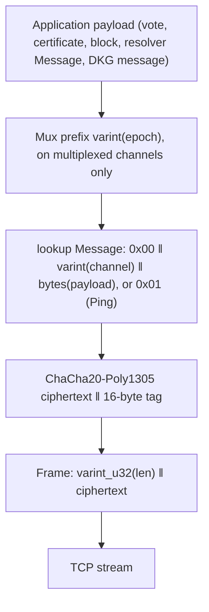
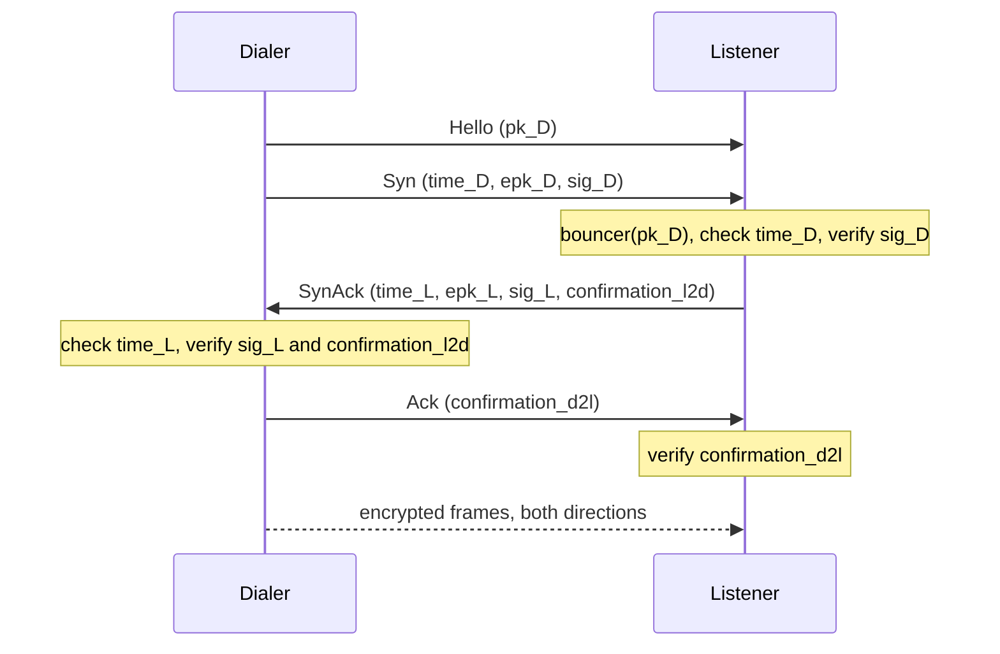

# Commonware validator network: encrypted stream, lookup network, mux, resolver and broadcast

This chapter specifies everything a Tempo validator sends and receives on the consensus network: the length-delimited framing, the authenticated key-exchange handshake, the encrypted transport, the authenticated `lookup` network that runs on top of it (message format, channels, connection management, peer sets, admission and rate limits), the epoch multiplexer, the resolver request/response protocol and the buffered broadcast engine. It restates the behaviour of commonware 2026.9.0 so that an implementation needs no commonware source.

What each Tempo channel carries, the Tempo parameter values and how Tempo derives its peer sets are in [08-p2p-and-sync.md](../08-p2p-and-sync.md). The payload formats carried on the channels are in [simplex.md](simplex.md) (votes, certificates), [dkg.md](dkg.md) (DKG messages) and 08-p2p-and-sync.md (blocks, marshal keys). Ed25519 and the BLAKE3 transcript are specified in [cryptography.md](cryptography.md) (§3 and §7). The codec and the notation (`‖`, `varint`, `varint_u32`, `u64be`, `bytes(x)`, Decode versus Read) are those of [codec.md](codec.md).

The key words MUST, MUST NOT, SHOULD, SHOULD NOT and MAY are to be interpreted as in [RFC 2119](https://www.rfc-editor.org/rfc/rfc2119).

## 1. Scope and layering

Tempo uses one configuration of each component:

| Layer | Tempo configuration | Section |
|---|---|---|
| Transport | TCP over IPv4 or IPv6 | §6.6 |
| Framing | `varint_u32(len) ‖ payload` frames | §2 |
| Handshake | X25519 ephemeral key exchange, Ed25519 identities, BLAKE3 transcript (version V0) | §3, §4 |
| Encryption | ChaCha20-Poly1305 with counter nonces, one key per direction | §5 |
| Network | authenticated `lookup` network: peers and addresses supplied by the application, no discovery | §6 |
| Rate limiting | GCRA quotas per channel and per peer | §7 |
| Epoch multiplexing | varint sub-channel prefix | §8 |
| Fetching | resolver `Message` (request, response, error) | §9 |
| Block dissemination | buffered broadcast | §10 |

Layering on one connection, from the wire up:



The `lookup` network exchanges no peer lists, addresses or bit vectors: every node learns the identities and addresses of its peers from its own application (for Tempo, from finalized chain state, [08-p2p-and-sync.md §2.4](../08-p2p-and-sync.md#24-peer-set-derivation)). After the handshake, the only messages on a connection are `Data` and `Ping` (§6.1).

## 2. Framing

Every message on a connection, before and after the handshake, is one frame:

```
Frame := varint_u32(len(payload)) ‖ payload
```

`varint_u32` is the canonical unsigned LEB128 encoding of [codec.md](codec.md) §3: at most 5 bytes, no value above `2^32 − 1`, and no zero byte after the first byte (no overlong form). A receiver MUST reject the connection when the length prefix is not a canonical `u32` varint.

Each frame has a maximum payload length `max`, fixed per frame type (§4.2 for handshake frames, §5.3 for encrypted frames). A receiver MUST read the length prefix, MUST close the connection without reading the payload when the length exceeds `max`, and otherwise reads exactly `len` payload bytes. A sender MUST NOT send a frame longer than the receiver's `max`.

Frames carry no type tag: their meaning comes from their position in the connection (§4.3) and, after the handshake, from the decrypted content (§6.1).

## 3. Transcript

The handshake derives its signatures, confirmations and keys from the BLAKE3 transcript of [cryptography.md §7](cryptography.md#7-transcript), always with version V0. This chapter uses its operations `new`, `commit`, `summarize`, `fork` and `noise` ([cryptography.md §7.2](cryptography.md#72-operations)); `noise(t, label, n)` denotes the first `n` bytes of the extendable output of `noise(t, label)`.

To **sign a transcript** with an Ed25519 key is to sign the 33-byte message `0x00 ‖ summarize(t)`, and to **verify a transcript signature** is to verify the same 33 bytes under [cryptography.md §3.4](cryptography.md#34-ed25519-verification) (ZIP-215). These are `sign_summary` and `verify_summary` of [cryptography.md §7.4](cryptography.md#74-signing-a-summary).

V0 framing is unambiguous for the handshake because every handshake history has a fixed packet count and order and every packet after the namespace has a fixed length.

## 4. Encrypted stream handshake

### 4.1 Roles, identities and namespace

The **dialer** opens the TCP connection; the **listener** accepts it. Each side has a static Ed25519 key pair (its identity, 32-byte public key, 64-byte signatures; [cryptography.md §3](cryptography.md#3-ed25519)). The dialer knows the listener's public key before it connects. The listener learns the dialer's public key from the first frame and decides whether to continue.

Both sides use the *stream namespace*:

```
stream_namespace = network_namespace ‖ b"_STREAM"
```

For Tempo, `network_namespace = union_unique(b"TEMPO", b"_P2P") = 0x05 ‖ b"TEMPO" ‖ b"_P2P"` ([codec.md §7.2](codec.md#72-union_unique)), so

```
stream_namespace = 05 54 45 4d 50 4f 5f 50 32 50 5f 53 54 52 45 41 4d     (17 bytes)
```

The handshake transcript starts as

```
T0 = fork(new(stream_namespace), b"_COMMONWARE_CRYPTOGRAPHY_HANDSHAKE")
```

Peers with different namespaces derive different transcripts, so their signatures and confirmations never verify.

Constants:

| Label | Bytes |
|---|---|
| Handshake label | `b"_COMMONWARE_CRYPTOGRAPHY_HANDSHAKE"` (34 bytes) |
| Listener-to-dialer cipher | `b"cipher_l2d"` |
| Dialer-to-listener cipher | `b"cipher_d2l"` |
| Listener-to-dialer confirmation | `b"confirmation_l2d"` |
| Dialer-to-listener confirmation | `b"confirmation_d2l"` |

### 4.2 Handshake messages

All integers are big-endian. `time_ms` is the sender's wall-clock time in milliseconds since the Unix epoch. `epk` is an X25519 public key ([RFC 7748](https://www.rfc-editor.org/rfc/rfc7748) §5, the 32-byte u-coordinate). `sig` is an Ed25519 signature (64 bytes). `confirmation` is a 32-byte transcript summary.

| Frame | Sender | Layout | Size (= frame `max`) |
|---|---|---|---|
| `Hello` | dialer | `pk_D[32]`: the dialer's Ed25519 public key | 32 |
| `Syn` | dialer | `u64be(time_ms) ‖ epk_D[32] ‖ sig_D[64]` | 104 |
| `SynAck` | listener | `u64be(time_ms) ‖ epk_L[32] ‖ sig_L[64] ‖ confirmation_l2d[32]` | 136 |
| `Ack` | dialer | `confirmation_d2l[32]` | 32 |

Each handshake frame's `max` is its exact size. A receiver MUST close the connection when a handshake frame's length prefix exceeds that size, and MUST Decode the payload exactly: a payload shorter than the size, or a `Hello` that is not a valid Ed25519 public key encoding ([cryptography.md §3.2](cryptography.md#32-public-key-decoding)) fails the handshake. Any 64 bytes decode as a signature; verification checks them. `epk` accepts any 32 bytes (RFC 7748 decoding, which ignores the most significant bit).

### 4.3 Procedure

The dialer sends `Hello` and `Syn` back to back without waiting. Then the listener answers `SynAck` and the dialer answers `Ack`.



Let `window(now) = [now − max_handshake_age, now + synchrony_bound)` in milliseconds, half-open (the lower end saturates at 0). Tempo's defaults are `max_handshake_age = 10 s` and `synchrony_bound = 5 s`.

Dialer:

```python
def dial(sk_D, pk_D, pk_L):                       # pk_L: the identity the dialer expects
    send_frame(pk_D)                              # Hello
    now = time_ms()
    ok = window(now)
    esk_D = random_x25519_secret()                # 32 fresh random bytes (RFC 7748)
    epk_D = X25519(esk_D, 9)
    t = T0
    commit(t, u64be(now)); commit(t, pk_L); commit(t, epk_D)
    sig_D = ed25519_sign(sk_D, 0x00 ‖ summarize(t))
    commit(t, pk_D)
    send_frame(u64be(now) ‖ epk_D ‖ sig_D)        # Syn

    time_L, epk_L, sig_L, conf_l2d = recv_frame(max=136)     # SynAck
    require time_L in ok
    commit(t, u64be(time_L)); commit(t, epk_L)
    require ed25519_verify(pk_L, 0x00 ‖ summarize(t), sig_L)
    shared = X25519(esk_D, epk_L)
    require shared != 32 zero bytes               # non-contributory exchange
    commit(t, shared)
    k_recv = noise(t, b"cipher_l2d", 32)
    k_send = noise(t, b"cipher_d2l", 32)
    require conf_l2d == summarize(fork(t, b"confirmation_l2d"))
    send_frame(summarize(fork(t, b"confirmation_d2l")))      # Ack
    return k_send, k_recv
```

Listener:

```python
def listen(sk_L, pk_L, bouncer):
    pk_D = recv_frame(max=32)                     # Hello; MUST decode as an Ed25519 public key
    require bouncer(pk_D)                         # admission decision (§6.5); else close
    time_D, epk_D, sig_D = recv_frame(max=104)    # Syn
    now = time_ms()
    require time_D in window(now)
    t = T0
    commit(t, u64be(time_D)); commit(t, pk_L); commit(t, epk_D)
    require ed25519_verify(pk_D, 0x00 ‖ summarize(t), sig_D)
    esk_L = random_x25519_secret()
    epk_L = X25519(esk_L, 9)
    commit(t, pk_D); commit(t, u64be(now)); commit(t, epk_L)
    sig_L = ed25519_sign(sk_L, 0x00 ‖ summarize(t))
    shared = X25519(esk_L, epk_D)
    require shared != 32 zero bytes
    commit(t, shared)
    k_send = noise(t, b"cipher_l2d", 32)
    k_recv = noise(t, b"cipher_d2l", 32)
    conf_l2d = summarize(fork(t, b"confirmation_l2d"))
    conf_d2l = summarize(fork(t, b"confirmation_d2l"))
    send_frame(u64be(now) ‖ epk_L ‖ sig_L ‖ conf_l2d)        # SynAck
    require recv_frame(max=32) == conf_d2l                    # Ack
    return pk_D, k_send, k_recv
```

Both sides commit the same packets in the same order: `time_D`, `pk_L`, `epk_D`, `pk_D`, `time_L`, `epk_L`, `shared`. The dialer's signature covers the first three; the listener's covers the first six; the keys and confirmations cover all seven. So the `SynAck` is bound to the dialer's `Syn`, and the `Ack` to the whole handshake.

Rules:

1. The dialer MUST fail the handshake when the `SynAck` signature does not verify under the public key it dialed. This is how the dialer authenticates the listener.
2. The listener MUST evaluate its admission decision (`bouncer`, §6.5) after reading `Hello` and before reading `Syn`. When it rejects, it closes the connection without sending anything.
3. Any `require` failure, decoding failure, oversized frame, closed connection or timeout fails the handshake. On failure a party closes the TCP connection and sends nothing further. The protocol has no error message.
4. The whole handshake, from the start of `dial` or `listen` to the last frame, MUST complete within `handshake_timeout` (Tempo default 5 s); a party closes the connection when it expires.
5. Ephemeral X25519 secrets MUST be fresh random values for every handshake and MUST NOT be reused.
6. The X25519 function and its key decoding are those of RFC 7748 §5 (clamping of the secret scalar, masking of the top bit of the u-coordinate). The all-zero check on `shared` is the "non-contributory" check RFC 7748 §6.1 describes; it rejects low-order points.

A handshake gives mutual authentication (each side signs with its static key), forward secrecy (the keys come from ephemeral X25519), and freshness within the timestamp window. It does not hide identities from observers, does not pad messages and has no session resumption.

## 5. Encrypted transport

### 5.1 Ciphers

After the handshake each side holds two keys:

| Key | Dialer use | Listener use |
|---|---|---|
| `noise(t, b"cipher_d2l", 32)` | send | receive |
| `noise(t, b"cipher_l2d", 32)` | receive | send |

Each key is a ChaCha20-Poly1305 key ([RFC 8439](https://www.rfc-editor.org/rfc/rfc8439) §2.8) with empty associated data and a 16-byte tag.

### 5.2 Nonces

Each direction has its own 96-bit message counter, starting at 0 when the handshake completes. The nonce of message number `n` (counting from 0) is the 12-byte little-endian encoding of `n`:

```
nonce(n) = n.to_bytes(12, "little")       # nonce(0) = 00…00, nonce(1) = 01 00 … 00
```

The sender increments its counter for every message it encrypts. The receiver increments its counter for every frame it attempts to decrypt, whether or not decryption succeeds. Nonces are never transmitted. When a counter would reach `2^96`, the party MUST close the connection instead of reusing a nonce.

### 5.3 Encrypted frames

Each message after the handshake is one frame (§2) whose payload is

```
ciphertext ‖ tag = ChaCha20-Poly1305-Seal(key, nonce(n), aad = "", plaintext)
```

so `len(payload) = len(plaintext) + 16`. The plaintext is one network message (§6.1).

Let `max_frame = max_message_size + 16` be the maximum plaintext length, where `max_message_size` is the network's application payload limit (Tempo default 8,388,608 bytes, [08-p2p-and-sync.md §3.4](../08-p2p-and-sync.md#34-message-size-limits)) and 16 is the network message overhead bound (§6.1). The encrypted frame's `max` is `max_frame + 16`:

| Quantity | Formula | Tempo default |
|---|---|---|
| Largest application payload a sender may submit | `max_message_size` | 8,388,608 |
| Largest network-message plaintext | `max_frame = max_message_size + 16` | 8,388,624 |
| Largest encrypted frame payload | `max_frame + 16` | 8,388,640 |

A receiver MUST close the connection when an encrypted frame's length prefix exceeds `max_frame + 16`, when the payload is shorter than 16 bytes, or when decryption fails. Encrypted frames are processed strictly in order; there is no reordering or retransmission at this layer.

A sender MAY write several encrypted frames in one TCP write. Each frame is still encrypted independently with the next nonce.

## 6. Authenticated lookup network

### 6.1 Network messages

Every plaintext of an encrypted frame is exactly one `Message`:

| Tag | Message | Layout after the tag |
|---|---|---|
| `0x00` | `Data` | `varint(channel) ‖ varint_u32(len(payload)) ‖ payload` |
| `0x01` | `Ping` | nothing |

`channel` is a `u64` channel identifier. `payload` is the application message for that channel. The overhead of a `Data` message over its payload is at most `1 + 10 + 5 = 16` bytes (tag, `u64` varint, `u32` varint).

A receiver MUST Decode the plaintext as one `Message` ([codec.md](codec.md) §11): the tag MUST be `0x00` or `0x01`, the varints MUST be canonical, the payload length MUST equal the number of remaining bytes, and a `Ping` MUST be exactly the single byte `0x01`. On any decoding failure the receiver MUST close the connection. A `Data` message whose `channel` the receiver has not registered also closes the connection (§6.3).

Example: `Data` on channel 3 with payload `be ef` is `00 03 02 be ef`; `Ping` is `01`.

### 6.2 Sending

A node keeps, per connected peer, two outbound queues: *high priority* and *low priority*. The application submits each message with a `priority` flag and a recipient set:

- `One(pk)` or `Some([pk, …])`: the listed peers that are currently connected. A listed peer that is not connected is skipped silently.
- `All`: every currently connected peer, whether it is in a primary or a secondary set (§6.5).

Before a message is queued, the sending node applies its outbound quota for the channel (§7.2) and its size limit: an application payload larger than `max_message_size` MUST NOT be sent. (The Tempo node drops such a message and counts it; [08-p2p-and-sync.md §3.4](../08-p2p-and-sync.md#34-message-size-limits).) A message that does not fit in a full queue is dropped. Delivery is best effort: there are no acknowledgements at this layer.

The per-peer sender loop:

```python
deadline = now() + ping_frequency
loop:
    wait until deadline, or until a message is available in a queue
    batch = []
    if deadline reached:
        batch.append(Ping)
    while len(batch) < send_batch_size:             # Tempo: 8
        msg = pop(high) or pop(low)                  # high priority first
        if msg is None: break
        batch.append(msg)
    encrypt and write each message of batch as its own frame, in order
    if deadline reached:
        deadline = now() + ping_frequency            # Tempo default 50 s
```

A node sends a `Ping` every `ping_frequency` whether or not it sends data; data traffic does not postpone pings. Pings keep idle TCP connections alive and let the sender detect a broken connection when a write fails. A node does not reply to a `Ping` and has no idle-read timeout: a connection stays open until a write or read fails, the peer is killed (§6.5), or the node shuts down.

Priority only orders a node's own outbound queues. It is not on the wire and gives the receiver no obligation.

### 6.3 Receiving

The per-peer receiver loop processes frames in order:

```python
loop:
    frame = recv_frame(max = max_frame + 16)          # §5.3
    plaintext = decrypt(frame)                         # failure: close
    msg = decode_message(plaintext)                    # §6.1; failure: close
    if msg is Data:
        if msg.channel not registered: close
        limiter = inbound_quota[msg.channel]           # per peer, per channel (§7.2)
    else:
        limiter = ping_quota                           # per peer
    if not limiter.allow(now()):
        sleep until limiter allows                     # back-pressure: stops reading this connection
    if msg is Data:
        enqueue (peer_pk, msg.payload) on the channel's inbound queue; drop it if the queue is full
```

Rules that affect interoperability:

1. **Inbound quota delays, it does not drop.** When a peer exceeds a channel's quota, the receiver stops reading from that connection until the quota allows the message, then delivers it. While it waits it reads nothing else from that peer, on any channel. A peer that keeps sending above quota therefore sees its TCP window fill and its own sends stall.
2. **Ping quota.** Inbound `Ping`s are limited to one per `max(ping_frequency / 2, 1 ns)` (burst 1); with Tempo's 50 s ping frequency, one per 25 s. A node MUST NOT send `Ping`s more often than that, or the receiver delays reading its connection.
3. **Unknown channel.** A `Data` message on a channel the receiver has not registered closes the connection. All Tempo validators register the same channels (0 to 5, [08-p2p-and-sync.md §3.1](../08-p2p-and-sync.md#31-channel-map)), so a node MUST NOT send on any other channel.
4. **Shared inbound queue.** Each channel has one inbound queue shared by all peers, with capacity `max_peers_per_set × tracked_peer_sets × burst(channel quota)` (Tempo: `128 × 1 × 128 = 16,384` for the 128/s channels). A message that arrives while the queue is full is dropped; queued messages stay.
5. **No payload inspection.** The network does not interpret `payload`. It tags each delivered payload with the authenticated public key of the connection it came from. Higher layers MUST attribute messages to that key, never to identities claimed inside payloads.
6. **Size.** The network accepts any `Data` that fits in an encrypted frame (§5.3), which allows payloads slightly above `max_message_size`; a conforming sender never sends them.

Closing the connection after a decryption, decoding or unknown-channel error does not block the peer (§6.7); it may reconnect after the cooldown of §6.5.

### 6.4 Channels

A channel is a `u64` identifier with an inbound and outbound quota (§7). Each node registers its channels before starting the network; channels are not negotiated. Payload formats are per channel and are defined by the application. Tempo's channels:

| Id | Name | Quota per peer | Multiplexed (§8) | Payload |
|---|---|---|---|---|
| 0 | votes | 128/s | yes | Simplex `Vote` ([simplex.md](simplex.md)) |
| 1 | certificates | 128/s | yes | Simplex `Certificate` ([simplex.md](simplex.md)) |
| 2 | simplex resolver | 128/s | yes | resolver `Message` with a view key (§9) |
| 3 | block broadcast | 8/s | no | buffered broadcast of blocks (§10) |
| 4 | marshal backfill | default 8/s | no | resolver `Message` with a marshal key (§9) |
| 5 | DKG | 128/s | yes | DKG message ([dkg.md](dkg.md)) |

Normative details and the Tempo-specific payloads are in [08-p2p-and-sync.md §3](../08-p2p-and-sync.md#3-consensus-channels).

### 6.5 Peer sets, admission and connections

#### 6.5.1 Peer sets

The application tells the network which peers it may talk to by *tracking* peer sets. A peer set has a `u64` index and two disjoint maps from Ed25519 public key to address:

- **primary** peers: the node dials them and accepts their connections;
- **secondary** peers: the node accepts their connections but never dials them.

A key listed in both maps is treated as primary. Tracking rules:

1. Indices MUST strictly increase. A set whose index is not greater than the latest tracked index is ignored.
2. The node retains the `tracked_peer_sets` most recent sets (Tempo: 1). Tracking a new set drops the oldest beyond that.
3. A set's size, counting primary and secondary keys plus the local key if absent, MUST NOT exceed `max_peers_per_set` (Tempo default 128). Tempo's node treats a larger set as a fatal error.
4. A peer is **eligible** when it is in a primary or secondary map of at least one retained set, is not the local node, and is not blocked (§6.7). A peer is a **dial target** when it is in a primary map of at least one retained set.
5. When tracking a set changes the address of a peer that is connected (or has a connection in progress), the node closes that connection. When dropping old sets leaves a connected peer ineligible, the node closes its connection.
6. *Overwrite* replaces addresses of already-known peers without creating a set; it closes the connections of peers whose address changed. Unknown keys are ignored.

Tempo derives its sets from finalized chain state and tracks a new set whenever membership changes ([08-p2p-and-sync.md §2.4](../08-p2p-and-sync.md#24-peer-set-derivation)).

#### 6.5.2 Addresses

A peer's address has an *ingress*, where the node dials it, and an *egress IP*, the source address its outbound connections come from:

| Address form | Ingress | Egress IP |
|---|---|---|
| `Symmetric(socket)` | `socket` | `socket.ip` |
| `Asymmetric{ingress, egress}` | `ingress`: a socket address or a DNS name and port | `egress.ip` |

Tempo builds `Asymmetric{ingress: socket, egress: (ip, 0)}` from ValidatorConfigV2 ([08-p2p-and-sync.md §2.3](../08-p2p-and-sync.md#23-peer-addresses-and-admission)); its ingress is always a literal socket address. Addresses are local state and never sent on the wire.

An IP address is **global** unless it is in one of these ranges (the standard library's "globally reachable" definition):

- IPv4: `0.0.0.0/8`, private (`10/8`, `172.16/12`, `192.168/16`), shared `100.64/10`, loopback `127/8`, link-local `169.254/16`, `192.0.0.0/24` except `192.0.0.9` and `192.0.0.10`, documentation (`192.0.2/24`, `198.51.100/24`, `203.0.113/24`), benchmarking `198.18/15`, reserved `240/4`, broadcast `255.255.255.255`;
- IPv6: `::`, `::1`, IPv4-mapped `::ffff:0:0/96`, `64:ff9b:1::/48`, `100::/64`, `2001::/23` except `2001:1::1`, `2001:1::2`, `2001:3::/32`, `2001:4:112::/48` and `2001:20::/28` and `2001:30::/28` (second segment `0x20` to `0x3f`), `2002::/16`, documentation `2001:db8::/32`, unique local `fc00::/7`, link-local `fe80::/10`.

Unless `allow_private_ips` is set (Tempo: false), a node MUST NOT dial a non-global address and MUST reject connections from non-global source addresses.

#### 6.5.3 Connection slots

A node keeps at most one connection per peer. Each known peer has a status, `Inert`, `Reserved` (a dial or an inbound handshake is in progress) or `Active` (connected), and a time `next_reservable_at` (initially the Unix epoch).

```python
def reserve(peer):                                  # used by both dialing and accepting
    if not eligible(peer) or peer.status != Inert:
        return None
    if now() < peer.next_reservable_at:
        return None                                 # cooldown
    peer.status = Reserved
    peer.next_reservable_at = now() + peer_connection_cooldown            # Tempo default 60 s
    peer.next_dial_at = peer.next_reservable_at + uniform(0, peer_connection_cooldown)
    return reservation

def connect(peer):                                  # after a successful handshake
    if not eligible(peer) or peer.address changed since reserve:
        close the connection; release(peer)
    else:
        peer.status = Active

def release(peer):                                  # connection closed or attempt failed
    peer.status = Inert
```

Consequences for interoperability:

- A node accepts an inbound handshake from a peer only while that peer is `Inert`. If both nodes dial each other at the same time, each rejects the other's inbound connection and both attempts fail; the random `next_dial_at` spreads the next attempts so one of them eventually connects.
- After any connection attempt or connection to a peer ends, neither side can reserve that peer again until `peer_connection_cooldown` after the previous reservation. An inbound handshake that completes inside the cooldown is closed right after it completes.

#### 6.5.4 Accepting connections

When a TCP connection arrives from `source`, the listener checks, in order, before reading any byte:

1. If `allow_private_ips` is false and `source.ip` is not global: close.
2. If `bypass_ip_check` is false (Tempo: false) and `source.ip` is not the egress IP of some eligible peer: close. (A blocked peer's egress IP no longer counts, unless another eligible peer shares it.)
3. Per-IP and per-subnet handshake quotas (§7.1): the connection consumes one cell from the quota of `source.ip` and one from the quota of its subnet (`/24` for IPv4, `/48` for IPv6; an IPv4-mapped IPv6 address uses its IPv4 `/24`). If either quota is exhausted: close. Tempo defaults: one per 5 s per IP, one per 15 ms per subnet.
4. If `max_concurrent_handshakes` (Tempo default 512) handshakes are in progress: close.

`source.ip` is the address exactly as the listening socket reports it, with no conversion. In steps 1 and 2, in the per-IP quota of step 3 and in the bouncer, an IPv4-mapped IPv6 source (`::ffff:a.b.c.d`) is an IPv6 address: it is not global, so step 1 closes it unless `allow_private_ips` is set, and it never equals a registered IPv4 egress, so step 2 and the bouncer reject it. Only the subnet quota maps it to its IPv4 `/24`. A node that accepts IPv4 peers MUST therefore listen so that their connections are reported as IPv4 sources (an IPv4 socket, or an IPv6-only socket beside an IPv4 one), not on a dual-stack IPv6 socket.

Then the listener runs the handshake of §4.3 with this bouncer:

```python
def bouncer(pk_D):                 # pk_D from the Hello frame
    return not blocked(pk_D) and eligible(pk_D) and pk_D.status == Inert \
           and (bypass_ip_check or egress_ip(pk_D) == source.ip)
```

After the handshake succeeds, the listener calls `reserve(pk_D)` (which re-checks the bouncer conditions and the cooldown), closes the connection if that fails, and otherwise starts the peer's send and receive loops and calls `connect`.

#### 6.5.5 Dialing

Every `dial_frequency` (Tempo default 1 s) the dialer may start one dial:

```python
def dial_tick():
    if queue is empty:
        queue = shuffle([p for p in dial_targets
                         if p.status == Inert and not blocked(p)
                         and ingress_valid(p) and p.next_dial_at <= now()])
    while queue:
        p = queue.pop()
        r = reserve(p)
        if r is None: continue
        start dial(p) in the background
        break
```

`ingress_valid` requires a global ingress IP unless `allow_private_ips`, or, for a DNS ingress, `allow_dns`. A DNS ingress resolves to addresses, filtered to global ones unless `allow_private_ips`, and one is picked at random. The dialer opens a TCP connection and runs the dialer side of §4.3 with the peer's public key; on success it calls `connect`. The TCP connect and handshake together MUST finish within `dial_timeout` (Tempo default 15 s), and the handshake alone within `handshake_timeout`.

When there is nothing to dial, the next query happens at the earliest `next_dial_at` or block expiry, clamped between `dial_frequency` and `peer_connection_cooldown`.

The shuffle defeats address poisoning: a peer that registers another peer's ingress makes dials to that address fail authentication, and a random order ensures the correct key is eventually tried before the listener's per-IP quota runs out.

### 6.6 Transport requirements

Connections are plain TCP. A node listens on one socket address (Tempo default `127.0.0.1:8000`; production nodes bind the port of their registered ingress). The listener applies no TLS and no other wrapping: the first bytes on the connection are the `Hello` frame.

### 6.7 Blocking

The application may *block* a peer it has caught misbehaving (an invalid signature, an undecodable payload on a channel whose format it knows, a resolver response that fails verification). Blocking:

1. marks the peer blocked until `now + block_duration` (Tempo default 4 h); blocking an already-blocked peer does not extend it, and the local node cannot be blocked;
2. closes the peer's connection;
3. removes the peer's egress IP from the accepted source addresses (unless another eligible peer uses it), makes the bouncer reject the peer, and stops dialing it.

When the block expires the peer becomes eligible again with no other change. Blocks are local; nothing is sent to the blocked peer.

## 7. Rate limiting

### 7.1 Quotas

A *quota* is a rate `r` with a burst `b`, enforced with the Generic Cell Rate Algorithm (GCRA, equivalent to a token bucket of capacity `b` that gains one token every `T = 1/r`). Two forms appear:

| Form | Burst `b` | Replenish interval `T` |
|---|---|---|
| `per_second(n)` | `n` | `1 s / n` |
| `with_period(d)` | 1 | `d` |

```python
# GCRA state per key: tat (theoretical arrival time), initially 0
def allow(key, now):
    tat = max(state[key], now)
    if tat - now > (b - 1) * T:          # more than b-1 cells in flight
        return False, tat - (b - 1) * T  # earliest time a cell is allowed
    state[key] = tat + T
    return True
```

### 7.2 Channel quotas

Each channel's quota (Tempo values in §6.4) applies independently:

- **Inbound**, per sending peer: the receiver delays reading (§6.3 rule 1).
- **Outbound**, per recipient: before submitting a message, the sender checks the recipient's quota for that channel. For `One(pk)`, the send is refused when `pk` is over quota. For `Some` and `All`, recipients over quota are removed from the recipient set, and the send is refused only when all of them are over quota. The application learns the earliest time the send would be allowed and decides whether to retry or drop. A message that passes the check consumes one cell for each remaining recipient, even if the recipient is not connected.

A conforming node SHOULD NOT send above its peers' quotas: messages above them stall its connection (inbound rule) rather than being dropped. Every sub-channel of a multiplexed channel (§8) shares the channel's quota.

### 7.3 Handshake limits

| Limit | Scope | Tempo default |
|---|---|---|
| `allowed_handshake_rate_per_ip` | inbound connections per source IP | `with_period(5 s)` |
| `allowed_handshake_rate_per_subnet` | inbound connections per `/24` or `/48` | `with_period(15 ms)` |
| `max_concurrent_handshakes` | inbound handshakes in progress | 512 |
| `peer_connection_cooldown` | reservations per peer, both directions | 60 s |

These limits are local policy, but they determine how fast an honest dialer can reconnect: a dialer SHOULD NOT dial the same listener from the same IP more often than once per 5 s, and SHOULD expect a peer to refuse a new connection within 60 s of the previous attempt.

## 8. Epoch multiplexer

A multiplexer splits one channel into sub-channels identified by a `u64`. Tempo uses the epoch as the sub-channel on channels 0, 1, 2 and 5.

```
MuxedPayload := varint(subchannel) ‖ inner_payload
```

Sending prepends `varint(subchannel)` to the inner payload; the result is the channel payload, so the size limit of §6.2 applies to the whole `MuxedPayload`, prefix included. Receiving:

```python
def on_channel_message(peer_pk, payload):
    try:
        subchannel, inner = read_varint_u64(payload), rest
    except InvalidVarint:
        return                                     # drop; the connection stays open
    route = routes.get(subchannel)
    if route is None:
        if backup is configured: backup.try_push(subchannel, peer_pk, inner)   # drop if full
        return                                     # otherwise drop
    route.try_push(peer_pk, inner)                 # drop if the sub-channel queue is full
```

`read_varint_u64` Reads (not Decodes) a canonical `u64` varint from the start of the payload ([codec.md](codec.md) §3, §11); the inner payload is everything after it and is decoded by the sub-channel's consumer. A sub-channel is registered and deregistered locally; registration is not signalled to peers. Messages for a sub-channel that is not registered are dropped, or handed to a backup handler when one is configured (Tempo configures one only on channel 0; [08-p2p-and-sync.md §3.2](../08-p2p-and-sync.md#32-epoch-multiplexing)).

Example: a vote for epoch 7 is `07 ‖ enc(vote)` as the channel-0 payload, and on the wire the network message is `00 00 varint_u32(1 + len(enc(vote))) 07 ‖ enc(vote)`.

## 9. Resolver protocol

The resolver fetches values identified by fixed-length keys from peers. Tempo runs two resolver instances: the Simplex resolver on channel 2 (keys are views) and the marshal resolver on channel 4 (keys are blocks, heights and rounds). Each instance has its own key type; the message format is the same.

### 9.1 Message

```
Message := u64be(id) ‖ Payload
Payload := 0x00 ‖ enc(key)          ; Request
         | 0x01 ‖ bytes(value)      ; Response
         | 0x02                     ; Error
```

- `id` is a fixed 8-byte big-endian integer, not a varint.
- `enc(key)` is the instance's key encoding. Keys have a fixed or self-delimiting encoding: the Simplex resolver key is `u64be(view)` (8 bytes); marshal keys are in [08-p2p-and-sync.md §3.3.5](../08-p2p-and-sync.md#335-channel-4-marshal-backfill).
- `bytes(value)` is `varint_u32(len(value)) ‖ value` with no length bound other than the frame size.

A receiver MUST Decode the channel payload as one `Message` (tag in `{0x00, 0x01, 0x02}`, key valid for the instance, no trailing bytes). A payload that fails to decode is dropped; the connection stays open and the peer is not blocked.

Examples (Simplex resolver, `id = 1`, view 5):

| Message | Bytes |
|---|---|
| Request | `00 00 00 00 00 00 00 01 00 00 00 00 00 00 00 00 05` |
| Response with value `ab cd` | `00 00 00 00 00 00 00 01 01 02 ab cd` |
| Error | `00 00 00 00 00 00 00 01 02` |

### 9.2 Requester

```python
next_id = 0                                         # per resolver instance; wraps at 2^64

def try_fetch(key):
    peers = [p for p in candidate_peers()           # see below
             if p != self and not blocked(p) and (key has no targets or p in targets(key))]
    if key is a retry: shuffle(peers)
    for p in peers:
        if outbound quota of p is exhausted: continue       # §7.2
        id = next_id; next_id = (next_id + 1) % 2**64
        if send(One(p), Message(id, Request(key)), priority=priority_requests) accepted:
            active[id] = (key, p, deadline = now() + timeout)
            return
    schedule another attempt                          # at the earliest quota time, or after retry_timeout

on Response(id, value) from peer q:
    if active.get(id) is None or active[id].peer != q: ignore
    (key, _, _) = active.pop(id)
    verdict = consumer.validate(key, value)
    if verdict == valid:      deliver and finish the fetch
    elif verdict == invalid:  block(q) (§6.7); retry key after retry_timeout
    elif verdict == ambiguous: retry key after retry_timeout, without penalty
    elif verdict == ignored:  finish the fetch, no longer needed

on Error(id) from peer q:
    if active.get(id) is None or active[id].peer != q: ignore
    retry key after retry_timeout

on deadline of active[id]:
    remove it; retry key after retry_timeout
```

Rules:

1. A requester has at most one request in flight per key. Each request goes to one peer.
2. A requester MUST accept a `Response` or `Error` only from the peer it sent the request with that `id` to, and only while that request is active. Responses with unknown `id`s, from other peers, or after the timeout are ignored. A late response does not penalize the peer.
3. Request ids are local to the requester; responders treat them as opaque and echo them.
4. A requester MUST verify every value before use. The validity rules are per key type: Simplex certificates ([simplex.md](simplex.md)) and marshal values ([08-p2p-and-sync.md §3.3.5](../08-p2p-and-sync.md#335-channel-4-marshal-backfill)). An invalid value MUST NOT be used, and the requester blocks the responder (§6.7; the per-channel rules are in [08-p2p-and-sync.md §2.5](../08-p2p-and-sync.md#25-misbehaviour-and-blocking)).
5. Candidate peers: the Simplex resolver asks the participants of the Simplex instance's epoch; the marshal resolver asks the primary peers of the latest tracked peer set. Fresh keys are tried before retries.

Tempo parameters:

| Instance | `timeout` | `retry_timeout` | Requests sent with priority | Responses sent with priority |
|---|---|---|---|---|
| Simplex resolver (channel 2) | 2 s (`--consensus.wait-for-peer-response`) | 2 s | yes | no |
| Marshal resolver (channel 4) | 2 s | 100 ms | no | no |

### 9.3 Responder

```python
on Request(id, key) from peer q:            # from any connected peer, not only candidates
    value = producer.produce(key)            # asynchronous, e.g. from storage
    if value is available:
        send(One(q), Message(id, Response(value)), priority=priority_responses)
    else:
        send(One(q), Message(id, Error), priority=priority_responses)
```

A responder answers on the same channel with the same `id`, to the peer that asked. It SHOULD answer `Error` promptly when it doesn't have the value, so the requester moves on without waiting for its timeout. A responder MUST NOT send a `Response` it would itself reject as invalid. Responses are subject to the responder's outbound quota (§7.2); a response that the quota refuses is dropped and the requester times out.

## 10. Buffered broadcast

Channel 3 carries the buffered broadcast engine. It has one message type on the wire: the application value itself.

```
BroadcastMessage := enc(M)                 ; for Tempo, M is a block in its consensus encoding
```

There is no tag, request, acknowledgement or digest on the wire. Each value has a digest computed locally (for Tempo, the block hash, [08-p2p-and-sync.md §3.3.4](../08-p2p-and-sync.md#334-channel-3-block-broadcast)).

Sending: the node inserts the value into its own cache (keyed by its local public key) and sends `enc(M)` to the recipients with the engine's priority flag (Tempo: priority). Tempo sends only the leader's proposal, to `All`; Simplex block forwarding is disabled.

Receiving:

```python
def on_broadcast(peer_pk, payload):
    m = decode(M, payload)                     # Decode exactly; failure: drop, no block
    d = digest(m)
    for w in waiters.pop(d, []):               # local subscribers waiting for d
        w.deliver(m)                           # satisfied regardless of who sent it
    if peer_pk not in latest_primary_peers:
        return                                 # not cached
    dq = deque[peer_pk]                        # most recent first, capacity deque_size
    if d in dq:
        move d to the front of dq; return      # duplicate
    dq.push_front(d); refcount[d] += 1; store m if refcount[d] == 1
    if len(dq) > deque_size:                   # Tempo: 10
        e = dq.pop_back(); refcount[e] -= 1; forget e if refcount[e] == 0
```

When a peer leaves the latest primary set, its deque is discarded and values only it held are forgotten. Cached values serve local lookups by digest. The engine never sends a cached value in reply to anything: a node that missed a broadcast fetches the block with the marshal resolver (§9).

A value received on channel 3 has no authority. The receiver verifies it as its consumer requires (for Tempo, block decoding and the consensus checks of [08-p2p-and-sync.md](../08-p2p-and-sync.md) and [07-consensus.md](../07-consensus.md)).

## 11. Constants

| Constant | Value |
|---|---|
| Stream namespace suffix | `b"_STREAM"` |
| Tempo network namespace | `union_unique(b"TEMPO", b"_P2P")` = `05 54 45 4d 50 4f 5f 50 32 50` |
| Tempo stream namespace | `05 54 45 4d 50 4f 5f 50 32 50 5f 53 54 52 45 41 4d` |
| Handshake transcript label | `b"_COMMONWARE_CRYPTOGRAPHY_HANDSHAKE"` |
| Transcript version | V0; start tags `New = 0x00`, `Resume = 0x01`, `Fork = 0x02`, `Noise = 0x03` |
| Cipher labels | `b"cipher_l2d"`, `b"cipher_d2l"` |
| Confirmation labels | `b"confirmation_l2d"`, `b"confirmation_d2l"` |
| Handshake frame sizes | `Hello` 32, `Syn` 104, `SynAck` 136, `Ack` 32 |
| AEAD | ChaCha20-Poly1305, 32-byte key, 12-byte little-endian counter nonce, 16-byte tag, empty AAD |
| Nonce limit | `2^96` messages per direction |
| Network message tags | `Data = 0x00`, `Ping = 0x01` |
| Network message overhead bound | 16 bytes |
| Resolver payload tags | `Request = 0x00`, `Response = 0x01`, `Error = 0x02` |
| Handshake subnet mask | IPv4 `/24`, IPv6 `/48` |
| Ping inbound quota | one per `ping_frequency / 2`, burst 1 |

Tempo parameter defaults (local policy unless [08-p2p-and-sync.md §2.2](../08-p2p-and-sync.md#22-transport-and-handshake) says otherwise): `max_message_size` 8,388,608; `synchrony_bound` 5 s; `max_handshake_age` 10 s; `handshake_timeout` 5 s; `dial_timeout` 15 s; `dial_frequency` 1 s; `ping_frequency` 50 s; `peer_connection_cooldown` 60 s; `block_duration` 4 h; `send_batch_size` 8; `tracked_peer_sets` 1; `max_peers_per_set` 128; outbound queue capacity per peer and priority `--consensus.mailbox-size` (16,384).

## 12. Test vectors

### 12.1 Handshake

Inputs (Tempo stream namespace, §4.1):

| Input | Value |
|---|---|
| Dialer Ed25519 seed | `11` × 32 |
| Dialer public key `pk_D` | `d04ab232742bb4ab3a1368bd4615e4e6d0224ab71a016baf8520a332c9778737` |
| Listener Ed25519 seed | `22` × 32 |
| Listener public key `pk_L` | `a09aa5f47a6759802ff955f8dc2d2a14a5c99d23be97f864127ff9383455a4f0` |
| `time_D` | 1,700,000,000,000 ms (`0000018bcfe56800`) |
| `time_L` | 1,700,000,000,250 ms (`0000018bcfe568fa`) |
| Dialer X25519 secret `esk_D` | `a1` × 32 (before RFC 7748 clamping) |
| Listener X25519 secret `esk_L` | `b2` × 32 (before RFC 7748 clamping) |

Intermediate values:

| Value | Hex |
|---|---|
| `epk_D` | `c306fb0ef2bf8b7f93bad98155fa37daec74db0c4cbeda6c6f1dba9d36558252` |
| `epk_L` | `db48257e1237976a74ad8cfedca00213408fe89ac6251f1b930245f242b5c31a` |
| `summarize(T0)` | `6407c4013774af1a254f39a66e847e7b12c650a1ab55b8ce1804fe3e77b93ba8` |
| Summary signed by the dialer | `125a2e2c363e9521b7bb48f9c64877c7080f97f6e2d87b7a4ba728dc8166cf60` |
| Summary signed by the listener | `698004ec3fdad3a530d75bc73f7626271cf020bbd847a944d38a5c8b8ed6c65e` |
| `shared` | `9502af7a4b678841b839429623a09a23f6cc551836e48a52c0e4faf4b9d3b06e` |
| `cipher_l2d` key | `c82d65f82c8e2de4afc919c8f9d5c7fa4539d3c28e3c0bcccca653773093fbd6` |
| `cipher_d2l` key | `c629f52fb2cf61eb04341d95adf1fe8623c088a5a3755a82cad0f49bd1524787` |

Frame payloads (each frame on the wire is `varint_u32(len) ‖ payload`: prefix `20` for 32 bytes, `68` for 104, `88 01` for 136):

```
Hello  = d04ab232742bb4ab3a1368bd4615e4e6d0224ab71a016baf8520a332c9778737

Syn    = 0000018bcfe56800c306fb0ef2bf8b7f93bad98155fa37daec74db0c4cbeda6c6f1dba9d36558252ab83480e6991dabce46f2d6323c8ea20363da174e414bddd65073782afa7a9a677b41042b320af1efa5fc4813779aa6202322971fd00ad84b558fb024e008c09

SynAck = 0000018bcfe568fadb48257e1237976a74ad8cfedca00213408fe89ac6251f1b930245f242b5c31ac9dc0766731652a47be7bc38f9e30b0d4b08a966aa95df9b2bd206ec950ae67989437c63ec00b59b0dcf42780bc739cf5109212c8de9665bae4e13e489d3e706d2d1bfd938c913e1737a5079d41465e7fa7705e5b1af47978accd415a2e33b08

Ack    = 345426b78da9bf56b93ad342b814d01551d1d258e11bfcc36950bd79e670262d
```

Field by field:

| Field | Hex |
|---|---|
| `Syn.time_ms` | `0000018bcfe56800` |
| `Syn.epk` | `c306fb0ef2bf8b7f93bad98155fa37daec74db0c4cbeda6c6f1dba9d36558252` |
| `Syn.sig` | `ab83480e6991dabce46f2d6323c8ea20363da174e414bddd65073782afa7a9a677b41042b320af1efa5fc4813779aa6202322971fd00ad84b558fb024e008c09` |
| `SynAck.time_ms` | `0000018bcfe568fa` |
| `SynAck.epk` | `db48257e1237976a74ad8cfedca00213408fe89ac6251f1b930245f242b5c31a` |
| `SynAck.sig` | `c9dc0766731652a47be7bc38f9e30b0d4b08a966aa95df9b2bd206ec950ae67989437c63ec00b59b0dcf42780bc739cf5109212c8de9665bae4e13e489d3e706` |
| `SynAck.confirmation` | `d2d1bfd938c913e1737a5079d41465e7fa7705e5b1af47978accd415a2e33b08` |

### 12.2 Encrypted messages

With the keys of §12.1:

| Direction, message number | Plaintext | Encrypted frame payload (ciphertext ‖ tag) |
|---|---|---|
| dialer → listener, 0 | `01` (`Ping`) | `9db55d8cda85de562c9e4e81f46204f2c7` |
| dialer → listener, 1 | `00 03 02 be ef` (`Data`, channel 3) | `19f0b1bdc230119a8c749b4349cb3d329fd0d4e76e` |
| listener → dialer, 0 | `01` (`Ping`) | `67cac38b9d7e95ebe32b7fd0203d91fbdc` |

The first frame on the wire is `11 9db55d8cda85de562c9e4e81f46204f2c7` (length 17).
