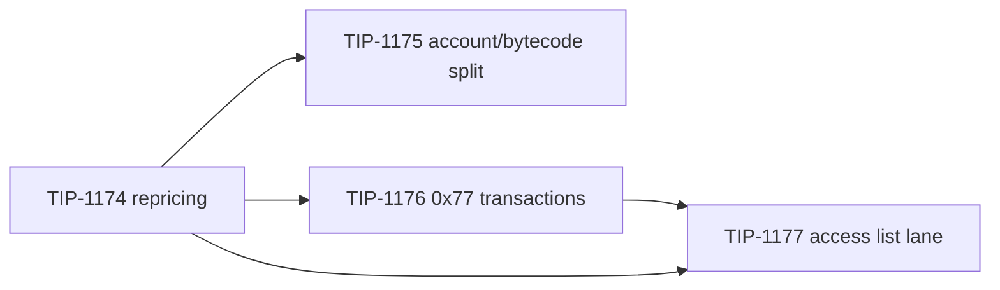

# TIP-1139: State Access Pricing and Access List Lane (Meta)

## Abstract

This meta-TIP binds four TIPs that together make state access declared,
prefetchable, and priced by what it costs: lane-split repricing, separate
account and bytecode pricing, extended access list transactions, and an access
list lane. It specifies no rules of its own. It states the shared goal, the
dependencies between the components, which combinations may activate together,
and the end state they reach.

## Motivation

Contract throughput is limited by state lookups that cannot start until
execution reaches them, and Tempo's state will grow quickly. If transactions
declare their resources in advance, clients can fetch them in parallel before
execution. Transaction-level declarations also work with multiple concurrent
proposers, where a block-level access list is unknown until the block has
executed.

The work was first specified as one TIP. It is split so that each part can be
reviewed, implemented, and scheduled on its own: the first three can be built in
parallel, and the lane needs block building and wallet support before it is
useful.

The prices are transitional. Tempo state is currently small, so they set
incentives for migrating to declared access rather than covering worst-case
database cost. Later TIPs should state a target for worst-case undeclared
lookups per block and derive prices from it.

## Components

| TIP | Title | What it does |
| --- | --- | --- |
| [TIP-1174](./tip-1174.md) | Lane-Split State Access Repricing | Declared and general-lane undeclared prices, payment lane inference, legacy access list read sets, refunds and storage credits |
| [TIP-1175](./tip-1175.md) | Separate Account and Bytecode Load Pricing | Code component only when an account has code; code-hash declarations |
| [TIP-1176](./tip-1176.md) | Extended Access List Transactions | Type `0x77` with read/write declarations; prefetch of state and write-set trie paths |
| [TIP-1177](./tip-1177.md) | Access List Lane | 100M access list lane, 10× undeclared prices there, general lane and transaction cap to 2^24 |

## Dependencies

An arrow means the target activates in the same or a later hardfork than its
source. Implementation of all four can proceed in parallel.

- **TIP-1174** depends only on TIP-1016 and TIP-1060.
- **TIP-1175** refines TIP-1174's code-load rule. Code-hash declarations need
  TIP-1176; without it, only legacy lists and prewarming make code warm.
- **TIP-1176** uses TIP-1174's prices and warmth. Its `code_hash` field MUST be
  empty until TIP-1175 is active, and its `flags` MUST be zero until TIP-1177 is
  active, so it needs no second transaction type.
- **TIP-1177** needs TIP-1176, block packing across lanes, and wallet support
  for generating lists.

Recommended order: TIP-1174 and TIP-1176 in the same hardfork, so contract
writes can be declared as soon as undeclared writes cost more; TIP-1175 in that
or any later hardfork; TIP-1177 once builders and wallets are ready. Target
hardforks are set by the network upgrade process, not by this TIP.

## End state

With all four active:

| Access | Declared | General lane, undeclared | Access list lane, undeclared |
| --- | ---: | ---: | ---: |
| Account or storage read | 2,000 | 4,000 | 20,000 |
| Account or storage write | 4,900 | 10,000 | 50,000 |
| Bytecode load (account read + code) | 5,000 | 10,000 | 50,000 |
| Any warm access | 100 | 100 | 100 |

Payment transactions carry no list and pay declared prices at first access.
Lanes: 500M total, 16,777,216 general, 100M access list, payment the rest (at
least 383,222,784).

## Shared assumptions

- Gas is computed from signed declarations and consensus state only, never from
  local cache residency or prefetch success.
- Payment lane calls never execute user code and keep a bounded access set that
  clients derive natively.

## Shared invariants

1. Each declared or inferred permission is paid for at most once per
   transaction; other first accesses pay their lane's undeclared price before
   the lookup.
2. Prefetch and cache state never warm a resource, and a read never warms a
   write.
3. A miss never makes a transaction invalid or changes its lane.
4. Each component TIP holds its own tests; a release that activates several
   MUST also test them together, including historical replay across each
   activation boundary.

## Open problems

- **Unpaid payment-lane prefetch:** payment transactions pay only for accesses
  execution reaches, but clients prefetch their whole derived set (TIP-1174).
- **Access list writes and creation at scale:** how the access list lane handles
  write-heavy and creating transactions may need its own follow-up.

# Tooling

N/A: tooling is specified in each component TIP.

# Observability

N/A: observability is specified in each component TIP.

# Threat Model

Specified in each component TIP. The combined bound on undeclared lookups per
block is in TIP-1177.

# Invariants

See Shared invariants above.
