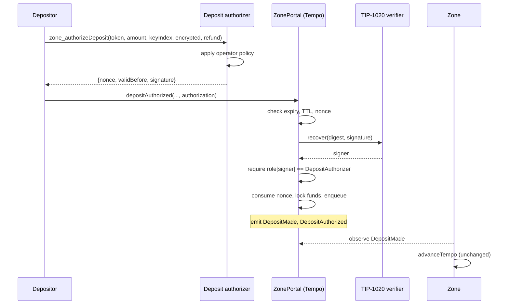

# TIP-1151: Signed Deposit Authorizations for Zone Portals

## Abstract

This TIP adds a deposit authorization mode to `ZonePortal`. While it is enforced, a deposit must carry
a short-lived EIP-712 authorization signed by a key that the admin registered as a deposit
authorizer. The authorization binds the depositor, token, amount, encrypted payload, refund
recipient, a per-depositor nonce, and an expiry. The portal checks the signature with the TIP-1020
signature verifier. No onchain allowlist entry is needed per user, and the zone-side state
transition is unchanged.

## Motivation

Today a zone admits deposits in one of two ways:

- **Closed access mode.** The depositor and refund recipient must hold the portal's `Account` role.
  Adding a user takes an admin transaction (`setAllowedAccount`). An application where users sign up
  dynamically needs a hot admin key, or it must queue onboarding behind cold-key transactions.
  The allowlist is also public, so it reveals every customer of the zone, including those who never
  deposit.
- **Open access mode.** Anyone can deposit. The zone has no way to refuse a deposit after the fact:
  `advanceTempo` must process every queued deposit, and the only failure paths are decryption
  failure and a reverted mint, both of which bounce back to Tempo. An operator who wants to enforce
  an application policy, such as "only signed-up users", cannot do so.

The sequencer operator already knows which users it is willing to serve. This TIP lets the operator
express that decision offchain, at request time, as a signature the portal can verify. A deposit
the operator will not accept never enters the queue, so the protocol needs no zone-side rejection
or extra bounce-back path. Users are onboarded with no onchain transaction, and only the
depositors that actually deposit appear onchain, which `DepositMade` already reveals.

### Alternatives considered

- **Zone-side rejection with bounce-back.** Let the sequencer refuse a deposit during
  `advanceTempo` and refund it. This adds a sequencer-controlled accept/reject input to the proven
  state transition, charges bounce-back fees to users who were never eligible, delays refunds by a
  full batch, and leaves rejected deposits visible on Tempo. Rejected.
- **Delegated allowlist manager.** Add a hot-key role that may call `setAllowedAccount`. This still
  costs one transaction per user and keeps the customer list public. Rejected.
- **Merkle-root allowlist.** The admin posts a root and depositors supply membership proofs. Every
  sign-up still needs a root update, so onboarding stays batched behind an onchain transaction.
  Rejected.
- **Contract authorizers (ERC-1271).** Calling an arbitrary verifier contract from the portal adds
  an external call to the deposit path. TIP-1020 already covers secp256k1, P256, and WebAuthn keys,
  including HSM, KMS, and enclave keys. Deferred until a concrete verifier, such as onchain OIDC
  proofs, needs it.
- **Authorizations without nonces.** Expiry and payload binding limit replay to the same depositor,
  amount, and recipient, but a depositor could still replay an authorization within its validity
  window and exceed per-user limits the operator enforces. Rejected in favor of a per-depositor
  nonce.

## Assumptions

- TIP-1020 is active, and its `recover` function returns the signer's Tempo address or reverts.
- The admin registers only authorizer keys that are controlled by the operator or a party the
  operator trusts to apply its deposit policy. A compromised authorizer can admit deposits until the
  admin removes it, but cannot move funds out of the portal.
- Tempo block timestamps track real time closely enough for second-granularity expiry.
- Zone-side execution does not depend on how a deposit was authorized. The zone processes every
  queued deposit exactly as today.
- Portal runtime replacement requires a Tempo hardfork, as specified in the zones spec. Existing
  portals keep their current behavior until the admin enables the new mode.

---

# Specification

## Overview



## Roles and configuration

`Role` gains a new member, appended so existing encodings do not change:

```solidity
enum Role {
    None,
    Sequencer,
    Account,
    CallbackGateway,
    PauseGuardian,
    DepositAuthorizer // 5
}
```

Like every portal role, `DepositAuthorizer` is mutually exclusive with the other roles. A sequencer
settlement key therefore cannot also be a deposit authorizer. This keeps settlement keys behind the
sequencer quorum and out of a public signing endpoint.

The portal gains one admin-mutable flag, `depositAuthMode`. It defaults to `false`.

| Function | Caller | Behavior |
|---|---|---|
| `setDepositAuthMode(bool enforced)` | admin | Sets the flag and emits `DepositAuthModeUpdated`. Reverts with `CapabilityAbdicated(AccessPolicy)` after access-policy abdication takes effect. |
| `setDepositAuthorizer(address account, bool allowed)` | admin | Moves `account` between `None` and `DepositAuthorizer` and emits `RoleUpdated`. Returns without an event when nothing changes. Reverts if `account` is zero or the messenger, or if it holds another role. |

After `Capability.AccessPolicy` abdication takes effect, `setDepositAuthorizer(account, true)`
reverts, but `setDepositAuthorizer(account, false)` remains available. Removing an authorizer only
narrows who can admit deposits, and the admin can already halt deposits with `pauseDeposits`, so
keeping removal adds no power while still allowing a compromised key to be revoked.

## Authorization message

An authorization is an EIP-712 signature under the portal's existing domain:

```text
EIP712Domain(string name,string version,uint256 chainId,address verifyingContract)
name              = "ZonePortal"
version           = "1"
chainId           = block.chainid
verifyingContract = the portal address
```

The struct type is:

```text
DepositAuthorization(address depositor,address token,uint128 amount,uint256 keyIndex,bytes32 payloadHash,address tempoRefundRecipient,uint64 nonce,uint64 validBefore)
```

with:

```solidity
payloadHash = keccak256(abi.encode(
    encrypted.ephemeralPubkeyX,
    encrypted.ephemeralPubkeyYParity,
    keccak256(encrypted.ciphertext),
    encrypted.nonce,
    encrypted.tag
));

structHash = keccak256(abi.encode(
    DEPOSIT_AUTHORIZATION_TYPEHASH,
    depositor, token, amount, keyIndex, payloadHash,
    tempoRefundRecipient, nonce, validBefore
));

digest = keccak256(abi.encodePacked("\x19\x01", DOMAIN_SEPARATOR(), structHash));
```

| Field | Binds |
|---|---|
| `depositor` | The account that must call the portal (`msg.sender`). A copied authorization is useless to anyone else. |
| `token`, `amount` | The exact token and gross deposit amount, before fees. |
| `keyIndex`, `payloadHash` | The exact encrypted recipient and memo. The authorization cannot be reused for another recipient. An authorizer that holds the sequencer encryption key may decrypt the payload and apply recipient-aware policy before signing. |
| `tempoRefundRecipient` | The Tempo address that receives a bounce-back. |
| `nonce` | Replay protection; see [Nonces](#nonces). |
| `validBefore` | Unix time in seconds after which the authorization is invalid. |

The domain binds the chain ID and the portal address, so an authorization cannot be used on another
chain or another zone. `SettlementAttestation` uses a different type hash, so an authorization cannot
be confused with a settlement signature.

The `signature` uses the TIP-1020 encoding: 65-byte secp256k1, 130-byte P256, or WebAuthn.
Keychain signatures are rejected by TIP-1020.

### Nonces

The portal stores `depositAuthorizationNonce[depositor]`, the lowest nonce it will still accept for
that depositor. It starts at zero. An authorization with nonce `n` is valid only if
`n >= depositAuthorizationNonce[depositor]` and `n < 2^64 - 1`. Using it sets
`depositAuthorizationNonce[depositor] = n + 1`.

Nonces may skip values. Using a higher nonce invalidates every unused authorization with a lower
nonce for the same depositor. Authorizers MAY issue the current onchain nonce, which is stateless
but means only the first of two concurrent authorizations for one depositor succeeds, or
`max(onchain nonce, last issued nonce + 1)`, which needs authorizer state. Either way, a client
whose authorization was consumed or invalidated requests a new one.

## Deposit entry point

```solidity
struct DepositAuthorization {
    uint64 nonce;
    uint64 validBefore;
    bytes signature;
}

function depositAuthorized(
    address token,
    uint128 amount,
    uint256 keyIndex,
    DepositPayload calldata encrypted,
    address tempoRefundRecipient,
    DepositAuthorization calldata authorization
) external returns (bytes32 newCurrentDepositQueueHash);
```

`depositAuthorized` MUST execute the following steps. A failure at any step reverts the whole call.

1. Apply the existing `whenNotPaused` check.
2. Require `depositAuthMode`, else revert `DepositAuthorizationNotEnforced()`.
3. Require `block.timestamp < validBefore`, else revert `DepositAuthorizationExpired(validBefore)`.
4. Require `validBefore <= block.timestamp + MAX_DEPOSIT_AUTHORIZATION_TTL`, else revert
   `DepositAuthorizationTooLong(validBefore)`. `MAX_DEPOSIT_AUTHORIZATION_TTL` is 3,600 seconds.
5. Require the nonce rule in [Nonces](#nonces) for `depositor = msg.sender`, else revert
   `DepositAuthorizationNonceInvalid(nonce, minimum)`.
6. Compute `digest` with `depositor = msg.sender` and call `SIGNATURE_VERIFIER.recover(digest,
   signature)`. If it reverts, revert `InvalidDepositAuthorization()`.
7. Require `hasRole(signer, Role.DepositAuthorizer)`, else revert
   `UnauthorizedDepositAuthorizer(signer)`.
8. Set `depositAuthorizationNonce[msg.sender] = nonce + 1`.
9. Run every existing `deposit` check and effect except the `Account` role checks on
   `msg.sender` and `tempoRefundRecipient`: non-zero refund recipient, token enabled and deposits
   active, TIP-403 recipient authorization of the refund recipient, payload shape, encryption key
   validity, fee collection, outstanding-deposit capacity, queue insertion, and `DepositMade`.
10. Emit `DepositAuthorized(depositNumber, msg.sender, signer, nonce)`.

The queued `Deposit`, its hash-chain encoding, and `DepositMade` are byte-for-byte identical to a
deposit made through `deposit`. The zone cannot tell, and does not need to know, how a deposit was
authorized.

## Interaction with existing modes

| Path | `depositAuthMode = false` | `depositAuthMode = true` |
|---|---|---|
| `deposit` / `depositEncrypted` from an enforced gateway | Unchanged | Unchanged. The gateway exemption and the refund-recipient `Account` check under `accessMode` still apply, so synchronous callback returns keep working without an authorization. |
| `deposit` / `depositEncrypted` from any other caller | Unchanged | Reverts `DepositAuthorizationRequired()` |
| `depositAuthorized` | Reverts `DepositAuthorizationNotEnforced()` | As specified above. No `Account` role checks. |
| Deposit bounce-back delivery and `claimRefund` | Unchanged | No `Account` role check. TIP-403 and TIP-1028 checks still apply. |
| Plain withdrawals, callbacks, gateway checks | Unchanged | Unchanged. `accessMode` and `gatewayMode` still govern them. |

Refund recipients are approved when the deposit is made, either by the authorization or, for
gateway returns, by the existing role check. Applying the `Account` role check again at refund time
would park refunds to authorized recipients indefinitely, because they normally hold no role. If the
admin later disables `depositAuthMode` while `accessMode` is enforced, refunds owed to recipients
without the `Account` role are parked until the admin restores the role or the mode.

A callback withdrawal in open gateway mode may still return value through `depositAuthorized` if its
callback data carries an authorization issued for the callback target as `depositor`.

A zone that wants permissionless entry with offchain policy uses `accessMode = false` and
`depositAuthMode = true`. A zone that also wants closed-loop withdrawals keeps `accessMode = true`
and its allowlist for withdrawal destinations only.

Enabling deposit authorization on an existing zone needs no zone-side or factory change. A new zone
SHOULD be created with `accessMode = true` and an empty allowlist, then configured with
`setDepositAuthorizer` and `setDepositAuthMode(true)`, so it is never open to unauthorized deposits.
The admin can then set `accessMode` to the withdrawal policy it wants.

## Interface additions

```solidity
interface IZonePortal {
    event DepositAuthModeUpdated(bool enforced);
    event DepositAuthorized(
        uint64 indexed depositNumber,
        address indexed depositor,
        address indexed authorizer,
        uint64 nonce
    );

    error DepositAuthorizationRequired();
    error DepositAuthorizationNotEnforced();
    error DepositAuthorizationExpired(uint64 validBefore);
    error DepositAuthorizationTooLong(uint64 validBefore);
    error DepositAuthorizationNonceInvalid(uint64 nonce, uint64 minimum);
    error InvalidDepositAuthorization();
    error UnauthorizedDepositAuthorizer(address signer);

    function MAX_DEPOSIT_AUTHORIZATION_TTL() external view returns (uint64);
    function DOMAIN_SEPARATOR() external view returns (bytes32);

    function isDepositAuthEnforced() external view returns (bool);
    function setDepositAuthMode(bool enforced) external; // admin-only
    function setDepositAuthorizer(address account, bool allowed) external; // admin-only
    function depositAuthorizationNonce(address depositor) external view returns (uint64);

    /// @notice Returns the EIP-712 digest an authorizer signs for these deposit arguments.
    function depositAuthorizationDigest(
        address depositor, address token, uint128 amount, uint256 keyIndex,
        DepositPayload calldata encrypted, address tempoRefundRecipient,
        uint64 nonce, uint64 validBefore
    ) external view returns (bytes32);

    function depositAuthorized(
        address token, uint128 amount, uint256 keyIndex,
        DepositPayload calldata encrypted, address tempoRefundRecipient,
        DepositAuthorization calldata authorization
    ) external returns (bytes32 newCurrentDepositQueueHash);
}
```

## Storage layout

The new state uses free space and does not move existing slots:

| Slot | Offset | Field |
|---:|---:|---|
| 21 | 2 | `_isDepositAuthEnforced` (`bool`), taken from `_enforcementModesPadding` |
| 29 | 0 | `depositAuthorizationNonce` (`mapping(address => uint64)`) |

Slot 19 is not reused. The zones spec still documents it as the `isSequencer` mapping, and a portal
that used that layout may retain entries that would alias new mapping keys.

## Gas

Compared with `deposit`, `depositAuthorized` adds the ABI cost of the authorization, one TIP-1020
recovery (3,000 gas for secp256k1, 8,000 for P256 or WebAuthn, plus input cost), one cold role read,
one nonce read and write, and one event. The first authorized deposit from a depositor creates the
nonce slot, which costs 250,000 gas under TIP-1000 unless the portal has a TIP-1060 storage credit.
Later deposits update an existing slot. Onboarding a user through `setAllowedAccount` creates a role
slot at the same cost, but the admin pays it, before the user is known to deposit.

## Activation

This TIP ships in the T13 `ZonePortal` runtime, which the T13 hardfork installs as specified in
the zones spec. Zone nodes and provers need no execution change because the deposit queue encoding
is unchanged.
Zone nodes MUST decode the new `Role` value wherever they read portal roles from Tempo state.

# Tooling

- **Authorizer RPC.** Zone nodes SHOULD expose `zone_authorizeDeposit` on the authenticated redacted
  RPC. The depositor is the account proven by the `X-Authorization-Token`. The request carries
  `token`, `amount`, `keyIndex`, `encrypted`, `tempoRefundRecipient`, and an optional
  operator-defined `credentials` object, such as an OIDC ID token. The response is
  `{ authorizer, nonce, validBefore, signature }`. A refusal returns a new error code, `-32007
  Deposit not authorized`. Operators MAY host the endpoint elsewhere; clients discover it through
  `ZonePortal.rpcUrl`.
- **Policy hook.** Whether to sign is not consensus. The reference node approves every
  authenticated depositor by default and can instead consult an operator webhook, which receives
  the depositor, the deposit arguments, and `credentials`, and approves with
  `{"approved": true}`. The webhook is where operators apply allowlists, signup state, or OIDC
  checks. The authorizer key is configured separately from settlement and encryption keys and MAY
  live in a remote signer, KMS, HSM, or enclave.
- **Zone metadata.** `zone_getZoneInfo` adds `isDepositAuthEnforced`.
- **SDK.** Client libraries add `getDepositAuthorization` and `depositAuthorized`, and fall back to
  `deposit` when the mode is off. Clients SHOULD check `depositAuthorizationDigest` against their
  local encoding in tests.
- **Operator tooling.** `xtask zones` adds commands for `setDepositAuthorizer` and
  `setDepositAuthMode`.
- **Errors.** Every portal error above is distinct, so clients can tell an expired authorization
  from a used nonce or a revoked authorizer and request a new one.

# Observability

| Event | Fields | Question it answers |
|---|---|---|
| `DepositAuthorized` | `depositNumber`, `depositor`, `authorizer`, `nonce` | Which key admitted this deposit? How many deposits did each key admit? |
| `DepositAuthModeUpdated` | `enforced` | When did the zone switch deposit gating modes? |
| `RoleUpdated` (existing) | `account`, `prev`, `next` | When was an authorizer added or removed? |

Operators SHOULD alert on `DepositAuthorized` events from an authorizer they did not expect, and on
the authorizer RPC's refusal and error rates. Authorizer services SHOULD log every issued
authorization with its digest so issued and used authorizations can be reconciled.

# Threat Model

- **Admin.** Trusted. Chooses the mode and the authorizer set, and can revoke an authorizer at any
  time.
- **Deposit authorizer.** Trusted to apply the operator's policy. A compromised key can admit
  deposits of the attacker's own funds to any recipient until revoked. It cannot withdraw, redirect
  existing deposits, or affect settlement. Removal takes effect immediately, and
  `MAX_DEPOSIT_AUTHORIZATION_TTL` bounds how long a policy decision can stay valid after it
  changes.
- **Sequencer operator.** Already trusted for liveness and has no forced-inclusion obligation. If it
  runs the authorizer, it can refuse deposits before they enter the portal instead of only failing
  to produce blocks. This is the intended policy power. Users who are refused keep their funds on
  Tempo.
- **Depositor.** Untrusted. Cannot reuse an authorization for another recipient, amount, token,
  refund recipient, zone, or chain, or reuse it after its nonce is consumed.
- **Observers and front-runners.** Can read pending authorizations from the mempool but cannot use
  them, because `msg.sender` must equal the signed depositor.
- **Out of scope.** Availability of the authorizer endpoint. If it is down, only enforced gateways
  can deposit. Operators SHOULD run redundant authorizers.

# Invariants

| ID | Invariant |
|---|---|
| DA1 | While `depositAuthMode` is true, every deposit queued by a caller other than an enforced gateway carries a valid authorization from an address that holds `DepositAuthorizer` at execution time. |
| DA2 | An authorization is accepted at most once, only from its `depositor`, only before `validBefore`, and only if `validBefore` is at most `MAX_DEPOSIT_AUTHORIZATION_TTL` after the current block time. |
| DA3 | Changing any signed field, the chain ID, or the portal address makes the authorization invalid. |
| DA4 | `depositAuthorizationNonce[depositor]` never decreases. |
| DA5 | A deposit queued through `depositAuthorized` has the same queue encoding and `DepositMade` event as the same deposit queued through `deposit`. |
| DA6 | With `depositAuthMode` false, portal behavior is identical to the behavior before this TIP. |
| DA7 | Withdrawal, callback, and gateway checks do not depend on `depositAuthMode`. |
| DA8 | No `Role` value other than `DepositAuthorizer` grants deposit-authorization power, and a `DepositAuthorizer` holds no other portal permission. |

The test suite MUST cover: each revert in the entry point, including expiry at exactly
`validBefore` and a TTL of exactly the maximum; nonce skipping and invalidation of lower nonces;
authorizer removal between issuance and use; a copied authorization submitted by another account;
each signed field mutated individually; secp256k1 and P256 authorizers (WebAuthn shares the
TIP-1020 verifier path); the gateway
exemption with gateway mode on and off; refund delivery and `claimRefund` with both mode
combinations; access-policy abdication blocking additions but not removals; and storage-layout
compatibility with existing portals.
