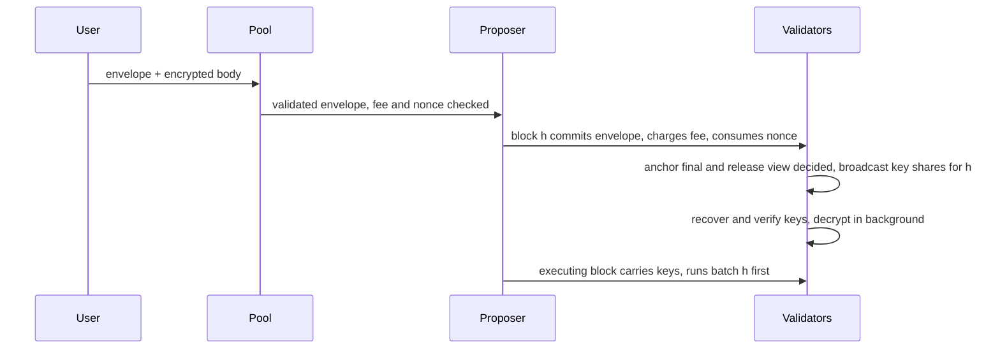

# TIP-1162: Threshold-encrypted transactions

## Abstract

Senders can encrypt a Tempo transaction's calls to the network's threshold BLS key. Validators release a per-transaction decryption key only once the including block and the block that records its finalization are both final, and the decrypted calls execute at the top of a block fixed by the chain's views and the certificates it carries, normally about four blocks later, so no proposer or searcher can reorder, insert ahead of or censor a transaction based on its contents. Plaintext transactions are unchanged; encrypted ones execute about four blocks after inclusion (roughly 2.2 s) and reveal sender, nonce and gas limit.

## Motivation

Every pending Tempo transaction is public in the pool and visible to the proposer before ordering is fixed, so DEX swaps, FX conversions and large stablecoin payments can be front-run or sandwiched, and a proposer can censor by content. Tempo already runs everything this needs: Simplex consensus with the `bls12381_threshold::vrf` scheme over `MinSig` (48-byte G1 signatures, 96-byte G2 public key), and an onchain DKG whose group public key stays fixed across reshares (`mainnet-network-identity.json`, since epoch 2042). Users can therefore encrypt to one long-lived key, and any later committee can release keys.

Alternatives considered:

| Option | Why not |
| --- | --- |
| Use the per-view VRF seed as the key (zero extra messages) | Commonware documents that a malicious leader can recover a round's seed before the round resolves, by equivocating, and choose among f+2 outcomes. Users also cannot predict the view, and a ciphertext targeting a view it missed is revealed without executing. |
| One key per block height (Shutter style) | One share per validator per block, but every ciphertext targeting a height it did not land in is revealed unexecuted, and can be front-run when resubmitted. |
| Batched threshold encryption (one constant-size share per block, nothing leaks) | Needs new pairing-based crypto with a per-epoch setup that neither Commonware nor an audit covers today. It is the upgrade path once mature, behind the same transaction format. |
| TEE sequencing | Changes the trust model from the validator quorum to a hardware vendor. |

## Assumptions

- Fewer than the signing threshold (2f+1 of 3f+1) of validators collude. This is the same threshold that already protects safety; a colluding quorum can decrypt early but cannot forge a key for a transaction no block included.
- The DKG group public key is constant across reshares. A full re-DKG changes it; transactions encrypted to the old key and still in the pool are then dropped and must be re-encrypted.
- Finality: a finalized block is never reverted, which Simplex guarantees.

---

# Specification

## Overview

An encrypted transaction has a plaintext envelope (who pays, which nonce, how much gas and fee) and an encrypted body (the calls and access list). The pool and the including block validate and charge the envelope without seeing the body. The body opens with a decryption key, the network's threshold signature over the transaction's identity, which honest validators sign only once the transaction's position is final.

## Mechanics

### Encryption

1. The sender seals the RLP of `(calls, access_list)` with ChaCha20-Poly1305 under a fresh random 32-byte key and a zero nonce; each key seals exactly one body.
2. The identity is `keccak256(chain_id ‖ sender ‖ nonce_key ‖ nonce ‖ gas_limit ‖ keccak256(sealed))` with fixed-width big-endian fields.
3. The sender encrypts the 32-byte key with Commonware's `tle::encrypt` (Boneh-Franklin IBE with the Fujisaki-Okamoto transform) to the network public key under namespace `TEMPO_ENCRYPTED_TX_V1` and the identity.
4. The sender signs the transaction with the TLE ciphertext and sealed body in place of `calls` and `access_list`. The signature and the transaction hash MUST cover both the TLE ciphertext and the sealed body: the identity cannot commit to the TLE ciphertext, and anyone can encrypt a different key to the same identity, which would make the body fail to decrypt after the sender has paid.

Because the identity hashes the envelope and the sealed body, copying a ciphertext into another envelope changes its identity, and the key released for the copy does not open it.

### Pool admission

The pool validates the envelope as it validates a Tempo transaction today: signature, fee token, balance for `gas_limit × max_fee_per_gas`, and the 2D nonce. It does not decrypt. The node rejects an encrypted transaction when the pool already holds the per-sender or global encrypted limit, configured like the existing pool limits.

### Inclusion (block h)

The proposer includes encrypted transactions as it includes plaintext ones, within two per-block limits:

- **Encrypted gas cap** (initially 25% of the block gas limit), so plaintext throughput is never displaced.
- **Encrypted transaction cap** (`MAX_ENCRYPTED_TXS`, initially 1,000), because key recovery and decryption cost a fixed amount per transaction regardless of its gas: without it, the gas cap alone admits about 5,950 minimum-gas envelopes per presto block, whose crypto exceeds the block time.

Each encrypted transaction also pays `ENCRYPTED_TX_GAS` (initially 25,000) of intrinsic gas on top of its own, so its share of the cap reflects its crypto cost. Inclusion consumes the nonce and charges `gas_limit × effective_gas_price` from the fee payer. The body does not execute in block h.

### Key release

Each block MAY carry one finalization certificate for one of its ancestors that no earlier block on its chain already covers. A certificate for block F covers F and every ancestor of F. The *anchor* of block h is the first block on h's chain whose carried certificate covers h; let a be the anchor's view, and call view a+1 the *release view*. The anchor is fixed by chain contents, not by which certificates happen to exist off-chain, so every validator derives the same one. Normally the anchor is h+1 or h+2, carrying h's own certificate.

An anchor proves h final but may itself be abandoned, so release also waits for the anchor to be final. A validator signs the identity of every encrypted transaction in block h with its DKG share, and broadcasts the partial signatures in one message on a new p2p channel, only once both hold:

1. It holds a finalization certificate covering h's anchor A (from the chain or the network).
2. It has seen a notarization or nullification certificate for the release view.

Honest validators also refuse to notarize a descendant of A in a view after the release view unless a block on that descendant's chain carries a certificate covering A, whenever they themselves hold such a certificate.

Recovering a key takes 2f+1 shares, so when any key exists at least f+1 honest validators hold a certificate covering A and have seen the release view's certificate. This fixes everything that could run before the batch:

- A is final, so every future block descends from it.
- The release view is decided: a notarization for it is unique, so no new block can be notarized in it.
- A descendant of A in a later view that lacks an on-chain certificate covering A gets at most f honest and f Byzantine notarize votes, short of 2f+1. Every later block that can be notarized is the executing block or follows it.

Honest proposers carry the newest finalization certificate they hold, so withholding one only delays release. Shares are usually sent as soon as the release view's notarization arrives, one network delay after it.

A validator recovers keys from the first quorum of shares with one interpolation per identity (`recover_multiple`), verifies all recovered keys with one batched pairing check against the network public key, and only on failure checks each sender's shares to drop the faulty one. It then decrypts every body in parallel and caches the plaintexts.

### Execution

Batch h becomes *due* at its *executing block*: the first descendant of A whose view is greater than a+1 and whose chain, from A onward, carries a certificate covering A. Normally A's child, in the release view, carries A's certificate, and A's grandchild is the executing block. If the release view was nullified, A's child is in a later view and is the executing block when it carries a certificate covering A. The executing block is fixed by the chain's views and the certificates its blocks carry, not by the proposer. Batch h runs at the top of its executing block unless more than two batches are due there; then it runs in the first following block with room, under the drain rule below, and no transaction of any block runs ahead of it in the meantime.

No block needs keys until the chain carries a certificate covering A, and such a certificate exists only once A is final, after which keys follow. If h or A is notarized but never gets its own finalization certificate, the certificate of a later finalized descendant covers it, and the batch waits for that; the blocks in between need no keys, so the chain keeps finalizing.

The executing block carries in its body, committed by its header, the keys for every batch it executes, in height order. Its header MUST commit to its consensus view, which the application already receives from Simplex. Each batch executes in its original inclusion order, before any of the block's own transactions:

- Keys are checked against the network public key with one batched pairing check. Validators that recovered the same keys compare bytes instead.
- A body that fails to decrypt or decode executes nothing; its fee is kept and its nonce stays consumed.
- A body that decodes runs its calls with the envelope's gas limit, as a Tempo transaction with that sender would; unused gas is refunded as today.

A batch is *due* at its executing block and stays due until executed. A block executes due batches oldest first, at most two of them. If more remain due after those two, the block MUST contain no transactions of its own, so nothing can run ahead of the batches it leaves for the next block; the backlog drains two batches per block. A block may include encrypted transactions only while fewer than `MAX_PENDING_BATCHES` (initially 8) batches on its chain are included but not yet executed. That bound sits above the normal pipeline of four or five in-flight batches, so it only bites during a finalization stall, where it stops batches piling up. Two batches in one block only follow a nullified view or a finalization stall, which already held the chain up for at least a view timeout, so a block then runs up to twice the encrypted caps.

A block that omits, reorders or alters a batch it must execute is invalid. A proposer that lacks the keys cannot build the executing block; its view times out and is nullified. Keys exist by then, because the chain carries a certificate covering A and the release view is decided, so the next leader builds it.

## Interfaces

The reference implementation is the `tempo-encrypted-tx` crate in this pull request: `Envelope::identity`, `EncryptedBody::{encrypt, decrypt}`, `key_shares`, `verify_key_shares`, `recover_keys` and `verify_keys`. Sizes: a TLE key ciphertext is 160 bytes (96-byte G2 point and two 32-byte blocks), the sealed body adds a 16-byte tag, a key share is 48 bytes plus its index, and a key is 48 bytes.

### Performance

Measured with the crate's benchmark (`cargo bench -p tempo-encrypted-tx`), 16 validators, 1,000 encrypted transactions in one block, on a 4-core machine:

| Stage | Who | 1 core | 4 cores |
| --- | --- | --- | --- |
| Sign key shares | each validator | 95 ms | 24 ms |
| Recover keys | each validator | 342 ms | 54 ms |
| Verify keys (batched) | followers, or on failure | 51 ms | 14 ms |
| Decrypt bodies | every node | 554 ms | 141 ms |
| Encrypt one body | sender | 0.71 ms | |

Shares go out one network delay after the release view is decided. Key recovery and decryption sit on the critical path of the executing block's proposer only: at `MAX_ENCRYPTED_TXS` = 1,000, a block following a full encrypted batch waits for its recovery and decryption: about 210 ms on the 4-core machine above and 45 ms on a 32-thread validator (measured with the `block_pipeline` benchmark in https://github.com/tempoxyz/tempo/pull/9006). After a nullified view or a finalization stall a block can execute two full batches (see Execution), doubling that to about 90 ms on 32 threads and 420 ms on 4 cores. The cap is a protocol parameter, set so that the two-batch wait stays inside the 550 ms block time on the slowest supported validator hardware. Blocks without a batch to execute see no added work, verifying validators compare keys and reuse cached plaintexts, and plaintext transactions are unaffected. This wait is the cost of strict ordering: letting the proposer defer the batch would let it front-run.

# Compatibility

Existing transaction types, RPCs and tooling are unchanged. Wallets and SDKs that want encrypted submission need the network public key (an RPC returns it) and the encryption step above; `viem/tempo` is the first client. Receipts for encrypted transactions are produced at execution, not inclusion: `eth_getTransactionReceipt` reports the executing block and a new field with the inclusion block. Indexers that assume a transaction executes in the block that contains it must read that field. Activation is a hardfork.

# Observability

Nodes export metrics for key-release latency from the child's notarization to recovered keys, decryption time per batch, bodies that failed to decrypt, and validators whose share batches failed verification. A body that fails to decrypt emits a receipt with status failed and a dedicated reason, so senders can tell a bad ciphertext from a reverted call.

# Threat Model

| Actor | Controls | Enforcing check | If it fails |
| --- | --- | --- | --- |
| Colluding quorum (≥2f+1 validators) | All shares | None: trusted, as for safety | Contents visible before ordering is final; ordering rules still hold |
| Proposer | Which envelopes enter block h, its own transactions | Batch executes first in a later block; keys verified against the network key | Can censor by sender, gas or fee, not by contents |
| Leader of the release view or later | Timing and content of its proposal, equivocation, withholding certificates | Shares released only once the anchor is final and the release view is decided; honest validators refuse descendants that omit a certificate they hold | Cannot get a content-dependent block notarized before the batch executes |
| Proposer of the executing block | Its own transactions | Executing block fixed by views; batch runs first; omission makes the block invalid | Can only add transactions after the batch |
| Up to f validators | Their own shares | Quorum recovery and batched key verification | Bad shares are detected and dropped |
| Searcher copying a ciphertext | Its own envelopes | Identity binds envelope and sealed body | The released key does not open the copy |
| Observer | Envelope metadata | None | Sender, nonce, gas limit, fee token, size and timing are public; senders that need to hide their address use a fee sponsor |

---

# Invariants

1. **No early key.** An honest validator never releases a key share for block h before it holds a certificate covering h's anchor and has seen the release view's certificate. Tests: a validator harness emits no share for h while either is missing, including when the anchor is later abandoned.
2. **Fixed execution point.** Batch h executes in exactly one block: its executing block (the first descendant of h's anchor A with view greater than a+1 whose chain carries a certificate covering A), or, when more than two batches are due there, the first later block where it is among the two oldest due batches. No block's own transaction runs between h becoming due and h executing. Tests: a block that skips a due batch it has room for, reorders batches, or adds its own transactions while leaving batches due fails validation; a nullified release view makes A's child the executing block when it carries a certificate covering A; a block notarized but finalized only through a descendant has its batch executed after its anchor's release view, and the chain keeps finalizing meanwhile; a certificate for h that appears after h's anchor does not move the executing block; an honest validator holding a certificate covering A does not notarize a later descendant of A whose chain omits one.
3. **Binding.** A key released for one identity never opens a body included under another envelope, and a substituted TLE ciphertext never opens the original body. Tests: `key_for_another_envelope_does_not_open_body`, `substituted_key_ciphertext_does_not_open_body`.
4. **Verified keys only.** A block whose carried keys fail verification against the network public key is invalid, and a share set that fails verification is never used for recovery. Tests: `swapped_keys_are_rejected`, `swapped_key_shares_are_rejected`, `missing_keys_are_rejected`, `missing_key_shares_are_rejected`.
5. **Charge at inclusion.** Inclusion consumes the nonce and charges the fee whether or not the body later decrypts, decodes or succeeds. Test: an undecryptable body leaves the nonce consumed and the fee kept, with a failed receipt.
6. **Bounded cost.** Encrypted gas a block includes never exceeds the encrypted gas cap, encrypted transactions it includes never exceed `MAX_ENCRYPTED_TXS`, and a block executes at most two batches, so at most twice either cap. A block that leaves due batches unexecuted contains no transactions of its own, and a block that includes encrypted transactions while `MAX_PENDING_BATCHES` batches are in flight fails validation. Tests: the payload builder stops at whichever inclusion limit it reaches first, a block over either fails validation, steady encrypted demand with no stall lets every block include, and after a stall the backlog drains two batches per block with no other transactions in between.

