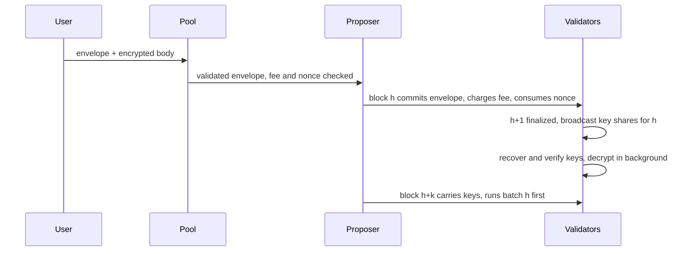

# TIP-1162: Threshold-encrypted transactions

## Abstract

Senders can encrypt a Tempo transaction's calls to the network's threshold BLS key. Validators release a per-transaction decryption key only after the including block and its child are finalized, and the decrypted calls execute at the top of a later block, so no proposer or searcher can reorder, insert ahead of or censor a transaction based on its contents. Plaintext transactions are unchanged; encrypted ones pay about two to three blocks of extra latency and reveal sender, nonce and gas limit.

## Motivation

Every pending Tempo transaction is public in the pool and visible to the proposer before ordering is fixed, so DEX swaps, FX conversions and large stablecoin payments can be front-run or sandwiched, and a proposer can censor by content. Tempo already runs everything this needs: Simplex consensus with the `bls12381_threshold::vrf` scheme over `MinSig` (48-byte G1 signatures, 96-byte G2 public key), and an onchain DKG whose group public key stays fixed across reshares (`mainnet-network-identity.json`, since epoch 2042). Users can therefore encrypt to one long-lived key, and any later committee can release keys.

Alternatives considered:

| Option | Why not |
| --- | --- |
| Use the per-view VRF seed as the key (zero extra messages) | Commonware documents that a malicious leader can recover a round's seed before the round resolves, by equivocating, and choose among f+2 outcomes. Users also cannot predict the view, and a ciphertext targeting a view it missed is revealed without executing. |
| One key per block height (Shutter style) | One share per validator per block, but every ciphertext targeting a height it did not land in is revealed unexecuted, and can be front-run when resubmitted. |
| Batched threshold encryption (one constant-size share per block, nothing leaks) | Needs new pairing-based crypto with a per-epoch setup that neither Commonware nor an audit covers today. It is the upgrade path once mature, behind the same transaction format. |
| TEE sequencing | Changes the trust model from the validator quorum to a hardware vendor. |

## Assumptions

- Fewer than the signing threshold (2f+1 of 3f+1) of validators collude. This is the same threshold that already protects safety; a colluding quorum can decrypt early but cannot forge a key for a transaction no block included.
- The DKG group public key is constant across reshares. A full re-DKG changes it; transactions encrypted to the old key and still in the pool are then dropped and must be re-encrypted.
- Finality: a finalized block is never reverted, which Simplex guarantees.

---

# Specification

## Overview

An encrypted transaction has a plaintext envelope (who pays, which nonce, how much gas and fee) and an encrypted body (the calls and access list). The pool and the including block validate and charge the envelope without seeing the body. The body opens with a decryption key, the network's threshold signature over the transaction's identity, which honest validators sign only once the transaction's position is final.

## Mechanics

### Encryption

1. The sender seals the RLP of `(calls, access_list)` with ChaCha20-Poly1305 under a fresh random 32-byte key and a zero nonce; each key seals exactly one body.
2. The identity is `keccak256(chain_id ‖ sender ‖ nonce_key ‖ nonce ‖ gas_limit ‖ keccak256(sealed))` with fixed-width big-endian fields.
3. The sender encrypts the 32-byte key with Commonware's `tle::encrypt` (Boneh-Franklin IBE with the Fujisaki-Okamoto transform) to the network public key under namespace `TEMPO_ENCRYPTED_TX_V1` and the identity.
4. The sender signs the transaction with the TLE ciphertext and sealed body in place of `calls` and `access_list` The signature and the transaction hash MUST cover both the TLE ciphertext and the sealed body: the identity cannot commit to the TLE ciphertext, and anyone can encrypt a different key to the same identity, which would make the body fail to decrypt after the sender has paid.

Because the identity hashes the envelope and the sealed body, copying a ciphertext into another envelope changes its identity, and the key released for the copy does not open it.

### Pool admission

The pool validates the envelope as it validates a Tempo transaction today: signature, fee token, balance for `gas_limit × max_fee_per_gas`, and the 2D nonce. It does not decrypt. The node rejects an encrypted transaction when the pool already holds the per-sender or global encrypted limit, configured like the existing pool limits.

### Inclusion (block h)

The proposer includes encrypted transactions as it includes plaintext ones, up to a per-block encrypted gas cap (initially 25% of the block gas limit) so that plaintext throughput is never displaced. Inclusion consumes the nonce and charges `gas_limit × effective_gas_price` from the fee payer. The body does not execute in block h.

### Key release

When a validator observes block h+1 finalized, it signs the identity of every encrypted transaction in block h with its DKG share and broadcasts the partial signatures for block h in one message on a new p2p channel. Waiting for h+1, not just h, guarantees that every block ordered before the batch's execution point was fixed before the contents were known.

A validator recovers keys from the first quorum of shares with one interpolation per identity (`recover_multiple`), verifies all recovered keys with one batched pairing check against the network public key, and only on failure checks each sender's shares to drop the faulty one. It then decrypts every body in parallel and caches the plaintexts.

### Execution (block h+k, k ≥ 2)

A block carries in its body, committed by its header, the decryption keys for zero or more pending batches, which must be the oldest pending batches in height order. Each carried batch executes at the top of the block, in its original inclusion order, before any of the block's own transactions:

- Keys are checked against the network public key with one batched pairing check (validators that recovered the same keys compare bytes instead).
- A body that fails to decrypt or decode executes nothing; its fee is kept and its nonce stays consumed.
- A body that decodes runs its calls with the envelope's gas limit, as a Tempo transaction with that sender would; unused gas is refunded as today.

A proposer cannot skip a pending batch or reorder within one, and the plaintext transactions it adds run after the batch. While more than 16 batches are pending, proposers include no new encrypted transactions.

## Interfaces

The reference implementation is the `tempo-encrypted-tx` crate in this pull request: `Envelope::identity`, `EncryptedBody::{encrypt, decrypt}`, `key_shares`, `verify_key_shares`, `recover_keys` and `verify_keys`. Sizes: a TLE key ciphertext is 160 bytes (96-byte G2 point and two 32-byte blocks), the sealed body adds a 16-byte tag, a key share is 48 bytes plus its index, and a key is 48 bytes.

### Performance

Measured with the crate's benchmark (`cargo bench -p tempo-encrypted-tx`), 16 validators, 1,000 encrypted transactions in one block, on a 4-core machine:

| Stage | Who | 1 core | 4 cores |
| --- | --- | --- | --- |
| Sign key shares | each validator | 95 ms | 24 ms |
| Recover keys | each validator | 342 ms | 54 ms |
| Verify keys (batched) | followers, or on failure | 51 ms | 14 ms |
| Decrypt bodies | every node | 554 ms | 141 ms |
| Encrypt one body | sender | 0.71 ms | |

None of it is on the consensus critical path: it runs between block h+1's finalization and the block that executes batch h, and verifying validators compare keys and reuse cached plaintexts. Plaintext transactions see no added work. Decryption dominates, at one pairing and one G2 multiplication per transaction, so the encrypted gas cap also bounds this cost.

# Compatibility

Existing transaction types, RPCs and tooling are unchanged. Wallets and SDKs that want encrypted submission need the network public key (an RPC returns it) and the encryption step above; `viem/tempo` is the first client. Receipts for encrypted transactions are produced at execution, not inclusion: `eth_getTransactionReceipt` reports the executing block and a new field with the inclusion block. Indexers that assume a transaction executes in the block that contains it must read that field. Activation is a hardfork.

# Observability

Nodes export metrics for pending batches, key-release latency from h+1 finalization to recovered keys, decryption time per batch, bodies that failed to decrypt, and validators whose share batches failed verification. A body that fails to decrypt emits a receipt with status failed and a dedicated reason, so senders can tell a bad ciphertext from a reverted call.

# Threat Model

| Actor | Controls | Enforcing check | If it fails |
| --- | --- | --- | --- |
| Colluding quorum (≥2f+1 validators) | All shares | None: trusted, as for safety | Contents visible before ordering is final; ordering rules still hold |
| Proposer | Which envelopes enter block h, its own transactions | Batch executes first in a later block; keys verified against the network key | Can censor by sender, gas or fee, not by contents |
| Leader of h+1 | Timing of its proposal | Keys need h+1 finalized | Cannot learn contents before h+1 is fixed |
| Up to f validators | Their own shares | Quorum recovery and batched key verification | Bad shares are detected and dropped |
| Searcher copying a ciphertext | Its own envelopes | Identity binds envelope and sealed body | The released key does not open the copy |
| Observer | Envelope metadata | None | Sender, nonce, gas limit, fee token, size and timing are public; senders that need to hide their address use a fee sponsor |
